# Revisão humana das extrações documentais — lote de 12 páginas

## Instruções e proveniência

Este relatório é editável. Os textos e indicadores abaixo foram copiados do snapshot da Fase 2, sem correção, normalização, truncamento ou nova avaliação. Nenhum campo humano foi preenchido.

- Snapshot: `artifacts/initial_state.json` da baseline.
- SHA-256: `ba555e70267df221683c429d7ab6c965d03b73e64e7d1d2e52dbe0d1ace9ba99`.
- Captura original: `2026-11-10T02:00:35.377629+00:00`.
- Confirmação da seleção Gold, somente leitura: `2026-11-10T03:11:16.816110+00:00`.

As páginas PDF e PNG são cópias dos arquivos já existentes no cache. A renderização de cada PDF de página e os pixels de cada PNG foram comparados ao original correspondente; não foi executado OCR. Os PDFs originais não foram modificados.

A edição registrada é apresentada literalmente a partir do snapshot, inclusive divergências. O número impresso é somente o candidato já registrado, ainda pendente de confirmação humana. As notas e justificativas históricas são dados persistidos, não uma nova validação e não uma conclusão humana. Configuração histórica desconhecida permanece desconhecida.

### Como preencher

1. Abra o PDF de página ou a imagem e compare cada extração separadamente.
2. Registre omissões, inclusões, números, estrutura e observações, identificando o extrator e a localização no original.
3. Preencha uma transcrição somente quando necessária; não copie um extrator como se fosse transcrição humana.
4. Em `reviews.json`, registre `compared_visually_with_pdf`, `visual_review_status`, `reviewer`, `reviewed_at` e os campos de achados. O Markdown não é sincronizado automaticamente com o JSON.
5. O protocolo atual só aceita `review_status="reviewed"` quando há transcrição textual, `transcription_origin="human"`, revisor e data declarados. Uma revisão somente visual pode usar `visual_review_status="completed"`, mantendo `review_status="pending_human_review"` até existir referência transcrita. Não invente uma transcrição para mudar esse estado.

Os arquivos `.txt` preservam exatamente os bytes UTF-8 das strings do snapshot, incluindo texto vazio e caracteres privados. Nos blocos Markdown, uma quebra separadora pode ser necessária antes da cerca final; para conferência byte a byte use os `.txt` e seus hashes.

## Índice

| Documento e edição registrada | Página física | Gold | Revisão |
|---|---:|---|---|
| ABNT NBR 10520:2023 | 8 | `docling` | [Abrir seção](#nbr10520-p0008) |
| ABNT NBR 12225:2023 | 5 | `docling` | [Abrir seção](#nbr12225-p0005) |
| ABNT NBR 14724:2024 | 14 | `glm_ocr` | [Abrir seção](#nbr14724-p0014) |
| ABNT NBR 15287:2025 | 9 | `glm_ocr` | [Abrir seção](#nbr15287-p0009) |
| ABNT NBR 6023:2025 | 5 | `glm_ocr` | [Abrir seção](#nbr6023-p0005) |
| ABNT NBR 6023:2025 | 6 | `glm_ocr` | [Abrir seção](#nbr6023-p0006) |
| ABNT NBR 6023:2025 | 21 | `glm_ocr` | [Abrir seção](#nbr6023-p0021) |
| ABNT NBR 6023:2025 | 28 | `glm_ocr` | [Abrir seção](#nbr6023-p0028) |
| ABNT NBR 6023:2025 | 54 | `glm_ocr` | [Abrir seção](#nbr6023-p0054) |
| ABNT NBR 6024:2012 | 5 | `glm_ocr` | [Abrir seção](#nbr6024-p0005) |
| ABNT NBR 6028:2021 | 4 | `glm_ocr` | [Abrir seção](#nbr6028-p0004) |
| ABNT NBR 6034:2005 | 5 | `glm_ocr` | [Abrir seção](#nbr6034-p0005) |


<a id="nbr10520-p0008"></a>

## ABNT NBR 10520:2023 — página física 8

- Documento no snapshot: `1` / `abnt_nbr_10520`.
- SHA-256 do original: `3b0eb948eaae37a1423f68bfb73892cb7a43577e5d156133e3b409d2b3b2cbca`.
- Página impressa: candidato registrado `null`; confirmação humana em branco.

- Gold: registro `1`, extração `2`, método `docling`, versão na coluna Gold `2023`.
- Hash do documento Gold: `6531ab2a0f194a582efa0665f9551979dff84d3a8fdd6fd953f4e0deccc35090`.
- Índices de página Gold ativos: `[10]`.

[PDF da página](pages/NBR10520_p0008/original.pdf) · [Imagem em tamanho integral](pages/NBR10520_p0008/original.png) · [PDF original, página física 8](../../../../data/raw/NBR10520.pdf#page=8)

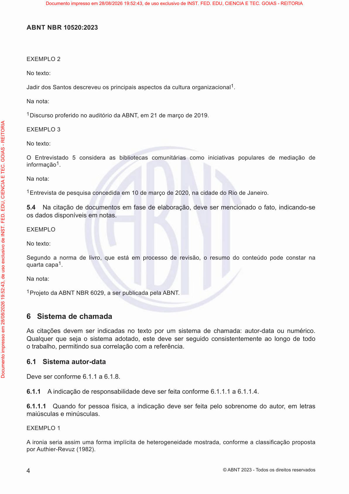

### Registro humano da página

- Comparado visualmente com o PDF: [ ] Sim [ ] Não — estado inicial: pendente.
- Revisor: ____________________
- Data: ____________________
- Número impresso confirmado: ____________________
- Transcrição necessária: [ ] Sim [ ] Não [ ] A definir
- Omissões, com extrator e localização: ____________________
- Inclusões, com extrator e localização: ____________________
- Erros numéricos, com extrator e localização: ____________________
- Erros estruturais, com extrator e localização: ____________________
- Observações: ____________________

**Transcrição humana, somente quando necessária:**

<!-- Campo humano em branco; não é saída de extrator. -->


### Indicadores históricos do snapshot

| Extrator | Registro da página | Execução | Processamento | Avaliação | Método de avaliação | Nota registrada | Revisão manual registrada | Conclusão não confirmada registrada |
|---|---:|---:|---|---|---|---|---|---|
| Leitor PDF | 8 | 1 | `success` | `pending` | `null` | `null` | `null` | `null` |
| Docling | 31 | 2 | `success` | `success` | `page_image` | `98.50` | `False` | `null` |
| GLM-OCR | 54 | 3 | `success` | `success` | `page_image` | `99.50` | `False` | `True` |


### Leitor PDF — texto completo

- Versão: `pypdf-6.18.1`.
- Registro de página: `8`; execução: `1`.
- SHA-256 do texto: `a05bc8367401cfec7ef1b32531381be4eed19ac2119d21d2fb9b0538fa5b4879`.
- [Abrir texto UTF-8 integral](pages/NBR10520_p0008/pdf_reader.txt).


```text
4
ABNT NBR 10520:2023
© ABNT 2023 - T odos os direitos reservados
EXEMPLO 2
No texto:
Jadir dos Santos descreveu os principais aspectos da cultura organizacional 1.
Na nota:
1 Discurso proferido no auditório da ABNT , em 21 de março de 2019.
EXEMPLO 3
No texto:
O Entrevistado 5 considera as bibliotecas comunitárias como iniciativas populares de mediação de
informação 1.
Na nota:
1 Entrevista de pesquisa concedida em 10 de março de 2020, na cidade do Rio de Janeiro.
5.4Na citação de documentos em fase de elaboração, deve ser mencionado o fato, indicando-se
os dados disponíveis em notas.
EXEMPLO
No texto:
Segundo a norma de livro, que está em processo de revisão, o resumo do conteúdo pode constar na
quarta capa 1.
Na nota:
1 Projeto da ABNT NBR 6029, a ser publicada pela ABNT .
6 Sistema de chamada
As citações devem ser indicadas no texto por um sistema de chamada: autor-data ou numérico.
Qualquer que seja o sistema adotado, este deve ser seguido consistentemente ao longo de todo
o trabalho, permitindo sua correlação com a referência.
6.1 Sistema autor-data
Deve ser conforme 6.1.1 a 6.1.8.
6.1.1A indicação de responsabilidade deve ser feita conforme 6.1.1.1 a 6.1.1.4.
6.1.1.1Quando for pessoa física, a indicação deve ser feita pelo sobrenome do autor, em letras
maiúsculas e minúsculas.
EXEMPLO 1
A ironia seria assim uma forma implícita de heterogeneidade mostrada, conforme a classicação proposta
por Authier-Revuz (1982).
Documento impresso em 28/08/2026 19:52:43, de uso exclusivo de INST. FED. EDU, CIENCIA E TEC. GOIAS - REITORIA
Documento impresso em 28/08/2026 19:52:43, de uso exclusivo de INST. FED. EDU, CIENCIA E TEC. GOIAS - REITORIA
```


**Revisão humana de Leitor PDF — preencher:**

- Comparado ao PDF: [ ] Sim [ ] Não [ ] Pendente
- Omissões: ____________________
- Inclusões: ____________________
- Erros numéricos: ____________________
- Erros estruturais: ____________________
- Observações: ____________________

**Diagnóstico histórico completo, sem nova avaliação:**

```json
{
  "id": 8,
  "extraction_id": 1,
  "extractor": "pdf_reader",
  "extractor_version": "pypdf-6.18.1",
  "content_hash": "a05bc8367401cfec7ef1b32531381be4eed19ac2119d21d2fb9b0538fa5b4879",
  "text_sha256": "a05bc8367401cfec7ef1b32531381be4eed19ac2119d21d2fb9b0538fa5b4879",
  "markdown_sha256": "a05bc8367401cfec7ef1b32531381be4eed19ac2119d21d2fb9b0538fa5b4879",
  "processing_status": "success",
  "attempt_count": 2,
  "processing_time_ms": 49,
  "error_message": null,
  "structured_output": null,
  "quality_score": null,
  "quality_metrics": null,
  "evaluation_status": "pending",
  "evaluation_method": null,
  "evaluation_model": null,
  "evaluation_prompt_version": null,
  "evaluation_error": null,
  "evaluated_at": null,
  "historical_configuration": null,
  "historical_configuration_provenance": "not_persisted_in_extraction_schema"
}
```


### Docling — texto completo

- Versão: `docling-2.126.0`.
- Registro de página: `31`; execução: `2`.
- SHA-256 do texto: `49bbb37c37eb7a056bb602a7ecde3ee6356e7eef5caee06aca7071c9e8796ea3`.
- [Abrir texto UTF-8 integral](pages/NBR10520_p0008/docling.txt).


```text
## ABNT NBR 10520:2023

EXEMPLO 2

No texto:

Jadir dos Santos descreveu os principais aspectos da cultura organizacional 1 .

Na nota:

1 Discurso proferido no auditório da ABNT, em 21 de março de 2019.

EXEMPLO 3

No texto:

- O Entrevistado 5 considera as bibliotecas comunitárias como iniciativas populares de mediação de informação 1 .

Na nota:

1 Entrevista de pesquisa concedida em 10 de março de 2020, na cidade do Rio de Janeiro.

- 5.4 Na citação de documentos em fase de elaboração, deve ser mencionado o fato, indicando-se os dados disponíveis em notas.

EXEMPLO

No texto:

Segundo a norma de livro, que está em processo de revisão, o resumo do conteúdo pode constar na quarta capa 1 .

Na nota:

1 Projeto da ABNT NBR 6029, a ser publicada pela ABNT.

## 6 Sistema de chamada

As citações devem ser indicadas no texto por um sistema de chamada: autor-data ou numérico. Qualquer que seja o sistema adotado, este deve ser seguido consistentemente ao longo de todo o trabalho, permitindo sua correlação com a referência.

## 6.1 Sistema autor-data

Deve ser conforme 6.1.1 a 6.1.8.

- 6.1.1 A indicação de responsabilidade deve ser feita conforme 6.1.1.1 a 6.1.1.4.
- 6.1.1.1 Quando for pessoa física, a indicação deve ser feita pelo sobrenome do autor, em letras maiúsculas e minúsculas.

## EXEMPLO 1

A ironia seria assim uma forma implícita de heterogeneidade mostrada, conforme a classi  cação proposta por Authier-Revuz (1982).
```


**Revisão humana de Docling — preencher:**

- Comparado ao PDF: [ ] Sim [ ] Não [ ] Pendente
- Omissões: ____________________
- Inclusões: ____________________
- Erros numéricos: ____________________
- Erros estruturais: ____________________
- Observações: ____________________

**Diagnóstico histórico completo, sem nova avaliação:**

```json
{
  "id": 31,
  "extraction_id": 2,
  "extractor": "docling",
  "extractor_version": "docling-2.126.0",
  "content_hash": "49bbb37c37eb7a056bb602a7ecde3ee6356e7eef5caee06aca7071c9e8796ea3",
  "text_sha256": "49bbb37c37eb7a056bb602a7ecde3ee6356e7eef5caee06aca7071c9e8796ea3",
  "markdown_sha256": "49bbb37c37eb7a056bb602a7ecde3ee6356e7eef5caee06aca7071c9e8796ea3",
  "processing_status": "success",
  "attempt_count": 2,
  "processing_time_ms": 14371,
  "error_message": null,
  "structured_output": null,
  "quality_score": "98.50",
  "quality_metrics": {
    "cer": 0.1945945945945946,
    "wer": 0.2591240875912409,
    "evaluation": {
      "scores": {
        "noise_control": 100,
        "reading_order": 100,
        "textual_fidelity": 95,
        "lists_preservation": 96,
        "duplication_control": 98,
        "tables_preservation": null,
        "content_completeness": 98,
        "hallucination_control": 100,
        "numbers_and_references": 99,
        "structural_preservation": 97
      },
      "confidence": 100.0,
      "justification": "A extração segue o texto fornecido de forma fiel. O conteúdo é uma seção de normas (ABNT NBR 10520:2023) com exemplos e regras sobre citações, mantendo a estrutura hierárquica e os exemplos conforme apresentado no texto original.",
      "noise_control": 100,
      "overall_score": 98.5,
      "reading_order": 100,
      "missing_elements": null,
      "textual_fidelity": 95,
      "incorrect_elements": null,
      "lists_preservation": 96,
      "duplicated_elements": null,
      "duplication_control": 98,
      "tables_preservation": null,
      "content_completeness": 98,
      "hallucinated_elements": null,
      "hallucination_control": 100,
      "numbers_and_references": 99,
      "requires_manual_review": false,
      "structural_preservation": 97
    },
    "extracted_word_count": 242,
    "reference_word_count": 274,
    "normalized_similarity": 0.8054054054054054,
    "requires_manual_review": false,
    "extracted_character_count": 1446,
    "reference_character_count": 1665
  },
  "evaluation_status": "success",
  "evaluation_method": "page_image",
  "evaluation_model": "gemma4:e2b",
  "evaluation_prompt_version": "rag-page-evaluation-v1",
  "evaluation_error": null,
  "evaluated_at": "2026-09-15T18:00:02.069463-03:00",
  "historical_configuration": null,
  "historical_configuration_provenance": "not_persisted_in_extraction_schema"
}
```


### GLM-OCR — texto completo

- Versão: `glmocr-0.1.5`.
- Registro de página: `54`; execução: `3`.
- SHA-256 do texto: `523b87f55d9fa4bff74e94345b88f0cb156f8c48e243e6de7010308e30306ff8`.
- [Abrir texto UTF-8 integral](pages/NBR10520_p0008/glm_ocr.txt).


```text
ABNT NBR 10520:2023

EXEMPLO 2

No texto:

Jadir dos Santos descreveu os principais aspectos da cultura organizacional¹.

Na nota:

¹Discurso proferido no auditório da ABNT, em 21 de março de 2019.

EXEMPLO 3

No texto:

O Entrevistado 5 considera as bibliotecas comunitárias como iniciativas populares de mediação de informação¹.

Na nota:

¹Entrevista de pesquisa concedida em 10 de março de 2020, na cidade do Rio de Janeiro.

5.4 Na citação de documentos em fase de elaboração, deve ser mencionado o fato, indicando-se os dados disponíveis em notas.

EXEMPLO

No texto:

Segundo a norma de livro, que está em processo de revisão, o resumo do conteúdo pode constar na quarta capa¹.

Na nota:

¹Projeto da ABNT NBR 6029, a ser publicada pela ABNT.

6 Sistema de chamada

As citações devem ser indicadas no texto por um sistema de chamada: autor-data ou numérico. Qualquer que seja o sistema adotado, este deve ser seguido consistenteemente ao longo de todo o trabalho, permitindo sua correlação com a referência.

6.1 Sistema autor-data

Deve ser conforme 6.1.1 a 6.1.8.

6.1.1 A indicação de responsabilidade deve ser feita conforme 6.1.1.1 a 6.1.1.4.

6.1.1.1 Quando for pessoa física, a indicação deve ser feita pelo sobrenome do autor, em letras maiúsculas e minúsculas.

EXEMPLO 1

A ironia seria assim uma forma implícita de heterogeneidade mostrada, conforme a classificação proposta por Authier-Revuz (1982).
```


**Revisão humana de GLM-OCR — preencher:**

- Comparado ao PDF: [ ] Sim [ ] Não [ ] Pendente
- Omissões: ____________________
- Inclusões: ____________________
- Erros numéricos: ____________________
- Erros estruturais: ____________________
- Observações: ____________________

**Diagnóstico histórico completo, sem nova avaliação:**

```json
{
  "id": 54,
  "extraction_id": 3,
  "extractor": "glm_ocr",
  "extractor_version": "glmocr-0.1.5",
  "content_hash": "523b87f55d9fa4bff74e94345b88f0cb156f8c48e243e6de7010308e30306ff8",
  "text_sha256": "523b87f55d9fa4bff74e94345b88f0cb156f8c48e243e6de7010308e30306ff8",
  "markdown_sha256": "523b87f55d9fa4bff74e94345b88f0cb156f8c48e243e6de7010308e30306ff8",
  "processing_status": "success",
  "attempt_count": 1,
  "processing_time_ms": 9771,
  "error_message": null,
  "structured_output": {
    "completion_unconfirmed": true
  },
  "quality_score": "99.50",
  "quality_metrics": {
    "cer": 0.1885885885885886,
    "wer": 0.25547445255474455,
    "evaluation": {
      "scores": {
        "noise_control": 100.0,
        "reading_order": 100.0,
        "textual_fidelity": 98.5,
        "lists_preservation": null,
        "duplication_control": 99.5,
        "tables_preservation": null,
        "content_completeness": 95.0,
        "hallucination_control": 100.0,
        "numbers_and_references": 97.5,
        "structural_preservation": 99.0
      },
      "confidence": 1.0,
      "justification": "O texto extraído é uma transcrição de um trecho de um documento técnico (provavelmente normas ABNT) que explica como fazer citações e referências. A fidelidade textual é muito alta. O formato JSON foi aplicado conforme solicitado.",
      "noise_control": 100.0,
      "overall_score": 99.5,
      "reading_order": 100.0,
      "missing_elements": [],
      "textual_fidelity": 98.5,
      "incorrect_elements": [],
      "lists_preservation": null,
      "duplicated_elements": [],
      "duplication_control": 99.5,
      "tables_preservation": null,
      "content_completeness": 95.0,
      "hallucinated_elements": [],
      "hallucination_control": 100.0,
      "numbers_and_references": 97.5,
      "requires_manual_review": false,
      "structural_preservation": 99.0
    },
    "extracted_word_count": 223,
    "reference_word_count": 274,
    "normalized_similarity": 0.8114114114114114,
    "requires_manual_review": false,
    "extracted_character_count": 1418,
    "reference_character_count": 1665
  },
  "evaluation_status": "success",
  "evaluation_method": "page_image",
  "evaluation_model": "gemma4:e2b",
  "evaluation_prompt_version": "rag-page-evaluation-v1",
  "evaluation_error": null,
  "evaluated_at": "2026-09-15T17:37:59.238453-03:00",
  "historical_configuration": null,
  "historical_configuration_provenance": "not_persisted_in_extraction_schema"
}
```


<a id="nbr12225-p0005"></a>

## ABNT NBR 12225:2023 — página física 5

- Documento no snapshot: `2` / `abnt_nbr_12225`.
- SHA-256 do original: `d9407b4cd5852b042dea7c31cd702e39b99aa3035aec3fa2b52c64e37aca711c`.
- Página impressa: candidato registrado `null`; confirmação humana em branco.

- Gold: registro `2`, extração `5`, método `docling`, versão na coluna Gold `2023`.
- Hash do documento Gold: `74f5900b406da5c7ccf1a8bd9fb0e29ad62989bbad3328ffcb8c0e9679a87450`.
- Índices de página Gold ativos: `[25]`.

[PDF da página](pages/NBR12225_p0005/original.pdf) · [Imagem em tamanho integral](pages/NBR12225_p0005/original.png) · [PDF original, página física 5](../../../../data/raw/NBR12225.pdf#page=5)

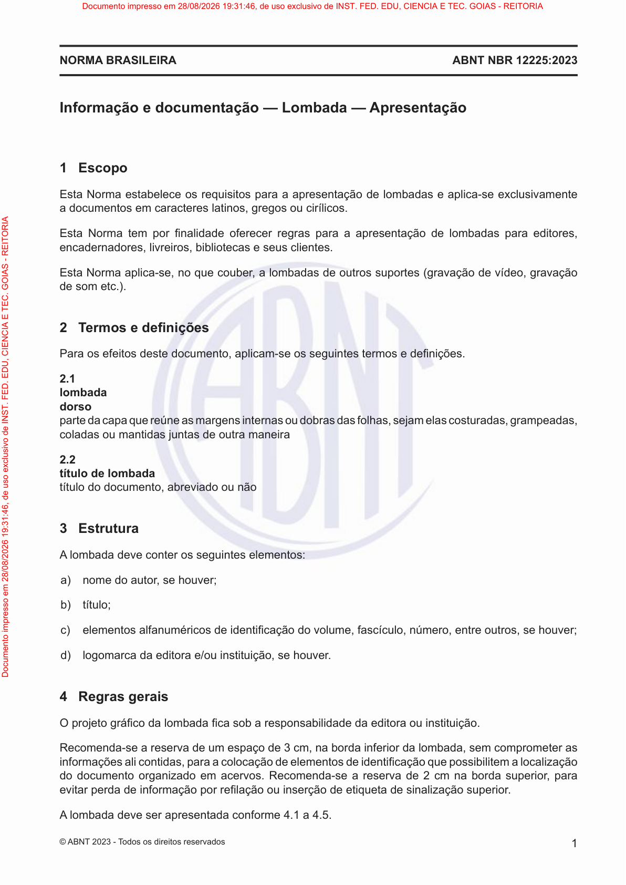

### Registro humano da página

- Comparado visualmente com o PDF: [ ] Sim [ ] Não — estado inicial: pendente.
- Revisor: ____________________
- Data: ____________________
- Número impresso confirmado: ____________________
- Transcrição necessária: [ ] Sim [ ] Não [ ] A definir
- Omissões, com extrator e localização: ____________________
- Inclusões, com extrator e localização: ____________________
- Erros numéricos, com extrator e localização: ____________________
- Erros estruturais, com extrator e localização: ____________________
- Observações: ____________________

**Transcrição humana, somente quando necessária:**

<!-- Campo humano em branco; não é saída de extrator. -->


### Indicadores históricos do snapshot

| Extrator | Registro da página | Execução | Processamento | Avaliação | Método de avaliação | Nota registrada | Revisão manual registrada | Conclusão não confirmada registrada |
|---|---:|---:|---|---|---|---|---|---|
| Leitor PDF | 74 | 4 | `success` | `pending` | `null` | `null` | `null` | `null` |
| Docling | 83 | 5 | `success` | `success` | `page_image` | `97.50` | `False` | `null` |
| GLM-OCR | 92 | 6 | `success` | `success` | `page_image` | `98.50` | `False` | `True` |


### Leitor PDF — texto completo

- Versão: `pypdf-6.18.1`.
- Registro de página: `74`; execução: `4`.
- SHA-256 do texto: `347661bf984f8fa22a2e4f0d12a3aefd40d06be23420de3fb6da2840e8661256`.
- [Abrir texto UTF-8 integral](pages/NBR12225_p0005/pdf_reader.txt).


```text
ABNT NBR 12225:2023NORMA BRASILEIRA
1© ABNT 2023 - T odos os direitos reservados
Informação e documentação — Lombada — Apresentação
1 Escopo
Esta Norma estabelece os requisitos para a apresentação de lombadas e aplica-se exclusivamente
a documentos em caracteres latinos, gregos ou cirílicos.
Esta Norma tem porfinalidade oferecer regras para a apresentação de lombadas para editores,
encadernadores, livreiros, bibliotecas e seus clientes.
Esta Norma aplica-se, no que couber, a lombadas de outros suportes (gravação de vídeo, gravação
de som etc.).
2Termos e definições
Para os efeitos deste documento, aplicam-se os seguintes termos e definições.
2.1
lombada
dorso
parte da capa que reúne as margens internas ou dobras das folhas, sejam elas costuradas, grampeadas,
coladas ou mantidas juntas de outra maneira
2.2
título de lombada
título do documento, abreviado ou não
3 Estrutura
A lombada deve conter os seguintes elementos:
a) nome do autor, se houver;
b) título;
c) elementos alfanuméricos de identificação do volume, fascículo, número, entre outros, se houver;
d) logomarca da editora e/ou instituição, se houver.
4 Regras gerais
O projeto gráfico da lombadafica sob a responsabilidade da editora ou instituição.
Recomenda-se a reserva de um espaço de 3 cm, na borda inferior da lombada, sem comprometer as
informações ali contidas, para a colocação de elementos de identificação que possibilitem a localização
do documento organizado em acervos. Recomenda-se a reserva de 2 cm na borda superior, para
evitar perda de informação por refilação ou inserção de etiqueta de sinalização superior.
A lombada deve ser apresentada conforme 4.1 a 4.5.
Documento impresso em 28/08/2026 19:31:46, de uso exclusivo de INST. FED. EDU, CIENCIA E TEC. GOIAS - REITORIA
Documento impresso em 28/08/2026 19:31:46, de uso exclusivo de INST. FED. EDU, CIENCIA E TEC. GOIAS - REITORIA
```


**Revisão humana de Leitor PDF — preencher:**

- Comparado ao PDF: [ ] Sim [ ] Não [ ] Pendente
- Omissões: ____________________
- Inclusões: ____________________
- Erros numéricos: ____________________
- Erros estruturais: ____________________
- Observações: ____________________

**Diagnóstico histórico completo, sem nova avaliação:**

```json
{
  "id": 74,
  "extraction_id": 4,
  "extractor": "pdf_reader",
  "extractor_version": "pypdf-6.18.1",
  "content_hash": "347661bf984f8fa22a2e4f0d12a3aefd40d06be23420de3fb6da2840e8661256",
  "text_sha256": "347661bf984f8fa22a2e4f0d12a3aefd40d06be23420de3fb6da2840e8661256",
  "markdown_sha256": "347661bf984f8fa22a2e4f0d12a3aefd40d06be23420de3fb6da2840e8661256",
  "processing_status": "success",
  "attempt_count": 1,
  "processing_time_ms": 61,
  "error_message": null,
  "structured_output": null,
  "quality_score": null,
  "quality_metrics": null,
  "evaluation_status": "pending",
  "evaluation_method": null,
  "evaluation_model": null,
  "evaluation_prompt_version": null,
  "evaluation_error": null,
  "evaluated_at": null,
  "historical_configuration": null,
  "historical_configuration_provenance": "not_persisted_in_extraction_schema"
}
```


### Docling — texto completo

- Versão: `docling-2.126.0`.
- Registro de página: `83`; execução: `5`.
- SHA-256 do texto: `5cf5a683f4a7bc0c424c2bbb4e37c8ffd5211ae04023973e87c017b162f27797`.
- [Abrir texto UTF-8 integral](pages/NBR12225_p0005/docling.txt).


```text
## Informação e documentação - Lombada - Apresentação

## 1 Escopo

Esta Norma estabelece os requisitos para a apresentação de lombadas e aplica-se exclusivamente a documentos em caracteres latinos, gregos ou cirílicos.

Esta Norma tem por finalidade oferecer regras para a apresentação de lombadas para editores, encadernadores, livreiros, bibliotecas e seus clientes.

Esta Norma aplica-se, no que couber, a lombadas de outros suportes (gravação de vídeo, gravação de som etc.).

## 2 Termos e definições

Para os efeitos deste documento, aplicam-se os seguintes termos e definições.

## 2.1 lombada dorso

parte da capa que reúne as margens internas ou dobras das folhas, sejam elas costuradas, grampeadas, coladas ou mantidas juntas de outra maneira

## 2.2

## título de lombada

título do documento, abreviado ou não

## 3 Estrutura

A lombada deve conter os seguintes elementos:

- a) nome do autor, se houver;
- b) título;
- c) elementos alfanuméricos de identificação do volume, fascículo, número, entre outros, se houver;
- d) logomarca da editora e/ou instituição, se houver.

## 4 Regras gerais

O projeto gráfico da lombada fica sob a responsabilidade da editora ou instituição.

Recomenda-se a reserva de um espaço de 3 cm, na borda inferior da lombada, sem comprometer as informações ali contidas, para a colocação de elementos de identificação que possibilitem a localização do documento organizado em acervos. Recomenda-se a reserva de 2 cm na borda superior, para evitar perda de informação por refilação ou inserção de etiqueta de sinalização superior.

A lombada deve ser apresentada conforme 4.1 a 4.5.
```


**Revisão humana de Docling — preencher:**

- Comparado ao PDF: [ ] Sim [ ] Não [ ] Pendente
- Omissões: ____________________
- Inclusões: ____________________
- Erros numéricos: ____________________
- Erros estruturais: ____________________
- Observações: ____________________

**Diagnóstico histórico completo, sem nova avaliação:**

```json
{
  "id": 83,
  "extraction_id": 5,
  "extractor": "docling",
  "extractor_version": "docling-2.126.0",
  "content_hash": "5cf5a683f4a7bc0c424c2bbb4e37c8ffd5211ae04023973e87c017b162f27797",
  "text_sha256": "5cf5a683f4a7bc0c424c2bbb4e37c8ffd5211ae04023973e87c017b162f27797",
  "markdown_sha256": "5cf5a683f4a7bc0c424c2bbb4e37c8ffd5211ae04023973e87c017b162f27797",
  "processing_status": "success",
  "attempt_count": 1,
  "processing_time_ms": 17228,
  "error_message": null,
  "structured_output": null,
  "quality_score": "97.50",
  "quality_metrics": {
    "cer": 0.2032171581769437,
    "wer": 0.2578397212543554,
    "evaluation": {
      "scores": {
        "noise_control": 98,
        "reading_order": 97,
        "textual_fidelity": 95,
        "lists_preservation": 97,
        "duplication_control": 98,
        "tables_preservation": null,
        "content_completeness": 98,
        "hallucination_control": 98,
        "numbers_and_references": 95,
        "structural_preservation": 96
      },
      "confidence": 1.0,
      "justification": "A extração fornecida é uma reprodução fiel do texto original, incluindo a estrutura e o conteúdo das seções. O texto nativo auxiliar confirma a fidelidade da informação apresentada.",
      "noise_control": 98,
      "overall_score": 97.5,
      "reading_order": 97,
      "missing_elements": null,
      "textual_fidelity": 95,
      "incorrect_elements": null,
      "lists_preservation": 97,
      "duplicated_elements": null,
      "duplication_control": 98,
      "tables_preservation": null,
      "content_completeness": 98,
      "hallucinated_elements": null,
      "hallucination_control": 98,
      "numbers_and_references": 95,
      "requires_manual_review": false,
      "structural_preservation": 96
    },
    "extracted_word_count": 253,
    "reference_word_count": 287,
    "normalized_similarity": 0.7967828418230563,
    "requires_manual_review": false,
    "extracted_character_count": 1623,
    "reference_character_count": 1865
  },
  "evaluation_status": "success",
  "evaluation_method": "page_image",
  "evaluation_model": "gemma4:e2b",
  "evaluation_prompt_version": "rag-page-evaluation-v1",
  "evaluation_error": null,
  "evaluated_at": "2026-09-15T17:39:57.854094-03:00",
  "historical_configuration": null,
  "historical_configuration_provenance": "not_persisted_in_extraction_schema"
}
```


### GLM-OCR — texto completo

- Versão: `glmocr-0.1.5`.
- Registro de página: `92`; execução: `6`.
- SHA-256 do texto: `a7d9ae207b6f0d5e4dff85241e8451d7106a8873dcf911cb800dee5459765569`.
- [Abrir texto UTF-8 integral](pages/NBR12225_p0005/glm_ocr.txt).


```text
Informação e documentação — Lombada — Apresentação

1 Escopo

Esta Norma estabelece os requisitos para a apresentação de lombadas e aplica-se exclusivamente a documentos em caracteres latinos, gregos ou cirílicos.

Esta Norma tem por finalidade oferecer regras para a apresentação de lombadas para editores, encadernadores, livreiros, bibliotecas e seus clientes.

Esta Norma aplica-se, no que couber, a lombadas de outros suportes (gravação de vídeo, gravação de som etc.).

2 Termos e definições

Para os efeitos deste documento, aplicam-se os seguintes termos e definições.

2.1
lombada
dorso
parte da capa que reúne as margens internas ou dobras das folhas, sejam elas costuradas, grampeadas, coladas ou mantidas juntas de outra maneira

2.2
título de lombada
título do documento, abreviado ou não

3 Estrutura

A lombada deve conter os seguintes elementos:

a) nome do autor, se houver;

b) título;

c) elementos alfanuméricos de identificação do volume, fascículo, número, entre outros, se houver;

d) logomarca da editora e/ou instituição, se houver.

4 Regras gerais

O projeto gráfico da lombada fica sob a responsabilidade da editora ou instituição.

Recomenda-se a reserva de um espaço de 3 cm, na borda inferior da lombada, sem comprometer as informações ali contidas, para a colocação de elementos de identificação que possibilitem a localização do documento organizado em acervos. Recomenda-se a reserva de 2 cm na borda superior, para evitar perda de informação por refilação ou inserção de etiqueta de sinalização superior.

A lombada deve ser apresentada conforme 4.1 a 4.5.
© ABNT 2023 - Todos os direitos reservados
```


**Revisão humana de GLM-OCR — preencher:**

- Comparado ao PDF: [ ] Sim [ ] Não [ ] Pendente
- Omissões: ____________________
- Inclusões: ____________________
- Erros numéricos: ____________________
- Erros estruturais: ____________________
- Observações: ____________________

**Diagnóstico histórico completo, sem nova avaliação:**

```json
{
  "id": 92,
  "extraction_id": 6,
  "extractor": "glm_ocr",
  "extractor_version": "glmocr-0.1.5",
  "content_hash": "a7d9ae207b6f0d5e4dff85241e8451d7106a8873dcf911cb800dee5459765569",
  "text_sha256": "a7d9ae207b6f0d5e4dff85241e8451d7106a8873dcf911cb800dee5459765569",
  "markdown_sha256": "a7d9ae207b6f0d5e4dff85241e8451d7106a8873dcf911cb800dee5459765569",
  "processing_status": "success",
  "attempt_count": 1,
  "processing_time_ms": 9905,
  "error_message": null,
  "structured_output": {
    "completion_unconfirmed": true
  },
  "quality_score": "98.50",
  "quality_metrics": {
    "cer": 0.17372654155495978,
    "wer": 0.20905923344947736,
    "evaluation": {
      "scores": {
        "noise_control": 100,
        "reading_order": 100,
        "textual_fidelity": 95,
        "lists_preservation": 100,
        "duplication_control": 95,
        "tables_preservation": null,
        "content_completeness": 100,
        "hallucination_control": 100,
        "numbers_and_references": 98,
        "structural_preservation": 100
      },
      "confidence": 100.0,
      "justification": "A extração fornecida é uma cópia fiel do texto original, incluindo a estrutura e o conteúdo das seções. A fidelidade textual é muito alta.",
      "noise_control": 100,
      "overall_score": 98.5,
      "reading_order": 100,
      "missing_elements": null,
      "textual_fidelity": 95,
      "incorrect_elements": null,
      "lists_preservation": 100,
      "duplicated_elements": null,
      "duplication_control": 95,
      "tables_preservation": null,
      "content_completeness": 100,
      "hallucinated_elements": null,
      "hallucination_control": 100,
      "numbers_and_references": 98,
      "requires_manual_review": false,
      "structural_preservation": 100
    },
    "extracted_word_count": 249,
    "reference_word_count": 287,
    "normalized_similarity": 0.8262734584450402,
    "requires_manual_review": false,
    "extracted_character_count": 1634,
    "reference_character_count": 1865
  },
  "evaluation_status": "success",
  "evaluation_method": "page_image",
  "evaluation_model": "gemma4:e2b",
  "evaluation_prompt_version": "rag-page-evaluation-v1",
  "evaluation_error": null,
  "evaluated_at": "2026-09-15T17:41:43.121008-03:00",
  "historical_configuration": null,
  "historical_configuration_provenance": "not_persisted_in_extraction_schema"
}
```


<a id="nbr14724-p0014"></a>

## ABNT NBR 14724:2024 — página física 14

- Documento no snapshot: `3` / `abnt_nbr_14724`.
- SHA-256 do original: `a82a50e4e5b8a786286e650438a56712ea877febab4ce5f21f0fb7334ea9cd1f`.
- Página impressa: candidato registrado `null`; confirmação humana em branco.

- Gold: registro `3`, extração `9`, método `glm_ocr`, versão na coluna Gold `2024`.
- Hash do documento Gold: `cd748832b1e7295e58facb5f8fc39d9a2bd321a3046cf9547cd17b62950ca01e`.
- Índices de página Gold ativos: `[48]`.

[PDF da página](pages/NBR14724_p0014/original.pdf) · [Imagem em tamanho integral](pages/NBR14724_p0014/original.png) · [PDF original, página física 14](../../../../data/raw/NBR14724.pdf#page=14)

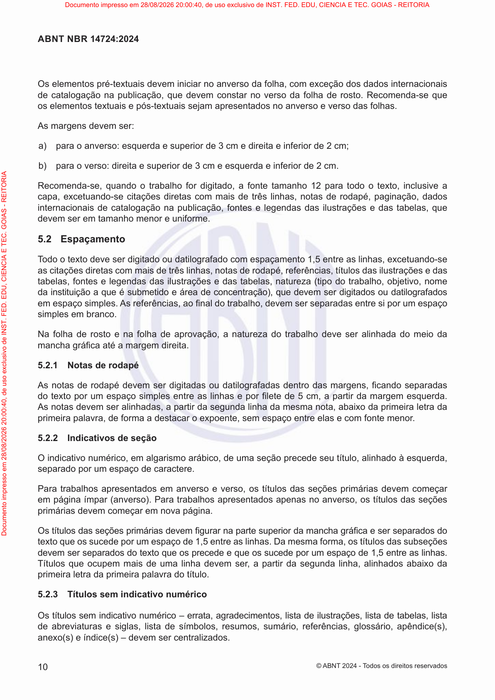

### Registro humano da página

- Comparado visualmente com o PDF: [ ] Sim [ ] Não — estado inicial: pendente.
- Revisor: ____________________
- Data: ____________________
- Número impresso confirmado: ____________________
- Transcrição necessária: [ ] Sim [ ] Não [ ] A definir
- Omissões, com extrator e localização: ____________________
- Inclusões, com extrator e localização: ____________________
- Erros numéricos, com extrator e localização: ____________________
- Erros estruturais, com extrator e localização: ____________________
- Observações: ____________________

**Transcrição humana, somente quando necessária:**

<!-- Campo humano em branco; não é saída de extrator. -->


### Indicadores históricos do snapshot

| Extrator | Registro da página | Execução | Processamento | Avaliação | Método de avaliação | Nota registrada | Revisão manual registrada | Conclusão não confirmada registrada |
|---|---:|---:|---|---|---|---|---|---|
| Leitor PDF | 110 | 7 | `success` | `pending` | `null` | `null` | `null` | `null` |
| Docling | 126 | 8 | `success` | `success` | `page_image` | `98.50` | `False` | `null` |
| GLM-OCR | 142 | 9 | `success` | `success` | `page_image` | `98.50` | `False` | `True` |


### Leitor PDF — texto completo

- Versão: `pypdf-6.18.1`.
- Registro de página: `110`; execução: `7`.
- SHA-256 do texto: `473ea255f98b7ae6841fb4bf12a7746e955ea32d9b2a9263444fa083b8f1b8f2`.
- [Abrir texto UTF-8 integral](pages/NBR14724_p0014/pdf_reader.txt).


```text
10
ABNT NBR 14724:2024
© ABNT 2024 - T odos os direitos reservados
Os elementos pré-textuais devem iniciar no anverso da folha, com exceção dos dados internacionais
de catalogação na publicação, que devem constar no verso da folha de rosto. Recomenda-se que
os elementos textuais e pós-textuais sejam apresentados no anverso e verso das folhas.
As margens devem ser:
a) para o anverso: esquerda e superior de 3 cm e direita e inferior de 2 cm;
b) para o verso: direita e superior de 3 cm e esquerda e inferior de 2 cm.
Recomenda-se, quando o trabalho for digitado, a fonte tamanho 12 para todo o texto, inclusive a
capa, excetuando-se citações diretas com mais de três linhas, notas de rodapé, paginação, dados
internacionais de catalogação na publicação, fontes e legendas das ilustrações e das tabelas, que
devem ser em tamanho menor e uniforme.
5.2 Espaçamento
T odo o texto deve ser digitado ou datilografado com espaçamento 1,5 entre as linhas, excetuando-se
as citações diretas com mais de três linhas, notas de rodapé, referências, títulos das ilustrações e das
tabelas, fontes e legendas das ilustrações e das tabelas, natureza (tipo do trabalho, objetivo, nome
da instituição a que é submetido e área de concentração), que devem ser digitados ou datilografados
em espaço simples. As referências, aofinal do trabalho, devem ser separadas entre si por um espaço
simples em branco.
Na folha de rosto e na folha de aprovação, a natureza do trabalho deve ser alinhada do meio da
mancha gráfica até a margem direita.
5.2.1 Notas de rodapé
As notas de rodapé devem ser digitadas ou datilografadas dentro das margens,ficando separadas
do texto por um espaço simples entre as linhas e porfilete de 5 cm, a partir da margem esquerda.
As notas devem ser alinhadas, a partir da segunda linha da mesma nota, abaixo da primeira letra da
primeira palavra, de forma a destacar o expoente, sem espaço entre elas e com fonte menor.
5.2.2 Indicativos de seção
O indicativo numérico, em algarismo arábico, de uma seção precede seu título, alinhado à esquerda,
separado por um espaço de caractere.
Para trabalhos apresentados em anverso e verso, os títulos das seções primárias devem começar
em página ímpar (anverso). Para trabalhos apresentados apenas no anverso, os títulos das seções
primárias devem começar em nova página.
Os títulos das seções primárias devemfigurar na parte superior da mancha gráfica e ser separados do
texto que os sucede por um espaço de 1,5 entre as linhas. Da mesma forma, os títulos das subseções
devem ser separados do texto que os precede e que os sucede por um espaço de 1,5 entre as linhas.
Títulos que ocupem mais de uma linha devem ser, a partir da segunda linha, alinhados abaixo da
primeira letra da primeira palavra do título.
5.2.3 Títulos sem indicativo numérico
Os títulos sem indicativo numérico – errata, agradecimentos, lista de ilustrações, lista de tabelas, lista
de abreviaturas e siglas, lista de símbolos, resumos, sumário, referências, glossário, apêndice(s),
anexo(s) e índice(s) – devem ser centralizados.
Documento impresso em 28/08/2026 20:00:40, de uso exclusivo de INST. FED. EDU, CIENCIA E TEC. GOIAS - REITORIA
Documento impresso em 28/08/2026 20:00:40, de uso exclusivo de INST. FED. EDU, CIENCIA E TEC. GOIAS - REITORIA
```


**Revisão humana de Leitor PDF — preencher:**

- Comparado ao PDF: [ ] Sim [ ] Não [ ] Pendente
- Omissões: ____________________
- Inclusões: ____________________
- Erros numéricos: ____________________
- Erros estruturais: ____________________
- Observações: ____________________

**Diagnóstico histórico completo, sem nova avaliação:**

```json
{
  "id": 110,
  "extraction_id": 7,
  "extractor": "pdf_reader",
  "extractor_version": "pypdf-6.18.1",
  "content_hash": "473ea255f98b7ae6841fb4bf12a7746e955ea32d9b2a9263444fa083b8f1b8f2",
  "text_sha256": "473ea255f98b7ae6841fb4bf12a7746e955ea32d9b2a9263444fa083b8f1b8f2",
  "markdown_sha256": "473ea255f98b7ae6841fb4bf12a7746e955ea32d9b2a9263444fa083b8f1b8f2",
  "processing_status": "success",
  "attempt_count": 1,
  "processing_time_ms": 67,
  "error_message": null,
  "structured_output": null,
  "quality_score": null,
  "quality_metrics": null,
  "evaluation_status": "pending",
  "evaluation_method": null,
  "evaluation_model": null,
  "evaluation_prompt_version": null,
  "evaluation_error": null,
  "evaluated_at": null,
  "historical_configuration": null,
  "historical_configuration_provenance": "not_persisted_in_extraction_schema"
}
```


### Docling — texto completo

- Versão: `docling-2.126.0`.
- Registro de página: `126`; execução: `8`.
- SHA-256 do texto: `a337b2cc210ca08186c9938e9a19d0a96dc2fc274431fa1e6e02d5a2fd135071`.
- [Abrir texto UTF-8 integral](pages/NBR14724_p0014/docling.txt).


```text
## ABNT NBR 14724:2024

Os elementos pré-textuais devem iniciar no anverso da folha, com exceção dos dados internacionais de catalogação na publicação, que devem constar no verso da folha de rosto. Recomenda-se que os elementos textuais e pós-textuais sejam apresentados no anverso e verso das folhas.

As margens devem ser:

- a) para o anverso: esquerda e superior de 3 cm e direita e inferior de 2 cm;
- b) para o verso: direita e superior de 3 cm e esquerda e inferior de 2 cm.

Recomenda-se, quando o trabalho for digitado, a fonte tamanho 12 para todo o texto, inclusive a capa, excetuando-se citações diretas com mais de três linhas, notas de rodapé, paginação, dados internacionais de catalogação na publicação, fontes e legendas das ilustrações e das tabelas, que devem ser em tamanho menor e uniforme.

## 5.2 Espaçamento

Todo o texto deve ser digitado ou datilografado com espaçamento 1,5 entre as linhas, excetuando-se as citações diretas com mais de três linhas, notas de rodapé, referências, títulos das ilustrações e das tabelas, fontes e legendas das ilustrações e das tabelas, natureza (tipo do trabalho, objetivo, nome da instituição a que é submetido e área de concentração), que devem ser digitados ou datilografados em espaço simples. As referências, ao final do trabalho, devem ser separadas entre si por um espaço simples em branco.

Na folha de rosto e na folha de aprovação, a natureza do trabalho deve ser alinhada do meio da mancha gráfica até a margem direita.

## 5.2.1 Notas de rodapé

As notas de rodapé devem ser digitadas ou datilografadas dentro das margens, ficando separadas do texto por um espaço simples entre as linhas e por filete de 5 cm, a partir da margem esquerda. As notas devem ser alinhadas, a partir da segunda linha da mesma nota, abaixo da primeira letra da primeira palavra, de forma a destacar o expoente, sem espaço entre elas e com fonte menor.

## 5.2.2 Indicativos de seção

O indicativo numérico, em algarismo arábico, de uma seção precede seu título, alinhado à esquerda, separado por um espaço de caractere.

Para trabalhos apresentados em anverso e verso, os títulos das seções primárias devem começar em página ímpar (anverso). Para trabalhos apresentados apenas no anverso, os títulos das seções primárias devem começar em nova página.

Os títulos das seções primárias devem figurar na parte superior da mancha gráfica e ser separados do texto que os sucede por um espaço de 1,5 entre as linhas. Da mesma forma, os títulos das subseções devem ser separados do texto que os precede e que os sucede por um espaço de 1,5 entre as linhas. Títulos que ocupem mais de uma linha devem ser, a partir da segunda linha, alinhados abaixo da primeira letra da primeira palavra do título.

## 5.2.3 Títulos sem indicativo numérico

Os títulos sem indicativo numérico - errata, agradecimentos, lista de ilustrações, lista de tabelas, lista de abreviaturas e siglas, lista de símbolos, resumos, sumário, referências, glossário, apêndice(s), anexo(s) e índice(s) - devem ser centralizados.
```


**Revisão humana de Docling — preencher:**

- Comparado ao PDF: [ ] Sim [ ] Não [ ] Pendente
- Omissões: ____________________
- Inclusões: ____________________
- Erros numéricos: ____________________
- Erros estruturais: ____________________
- Observações: ____________________

**Diagnóstico histórico completo, sem nova avaliação:**

```json
{
  "id": 126,
  "extraction_id": 8,
  "extractor": "docling",
  "extractor_version": "docling-2.126.0",
  "content_hash": "a337b2cc210ca08186c9938e9a19d0a96dc2fc274431fa1e6e02d5a2fd135071",
  "text_sha256": "a337b2cc210ca08186c9938e9a19d0a96dc2fc274431fa1e6e02d5a2fd135071",
  "markdown_sha256": "a337b2cc210ca08186c9938e9a19d0a96dc2fc274431fa1e6e02d5a2fd135071",
  "processing_status": "success",
  "attempt_count": 1,
  "processing_time_ms": 11642,
  "error_message": null,
  "structured_output": null,
  "quality_score": "98.50",
  "quality_metrics": {
    "cer": 0.10423053341508277,
    "wer": 0.12290502793296089,
    "evaluation": {
      "scores": {
        "noise_control": 100,
        "reading_order": 100,
        "textual_fidelity": 95,
        "lists_preservation": 100,
        "duplication_control": 95,
        "tables_preservation": null,
        "content_completeness": 100,
        "hallucination_control": 100,
        "numbers_and_references": 98,
        "structural_preservation": 100
      },
      "confidence": 100.0,
      "justification": "A extração fornecida é um texto que parece ser uma seção de normas (ABNT NBR 14724:2024) com suas respectivas regras de formatação. O texto nativo auxiliar contém repetições e erros de digitação/formatação (como 'T odo o texto' em vez de 'Todo o texto', e a duplicação da informação final), mas a estrutura e o conteúdo principal das normas estão fielmente representados no texto extraído, incluindo as seções 5.2, 5.2.1, 5.2.2 e 5.2.3.",
      "noise_control": 100,
      "overall_score": 98.5,
      "reading_order": 100,
      "missing_elements": null,
      "textual_fidelity": 95,
      "incorrect_elements": null,
      "lists_preservation": 100,
      "duplicated_elements": null,
      "duplication_control": 95,
      "tables_preservation": null,
      "content_completeness": 100,
      "hallucinated_elements": null,
      "hallucination_control": 100,
      "numbers_and_references": 98,
      "requires_manual_review": false,
      "structural_preservation": 100
    },
    "extracted_word_count": 501,
    "reference_word_count": 537,
    "normalized_similarity": 0.8957694665849172,
    "requires_manual_review": false,
    "extracted_character_count": 3036,
    "reference_character_count": 3262
  },
  "evaluation_status": "success",
  "evaluation_method": "page_image",
  "evaluation_model": "gemma4:e2b",
  "evaluation_prompt_version": "rag-page-evaluation-v1",
  "evaluation_error": null,
  "evaluated_at": "2026-09-15T17:43:57.677586-03:00",
  "historical_configuration": null,
  "historical_configuration_provenance": "not_persisted_in_extraction_schema"
}
```


### GLM-OCR — texto completo

- Versão: `glmocr-0.1.5`.
- Registro de página: `142`; execução: `9`.
- SHA-256 do texto: `ee63df7630d8b69ce5ede806275317cb2f296268808d13dabcd82e8e1bfac311`.
- [Abrir texto UTF-8 integral](pages/NBR14724_p0014/glm_ocr.txt).


```text
Os elementos pré-textuais devem iniciar no anverso da folha, com exceção dos dados internacionais de catalogação na publicação, que devem constar no verso da folha de rosto. Recomenda-se que os elementos textuais e pós-textuais sejam apresentados no anverso e verso das folhas.

As margens devem ser:

a) para o anverso: esquerda e superior de 3 cm e direita e inferior de 2 cm;

b) para o verso: direita e superior de 3 cm e esquerda e inferior de 2 cm.

Recomenda-se, quando o trabalho for digitado, a fonte tamanho 12 para todo o texto, inclusive a capa, excetuando-se citações diretas com mais de três linhas, notas de rodapé, paginação, dados internacionais de catalogação na publicação, fontes e legendas das ilustrações e das tabelas, que devem ser em tamanho menor e uniforme.

5.2 Espaçoamento

Todo o texto deve ser digitado ou datilografado com espaçoamento 1,5 entre as linhas, excetuando-se as citações diretas com mais de três linhas, notas de rodapé, referências, títulos das ilustrações e das tabelas, fontes e legendas das ilustrações e das tabelas, natureza (tipo do trabalho, objetivo, nome da instituição a que é submetido e área de concentração), que devem ser digitados ou datilografados em espaço simples. As referências, ao final do trabalho, devem ser separadas entre si por um espaço simples em branco.

Na folha de rosto e na folha de aprovação, a natureza do trabalho deve ser alinhada do meio da mancha gráfica até a margem direita.

5.2.1 Notas de rodapé

As notas de rodapé devem ser digitadas ou datilografadas dentro das margens, ficando separadas do texto por um espaço simples entre as linhas e por filete de 5 cm, a partir da margem esquerda. As notas devem ser alinhadas, a partir da segunda linha da mesma nota, abaixo da primeira letra da primeira palavra, de forma a destacar o expoente, sem espaço entre elas e com fonte menor.

5.2.2 Indicativos de seção

O indicativo numérico, em algarismo arábico, de uma seção precede seu título, alinhado à esquerda, separado por um espaço de caractere.

Para trabalhos apresentados em anverso e verso, os títulos das seções primárias devem começar em página impar (anverso). Para trabalhos apresentados apenas no anverso, os títulos das seções primárias devem começar em nova página.

Os títulos das seções primárias devem figurar na parte superior da mancha gráfica e ser separados do texto que os sucede por um espaço de 1,5 entre as linhas. Da mesma forma, os títulos das subseções devem ser separados do texto que os precede e que os sucede por um espaço de 1,5 entre as linhas. Títulos que ocupm mais de uma linha devem ser, a partir da segunda linha, alinhados abaixo da primeira letra da primeira palavra do título.

5.2.3 Títulos sem indicativo numérico

Os títulos sem indicativo numérico – errata, agradecimentos, lista de ilustrações, lista de tabelas, lista de abreviaturas e siglas, lista de símbolos, resumos, sumário, referências, glossário, apéndice(s), anexo(s) e índice(s) – devem ser centralizados.
10 © ABNT 2024 - Todos os direitos reservados
```


**Revisão humana de GLM-OCR — preencher:**

- Comparado ao PDF: [ ] Sim [ ] Não [ ] Pendente
- Omissões: ____________________
- Inclusões: ____________________
- Erros numéricos: ____________________
- Erros estruturais: ____________________
- Observações: ____________________

**Diagnóstico histórico completo, sem nova avaliação:**

```json
{
  "id": 142,
  "extraction_id": 9,
  "extractor": "glm_ocr",
  "extractor_version": "glmocr-0.1.5",
  "content_hash": "ee63df7630d8b69ce5ede806275317cb2f296268808d13dabcd82e8e1bfac311",
  "text_sha256": "ee63df7630d8b69ce5ede806275317cb2f296268808d13dabcd82e8e1bfac311",
  "markdown_sha256": "ee63df7630d8b69ce5ede806275317cb2f296268808d13dabcd82e8e1bfac311",
  "processing_status": "success",
  "attempt_count": 1,
  "processing_time_ms": 12970,
  "error_message": null,
  "structured_output": {
    "completion_unconfirmed": true
  },
  "quality_score": "98.50",
  "quality_metrics": {
    "cer": 0.09993868792152054,
    "wer": 0.12104283054003724,
    "evaluation": {
      "scores": {
        "noise_control": 100,
        "reading_order": 98,
        "textual_fidelity": 95,
        "lists_preservation": 96,
        "duplication_control": 100,
        "tables_preservation": null,
        "content_completeness": 100,
        "hallucination_control": 100,
        "numbers_and_references": 95,
        "structural_preservation": 97
      },
      "confidence": 100.0,
      "justification": "O texto extraído é uma transcrição de regras de formatação (provavelmente ABNT) e suas respectivas seções. A fidelidade textual é muito alta. O conteúdo é completo em relação ao que foi fornecido. A estrutura e a ordem de leitura são preservadas. As notas de rodapé e o texto nativo auxiliar foram incluídos conforme solicitado.",
      "noise_control": 100,
      "overall_score": 98.5,
      "reading_order": 98,
      "missing_elements": null,
      "textual_fidelity": 95,
      "incorrect_elements": null,
      "lists_preservation": 96,
      "duplicated_elements": null,
      "duplication_control": 100,
      "tables_preservation": null,
      "content_completeness": 100,
      "hallucinated_elements": null,
      "hallucination_control": 100,
      "numbers_and_references": 95,
      "requires_manual_review": false,
      "structural_preservation": 97
    },
    "extracted_word_count": 500,
    "reference_word_count": 537,
    "normalized_similarity": 0.9000613120784795,
    "requires_manual_review": false,
    "extracted_character_count": 3044,
    "reference_character_count": 3262
  },
  "evaluation_status": "success",
  "evaluation_method": "page_image",
  "evaluation_model": "gemma4:e2b",
  "evaluation_prompt_version": "rag-page-evaluation-v1",
  "evaluation_error": null,
  "evaluated_at": "2026-09-15T17:46:01.310213-03:00",
  "historical_configuration": null,
  "historical_configuration_provenance": "not_persisted_in_extraction_schema"
}
```


<a id="nbr15287-p0009"></a>

## ABNT NBR 15287:2025 — página física 9

- Documento no snapshot: `4` / `abnt_nbr_15287`.
- SHA-256 do original: `be65c2585e06290b529420e6aba3fb75809deff80d7c7c6b9d8b7dc8d415fcfc`.
- Página impressa: candidato registrado `null`; confirmação humana em branco.

- Gold: registro `4`, extração `12`, método `glm_ocr`, versão na coluna Gold `null`.
- Hash do documento Gold: `e670e26f8995d7c48b0a5a19b1a1af022c07d0736d5c9a701178fb3d544f8cb9`.
- Índices de página Gold ativos: `[54]`.

[PDF da página](pages/NBR15287_p0009/original.pdf) · [Imagem em tamanho integral](pages/NBR15287_p0009/original.png) · [PDF original, página física 9](../../../../data/raw/NBR15287.pdf#page=9)

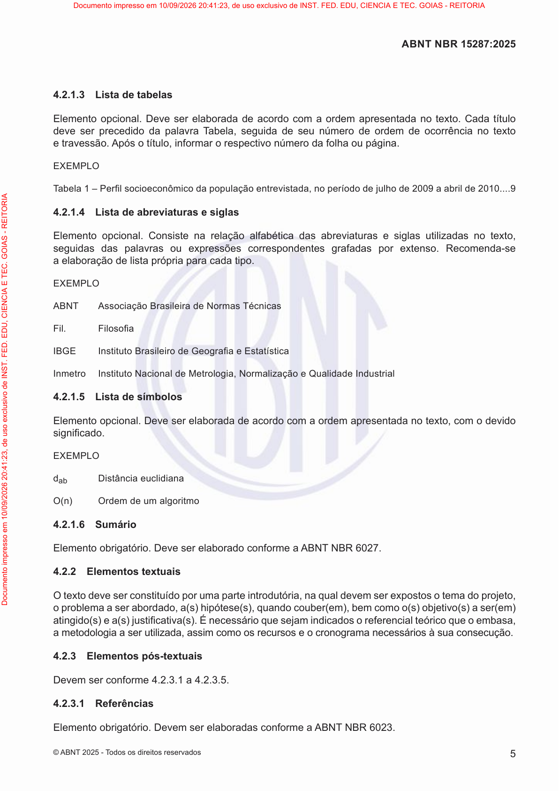

### Registro humano da página

- Comparado visualmente com o PDF: [ ] Sim [ ] Não — estado inicial: pendente.
- Revisor: ____________________
- Data: ____________________
- Número impresso confirmado: ____________________
- Transcrição necessária: [ ] Sim [ ] Não [ ] A definir
- Omissões, com extrator e localização: ____________________
- Inclusões, com extrator e localização: ____________________
- Erros numéricos, com extrator e localização: ____________________
- Erros estruturais, com extrator e localização: ____________________
- Observações: ____________________

**Transcrição humana, somente quando necessária:**

<!-- Campo humano em branco; não é saída de extrator. -->


### Indicadores históricos do snapshot

| Extrator | Registro da página | Execução | Processamento | Avaliação | Método de avaliação | Nota registrada | Revisão manual registrada | Conclusão não confirmada registrada |
|---|---:|---:|---|---|---|---|---|---|
| Leitor PDF | 153 | 10 | `success` | `pending` | `null` | `null` | `null` | `null` |
| Docling | 166 | 11 | `success` | `success` | `page_image` | `97.50` | `True` | `null` |
| GLM-OCR | 179 | 12 | `success` | `success` | `page_image` | `98.50` | `True` | `True` |


### Leitor PDF — texto completo

- Versão: `pypdf-6.18.1`.
- Registro de página: `153`; execução: `10`.
- SHA-256 do texto: `f4476255f965899c5e99240a61194a64f6e4ad6abbb04f9ca144f9e1888151ef`.
- [Abrir texto UTF-8 integral](pages/NBR15287_p0009/pdf_reader.txt).


```text
5
ABNT NBR 15287:2025
© ABNT 2025 - T odos os direitos reservados
4.2.1.3 Lista de tabelas
Elemento opcional. Deve ser elaborada de acordo com a ordem apresentada no texto. Cada título
deve ser precedido da palavra T abela, seguida de seu número de ordem de ocorrência no texto
e travessão. Após o título, informar o respectivo número da folha ou página.
EXEMPLO
T abela 1 – Perfil socioeconômico da população entrevistada, no período de julho de 2009 a abril de 2010....9
4.2.1.4 Lista de abreviaturas e siglas
Elemento opcional. Consiste na relação alfabética das abreviaturas e siglas utilizadas no texto,
seguidas das palavras ou expressões correspondentes grafadas por extenso. Recomenda-se
a elaboração de lista própria para cada tipo.
EXEMPLO
ABNT Associação Brasileira de Normas Técnicas
Fil. Filosofia
IBGE Instituto Brasileiro de Geografia e Estatística
Inmetro Instituto Nacional de Metrologia, Normalização e Qualidade Industrial
4.2.1.5 Lista de símbolos
Elemento opcional. Deve ser elaborada de acordo com a ordem apresentada no texto, com o devido
significado.
EXEMPLO
dab Distância euclidiana
O(n) Ordem de um algoritmo
4.2.1.6 Sumário
Elemento obrigatório. Deve ser elaborado conforme a ABNT NBR 6027.
4.2.2 Elementos textuais
O texto deve ser constituído por uma parte introdutória, na qual devem ser expostos o tema do projeto,
o problema a ser abordado, a(s) hipótese(s), quando couber(em), bem como o(s) objetivo(s) a ser(em)
atingido(s) e a(s) justificativa(s). É necessário que sejam indicados o referencial teórico que o embasa,
a metodologia a ser utilizada, assim como os recursos e o cronograma necessários à sua consecução.
4.2.3 Elementos pós-textuais
Devem ser conforme 4.2.3.1 a 4.2.3.5.
4.2.3.1 Referências
Elemento obrigatório. Devem ser elaboradas conforme a ABNT NBR 6023.
Documento impresso em 10/09/2026 20:41:23, de uso exclusivo de INST. FED. EDU, CIENCIA E TEC. GOIAS - REITORIA
Documento impresso em 10/09/2026 20:41:23, de uso exclusivo de INST. FED. EDU, CIENCIA E TEC. GOIAS - REITORIA
```


**Revisão humana de Leitor PDF — preencher:**

- Comparado ao PDF: [ ] Sim [ ] Não [ ] Pendente
- Omissões: ____________________
- Inclusões: ____________________
- Erros numéricos: ____________________
- Erros estruturais: ____________________
- Observações: ____________________

**Diagnóstico histórico completo, sem nova avaliação:**

```json
{
  "id": 153,
  "extraction_id": 10,
  "extractor": "pdf_reader",
  "extractor_version": "pypdf-6.18.1",
  "content_hash": "f4476255f965899c5e99240a61194a64f6e4ad6abbb04f9ca144f9e1888151ef",
  "text_sha256": "f4476255f965899c5e99240a61194a64f6e4ad6abbb04f9ca144f9e1888151ef",
  "markdown_sha256": "f4476255f965899c5e99240a61194a64f6e4ad6abbb04f9ca144f9e1888151ef",
  "processing_status": "success",
  "attempt_count": 1,
  "processing_time_ms": 61,
  "error_message": null,
  "structured_output": null,
  "quality_score": null,
  "quality_metrics": null,
  "evaluation_status": "pending",
  "evaluation_method": null,
  "evaluation_model": null,
  "evaluation_prompt_version": null,
  "evaluation_error": null,
  "evaluated_at": null,
  "historical_configuration": null,
  "historical_configuration_provenance": "not_persisted_in_extraction_schema"
}
```


### Docling — texto completo

- Versão: `docling-2.126.0`.
- Registro de página: `166`; execução: `11`.
- SHA-256 do texto: `f0dff118f23e9f49993e11af00a40676ca45376ccfc6dcdba509c7fbc3161af9`.
- [Abrir texto UTF-8 integral](pages/NBR15287_p0009/docling.txt).


```text
## 4.2.1.3 Lista de tabelas

Elemento opcional. Deve ser elaborada de acordo com a ordem apresentada no texto. Cada título deve ser precedido da palavra Tabela, seguida de seu número de ordem de ocorrência no texto e travessão. Após o título, informar o respectivo número da folha ou página.

EXEMPLO

Tabela 1 - Perfil socioeconômico da população entrevistada, no período de julho de 2009 a abril de 2010....9

## 4.2.1.4 Lista de abreviaturas e siglas

Elemento opcional. Consiste na relação alfabética das abreviaturas e siglas utilizadas no texto, seguidas das palavras ou expressões correspondentes grafadas por extenso. Recomenda-se a elaboração de lista própria para cada tipo.

EXEMPLO

ABNT Associação Brasileira de Normas Técnicas

Fil. Filosofia

IBGE

Instituto Brasileiro de Geografia e Estatística

Inmetro Instituto Nacional de Metrologia, Normalização e Qualidade Industrial

## 4.2.1.5 Lista de símbolos

Elemento opcional. Deve ser elaborada de acordo com a ordem apresentada no texto, com o devido significado.

EXEMPLO

- d ab Distância euclidiana
- O(n) Ordem de um algoritmo

## 4.2.1.6 Sumário

Elemento obrigatório. Deve ser elaborado conforme a ABNT NBR 6027.

## 4.2.2 Elementos textuais

Otexto deve ser constituído por uma parte introdutória, na qual devem ser expostos o tema do projeto, o problema a ser abordado, a(s) hipótese(s), quando couber(em), bem como o(s) objetivo(s) a ser(em) atingido(s) e a(s) justificativa(s). É necessário que sejam indicados o referencial teórico que o embasa, a metodologia a ser utilizada, assim como os recursos e o cronograma necessários à sua consecução.

## 4.2.3 Elementos pós-textuais

Devem ser conforme 4.2.3.1 a 4.2.3.5.

## 4.2.3.1 Referências

Elemento obrigatório. Devem ser elaboradas conforme a ABNT NBR 6023.

## ABNT NBR 15287:2025
```


**Revisão humana de Docling — preencher:**

- Comparado ao PDF: [ ] Sim [ ] Não [ ] Pendente
- Omissões: ____________________
- Inclusões: ____________________
- Erros numéricos: ____________________
- Erros estruturais: ____________________
- Observações: ____________________

**Diagnóstico histórico completo, sem nova avaliação:**

```json
{
  "id": 166,
  "extraction_id": 11,
  "extractor": "docling",
  "extractor_version": "docling-2.126.0",
  "content_hash": "f0dff118f23e9f49993e11af00a40676ca45376ccfc6dcdba509c7fbc3161af9",
  "text_sha256": "f0dff118f23e9f49993e11af00a40676ca45376ccfc6dcdba509c7fbc3161af9",
  "markdown_sha256": "f0dff118f23e9f49993e11af00a40676ca45376ccfc6dcdba509c7fbc3161af9",
  "processing_status": "success",
  "attempt_count": 1,
  "processing_time_ms": 12463,
  "error_message": null,
  "structured_output": null,
  "quality_score": "97.50",
  "quality_metrics": {
    "cer": 0.16946640316205533,
    "wer": 0.22903225806451613,
    "evaluation": {
      "scores": {
        "noise_control": 99,
        "reading_order": 98,
        "textual_fidelity": 95,
        "lists_preservation": 94,
        "duplication_control": 99,
        "tables_preservation": 100,
        "content_completeness": 80,
        "hallucination_control": 99,
        "numbers_and_references": 96,
        "structural_preservation": 97
      },
      "confidence": 100.0,
      "justification": "O texto fornecido é uma lista de seções e instruções de formatação (provavelmente de um manual de formatação ABNT), com exemplos de como listar tabelas, abreviaturas, símbolos e referências. O conteúdo principal que deveria ser extraído (os dados das tabelas, as listas completas, etc.) está ausente. A fidelidade é alta pois o texto extraído corresponde exatamente ao que foi fornecido, mas a completude é baixa porque os elementos solicitados (tabelas, listas) estão apenas descritos em formato de exemplo, e não contidos no corpo do texto.",
      "noise_control": 99,
      "overall_score": 97.5,
      "reading_order": 98,
      "missing_elements": [
        "O conteúdo real das tabelas, abreviaturas, símbolos e referências não foi fornecido no texto extraído, apenas os títulos e a estrutura de formatação."
      ],
      "textual_fidelity": 95,
      "incorrect_elements": [],
      "lists_preservation": 94,
      "duplicated_elements": [],
      "duplication_control": 99,
      "tables_preservation": 100,
      "content_completeness": 80,
      "hallucinated_elements": [],
      "hallucination_control": 99,
      "numbers_and_references": 96,
      "requires_manual_review": true,
      "structural_preservation": 97
    },
    "extracted_word_count": 272,
    "reference_word_count": 310,
    "normalized_similarity": 0.8305335968379447,
    "requires_manual_review": true,
    "extracted_character_count": 1811,
    "reference_character_count": 2024
  },
  "evaluation_status": "success",
  "evaluation_method": "page_image",
  "evaluation_model": "gemma4:e2b",
  "evaluation_prompt_version": "rag-page-evaluation-v1",
  "evaluation_error": null,
  "evaluated_at": "2026-09-15T17:46:36.056629-03:00",
  "historical_configuration": null,
  "historical_configuration_provenance": "not_persisted_in_extraction_schema"
}
```


### GLM-OCR — texto completo

- Versão: `glmocr-0.1.5`.
- Registro de página: `179`; execução: `12`.
- SHA-256 do texto: `96a68d91d61949bb3b84d3cc41454fcd05362acaed482ef43d573c66ffd86acd`.
- [Abrir texto UTF-8 integral](pages/NBR15287_p0009/glm_ocr.txt).


```text
4.2.1.3 Lista de tabelas

Elemento opcional. Deve ser elaborada de acordo com a ordem apresentada no texto. Cada título deve ser precedido da palavra Tabela, seguida de seu número de ordem de ocorrência no texto e travessão. Após o título, informar o respectivo número da folha ou página.

EXEMPLO

Tabela 1 – Perfil socioeconômico da população entrevistada, no período de julho de 2009 a abril de 2010….9

4.2.1.4 Lista de abreviaturas e siglas

Elemento opcional. Consiste na relação alfabética das abreviaturas e siglas utilizadas no texto, seguidas das palavras ou expressões correspondentes grafadas por extenso. Recomenda-se a elaboração de lista própria para cada tipo.

EXEMPLO

ABNT Associação Brasileira de Normas Técnicas

Fil. Filosofia

IBGE Instituto Brasileiro de Geografia e Estatística

Inmetro Instituto Nacional de Metrologia, Normalização e Qualidade Industrial

4.2.1.5 Lista de símbolos

Elemento opcional. Deve ser elaborada de acordo com a ordem apresentada no texto, com o devido significado.

EXEMPLO

$d_{ab}$ Distância euclidiana

O(n) Ordem de um algoritmo

4.2.1.6 Sumário

Elemento obrigatório. Deve ser elaborado conforme a ABNT NBR 6027.

4.2.2 Elementos textuais

O texto deve ser constituído por uma parte introdutória, na qual devem ser expostos o tema do projeto, o problema a ser abordado, a(s) hipótese(s), quando couber(em), bem como o(s) objetivo(s) a ser(em) atingido(s) e a(s) justificativa(s). É necessário que sejam indicados o referencial teórico que o embasa, a metodologia a ser utilizada, assim como os recursos e o cronograma necessários à sua consecução.

4.2.3 Elementos pós-textuais

Devem ser conforme 4.2.3.1 a 4.2.3.5.

4.2.3.1 Referências

Elemento obrigatório. Devem ser elaboradas conforme a ABNT NBR 6023.

© ABNT 2025 - Todos os direitos reservados
```


**Revisão humana de GLM-OCR — preencher:**

- Comparado ao PDF: [ ] Sim [ ] Não [ ] Pendente
- Omissões: ____________________
- Inclusões: ____________________
- Erros numéricos: ____________________
- Erros estruturais: ____________________
- Observações: ____________________

**Diagnóstico histórico completo, sem nova avaliação:**

```json
{
  "id": 179,
  "extraction_id": 12,
  "extractor": "glm_ocr",
  "extractor_version": "glmocr-0.1.5",
  "content_hash": "96a68d91d61949bb3b84d3cc41454fcd05362acaed482ef43d573c66ffd86acd",
  "text_sha256": "96a68d91d61949bb3b84d3cc41454fcd05362acaed482ef43d573c66ffd86acd",
  "markdown_sha256": "96a68d91d61949bb3b84d3cc41454fcd05362acaed482ef43d573c66ffd86acd",
  "processing_status": "success",
  "attempt_count": 1,
  "processing_time_ms": 10292,
  "error_message": null,
  "structured_output": {
    "completion_unconfirmed": true
  },
  "quality_score": "98.50",
  "quality_metrics": {
    "cer": 0.15612648221343872,
    "wer": 0.19032258064516128,
    "evaluation": {
      "scores": {
        "noise_control": 100,
        "reading_order": 100,
        "textual_fidelity": 100,
        "lists_preservation": 100,
        "duplication_control": 98,
        "tables_preservation": 70,
        "content_completeness": 95,
        "hallucination_control": 100,
        "numbers_and_references": 100,
        "structural_preservation": 100
      },
      "confidence": 100.0,
      "justification": "O texto extraído consiste em uma lista de seções e suas descrições estruturais (4.2.1.3 a 4.2.3.1), que definem os elementos pós-textuais de um trabalho acadêmico conforme as normas ABNT. O conteúdo real das tabelas, abreviaturas, símbolos e referências mencionados nos exemplos não está presente no texto extraído, apenas os modelos de como eles devem ser apresentados (Exemplo). Portanto, a fidelidade textual é alta para a estrutura fornecida, mas o conteúdo específico solicitado (tabelas, listas) está ausente.",
      "noise_control": 100,
      "overall_score": 98.5,
      "reading_order": 100,
      "missing_elements": [
        "O conteúdo real das tabelas, abreviaturas, símbolos e referências não foram fornecidos no texto extraído, apenas suas descrições."
      ],
      "textual_fidelity": 100,
      "incorrect_elements": [],
      "lists_preservation": 100,
      "duplicated_elements": [
        "A seção 4.2.1.3 é repetida com pequenas variações de formatação (ex: 'Lista de tabelas' vs 'Tabela')."
      ],
      "duplication_control": 98,
      "tables_preservation": 70,
      "content_completeness": 95,
      "hallucinated_elements": [],
      "hallucination_control": 100,
      "numbers_and_references": 100,
      "requires_manual_review": true,
      "structural_preservation": 100
    },
    "extracted_word_count": 267,
    "reference_word_count": 310,
    "normalized_similarity": 0.8438735177865613,
    "requires_manual_review": true,
    "extracted_character_count": 1809,
    "reference_character_count": 2024
  },
  "evaluation_status": "success",
  "evaluation_method": "page_image",
  "evaluation_model": "gemma4:e2b",
  "evaluation_prompt_version": "rag-page-evaluation-v1",
  "evaluation_error": null,
  "evaluated_at": "2026-09-15T17:48:30.417368-03:00",
  "historical_configuration": null,
  "historical_configuration_provenance": "not_persisted_in_extraction_schema"
}
```


<a id="nbr6023-p0005"></a>

## ABNT NBR 6023:2025 — página física 5

- Documento no snapshot: `16` / `abnt_nbr_6023`.
- SHA-256 do original: `0b2f5b6e93f07ecf5016fe400776da7534a1f0c7c9371ae99366e64d9107d05b`.
- Página impressa: candidato registrado `null`; confirmação humana em branco.

- Gold: registro `32`, extração `37`, método `glm_ocr`, versão na coluna Gold `2025`.
- Hash do documento Gold: `0f9a0993b0ae76baf93434e18971f4f0e21598115907f1210a44982c2beddd2a`.
- Índices de página Gold ativos: `[632]`.

[PDF da página](pages/NBR6023_p0005/original.pdf) · [Imagem em tamanho integral](pages/NBR6023_p0005/original.png) · [PDF original, página física 5](../../../../data/raw/NBR6023.pdf#page=5)

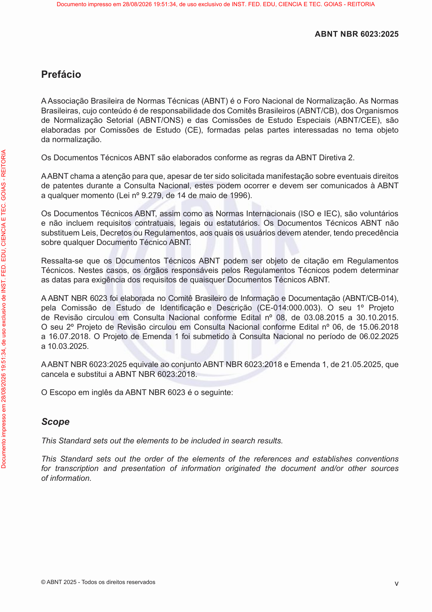

### Registro humano da página

- Comparado visualmente com o PDF: [ ] Sim [ ] Não — estado inicial: pendente.
- Revisor: ____________________
- Data: ____________________
- Número impresso confirmado: ____________________
- Transcrição necessária: [ ] Sim [ ] Não [ ] A definir
- Omissões, com extrator e localização: ____________________
- Inclusões, com extrator e localização: ____________________
- Erros numéricos, com extrator e localização: ____________________
- Erros estruturais, com extrator e localização: ____________________
- Observações: ____________________

**Transcrição humana, somente quando necessária:**

<!-- Campo humano em branco; não é saída de extrator. -->


### Indicadores históricos do snapshot

| Extrator | Registro da página | Execução | Processamento | Avaliação | Método de avaliação | Nota registrada | Revisão manual registrada | Conclusão não confirmada registrada |
|---|---:|---:|---|---|---|---|---|---|
| Leitor PDF | 224 | 16 | `success` | `pending` | `null` | `null` | `null` | `null` |
| Docling | 298 | 17 | `success` | `success` | `deterministic_fallback` | `50.00` | `True` | `null` |
| GLM-OCR | 785 | 37 | `success` | `success` | `deterministic_fallback` | `50.00` | `True` | `True` |


### Leitor PDF — texto completo

- Versão: `pypdf-6.18.1`.
- Registro de página: `224`; execução: `16`.
- SHA-256 do texto: `1c31acc33da6268bc03c4dbe474324f9ee37b668c1b9cecd0b3603f39fa2e959`.
- [Abrir texto UTF-8 integral](pages/NBR6023_p0005/pdf_reader.txt).


```text
Prefácio
A Associação Brasileira de Normas Técnicas (ABNT) é o Foro Nacional de Normalização. As Normas
Baa,aaCBa(BNT/CB),Oa
NaaSa(BNT/ONS) aC EEa(BNT/CEE),
aaa C E(CE),aa a a aa  a
da normalização.
ODTBNT aa a a aBNT Da 2.
BNTaa a aaa, aaaaaaa
de patentesaa Ca Naa,      a  BNT
aa (L º 9.279,14 a 1996).
ODT BNT , a aNaIaa(ISOIEC), 
    aa,a  a. ODT BNT
L, DRa, aaa,a
 aDTBNT .
Raa-  DT BNT    a Ra
T. N a,   RaT  a
a aa aaa   aDTBNT .
BNT NBR 6023 aaaCBa Ia Da(BNT/CB-014),
a C E Ifia D(CE-014:000.003).O1º P
R  Ca Naa Ea º 08,03.08.2015 a 30.10.2015.
O2º P R  Ca Naa Ea º 06,15.06.2018
a 16.07.2018. O P Ea 1  Ca Naa   06.02.2025
a 10.03.2025.
BNT NBR 6023:2025aa BNT NBR 6023:2018Ea 1,21.05.2025,
cancela e substitui a ABNT NBR 6023:2018.
O E   aBNT NBR 6023  :
Scope
This Standard sets out the elements to be included in search results.
This Standard sets out the order of the elements of the references and establishes conventions
for transcription and presentation of information originated the document and/or other sources
of information.
v
ABNT NBR 6023:2025
©BNT 2025 - T   a
Documento impresso em 28/08/2026 19:51:34, de uso exclusivo de INST. FED. EDU, CIENCIA E TEC. GOIAS - REITORIA
Documento impresso em 28/08/2026 19:51:34, de uso exclusivo de INST. FED. EDU, CIENCIA E TEC. GOIAS - REITORIA
```


**Revisão humana de Leitor PDF — preencher:**

- Comparado ao PDF: [ ] Sim [ ] Não [ ] Pendente
- Omissões: ____________________
- Inclusões: ____________________
- Erros numéricos: ____________________
- Erros estruturais: ____________________
- Observações: ____________________

**Diagnóstico histórico completo, sem nova avaliação:**

```json
{
  "id": 224,
  "extraction_id": 16,
  "extractor": "pdf_reader",
  "extractor_version": "pypdf-6.18.1",
  "content_hash": "1c31acc33da6268bc03c4dbe474324f9ee37b668c1b9cecd0b3603f39fa2e959",
  "text_sha256": "1c31acc33da6268bc03c4dbe474324f9ee37b668c1b9cecd0b3603f39fa2e959",
  "markdown_sha256": "1c31acc33da6268bc03c4dbe474324f9ee37b668c1b9cecd0b3603f39fa2e959",
  "processing_status": "success",
  "attempt_count": 1,
  "processing_time_ms": 63,
  "error_message": null,
  "structured_output": null,
  "quality_score": null,
  "quality_metrics": null,
  "evaluation_status": "pending",
  "evaluation_method": null,
  "evaluation_model": null,
  "evaluation_prompt_version": null,
  "evaluation_error": null,
  "evaluated_at": null,
  "historical_configuration": null,
  "historical_configuration_provenance": "not_persisted_in_extraction_schema"
}
```


### Docling — texto completo

- Versão: `docling-2.126.0`.
- Registro de página: `298`; execução: `17`.
- SHA-256 do texto: `13987a57b1b1eb829719f74ac16f7ca9d01ff5442e3cf738855426614e6b7eb9`.
- [Abrir texto UTF-8 integral](pages/NBR6023_p0005/docling.txt).


```text
## Prefácio

AAssociação Brasileira de Normas Técnicas (ABNT) é o Foro Nacional de Normalização. As Normas B  a  a  ,      a  a   C  B  a  (  BNT/CB),  O  a   N  a  a  S  a  (  BNT/ONS)   a  C   E  E  a  (  BNT/CEE),   a  a  a   C   E  (CE),  a  a   a   a   a  a    a  da normalização.

O  D  T   BNT   a  a   a   a   a  BNT D  a 2.

 BNT  a  a a a   a  a  , a  a      a  a  a  a    a   de patentes  a  a C  a Na  a  ,        a    BNT a  a   (L   º 9.279,  14   a   1996).

O  D  T   BNT, a   a  N  a  I  a  a  (ISO  IEC),        a  a  ,  a    a  . O  D  T   BNT   L  , D   R  a  , a   a     a  ,   a   a  D  T   BNT.

R  a  a-   D  T   BNT      a   R  a  T  . N   a  ,     R  a  T    a  a   a  a   a  a  a     a  D  T   BNT.

 BNT NBR 6023   a  a  a  C  B  a   I  a   D  a  (  BNT/CB-014),  a C   E   I fi a   D  (CE-014:000.003) . O  1º P   R    C  a Na  a   E  a   º 08,  03.08.2015 a 30.10.2015. O  2º P   R    C  a Na  a   E  a   º 06,  15.06.2018 a 16.07.2018. O P   E  a 1    C  a Na  a     06.02.2025 a 10.03.2025.

 BNT NBR 6023:2025  a  a    BNT NBR 6023:2018  E  a 1,  21.05.2025,  cancela e substitui a ABNT NBR 6023:20 1 8.

O E     a  BNT NBR 6023    :

## Scope

This Standard sets out the elements to be included in search results.

This Standard sets out the order of the elements of the references and establishes conventions for transcription and presentation of information originated the document and/or other sources of information.

## ABNT NBR 6023:2025
```


**Revisão humana de Docling — preencher:**

- Comparado ao PDF: [ ] Sim [ ] Não [ ] Pendente
- Omissões: ____________________
- Inclusões: ____________________
- Erros numéricos: ____________________
- Erros estruturais: ____________________
- Observações: ____________________

**Diagnóstico histórico completo, sem nova avaliação:**

```json
{
  "id": 298,
  "extraction_id": 17,
  "extractor": "docling",
  "extractor_version": "docling-2.126.0",
  "content_hash": "13987a57b1b1eb829719f74ac16f7ca9d01ff5442e3cf738855426614e6b7eb9",
  "text_sha256": "13987a57b1b1eb829719f74ac16f7ca9d01ff5442e3cf738855426614e6b7eb9",
  "markdown_sha256": "13987a57b1b1eb829719f74ac16f7ca9d01ff5442e3cf738855426614e6b7eb9",
  "processing_status": "success",
  "attempt_count": 1,
  "processing_time_ms": 12513,
  "error_message": null,
  "structured_output": null,
  "quality_score": "50.00",
  "quality_metrics": {
    "cer": 0.2916321458160729,
    "wer": 2.076923076923077,
    "evaluation": {
      "scores": {
        "noise_control": 50.0,
        "reading_order": 50.0,
        "textual_fidelity": 50.0,
        "lists_preservation": 50.0,
        "duplication_control": 50.0,
        "tables_preservation": 50.0,
        "content_completeness": 50.0,
        "hallucination_control": 50.0,
        "numbers_and_references": 50.0,
        "structural_preservation": 50.0
      },
      "confidence": 0.0,
      "justification": "Fallback determinístico: o modelo avaliador não retornou JSON válido. A página precisa de revisão manual.",
      "overall_score": 50.0,
      "fallback_error": "[WinError 10061] Nenhuma conexão pôde ser feita porque a máquina de destino as recusou ativamente",
      "missing_elements": [],
      "incorrect_elements": [],
      "duplicated_elements": [],
      "hallucinated_elements": [],
      "requires_manual_review": true
    },
    "extracted_word_count": 609,
    "reference_word_count": 260,
    "normalized_similarity": 0.725,
    "requires_manual_review": true,
    "extracted_character_count": 2560,
    "reference_character_count": 2414
  },
  "evaluation_status": "success",
  "evaluation_method": "deterministic_fallback",
  "evaluation_model": "gemma4:e2b",
  "evaluation_prompt_version": "rag-page-evaluation-v1",
  "evaluation_error": null,
  "evaluated_at": "2026-09-15T22:50:45.902180-03:00",
  "historical_configuration": null,
  "historical_configuration_provenance": "not_persisted_in_extraction_schema"
}
```


### GLM-OCR — texto completo

- Versão: `glmocr-0.1.5`.
- Registro de página: `785`; execução: `37`.
- SHA-256 do texto: `2652cec2cb0c47dcd9bf8b42369583285ca000597c59f489cb1e367cf426d380`.
- [Abrir texto UTF-8 integral](pages/NBR6023_p0005/glm_ocr.txt).


```text
Prefácio

A Associação Brasileira de Normas Técnicas (ABNT) é o Foro Nacional de Normalização. As Normas Brasileiras, cujo conteúdo é de responsabilidade dos Comitês Brasileiros (ABNT/CB), dos Organismos de Normalização Setorial (ABNT/ONS) e das Comissões de Estudo Especialis (ABNT/CEE), são elaboradas por Comissões de Estudo (CE), formadas pelas partes interessadas no tema objeto da normalização.

Os Documentos Técnicos ABNT são elaborados conforme as regras da ABNT Diretiva 2.

AABNT chama a atenção para que, apesar de ter sido solicitada manifestação sobre eventuais direitos de patentes durante a Consulta Nacional, estes podem ocorrer e devem ser comunicados à ABNT a qualquer momento (Lei nº 9.279, de 14 de maio de 1996).

Os Documentos Técnicos ABNT, assim como as Normas Internacionais (ISO e IEC), são voluntários e não incluem requisitos contratuais, legais ou estatutários. Os Documentos Técnicos ABNT não substituem Leis, Decretos ou Regulamentos, aos quais os usuários devem atender, tendo precedência sobre qualquer Documento Técnico ABNT.

Ressalta-se que os Documentos Técnicos ABNT podem ser objeto de citação em Regulamentos Técnicos. Nestes casos, os órgãos responsáveis pelos Regulamentos Técnicos podem determinar as datas para exigência dos requisitos de quaisquer Documentos Técnicos ABNT.

A ABNT NBR 6023 foi elaborada no Comitê Brasileiro de Informação e Documentação (ABNT/CB-014), pela Comissão de Estudo de Identificação e Descrição (CE-014:000.003). O seu 1º Projeto de Revisão circulou em Consulta Nacional conforme Edital nº 08, de 03.08.2015 a 30.10.2015. O seu 2º Projeto de Revisão circulou em Consulta Nacional conforme Edital nº 06, de 15.06.2018 a 16.07.2018. O Projeto de Emenda 1 foi submetido à Consulta Nacional no período de 06.02.2025 a 10.03.2025.

AABNT NBR 6023:2025 equivale ao conjunto ABNT NBR 6023:2018 e Emenda 1, de 21.05.2025, que cancela e substitui a ABNT NBR 6023:2018.

O Escopo em inglês da ABNT NBR 6023 é o seguinte:

Scope

This Standard sets out the elements to be included in search results.

This Standard sets out the order of the elements of the references and establishes conventions for transcription and presentation of information originated the document and/or other sources of information.
```


**Revisão humana de GLM-OCR — preencher:**

- Comparado ao PDF: [ ] Sim [ ] Não [ ] Pendente
- Omissões: ____________________
- Inclusões: ____________________
- Erros numéricos: ____________________
- Erros estruturais: ____________________
- Observações: ____________________

**Diagnóstico histórico completo, sem nova avaliação:**

```json
{
  "id": 785,
  "extraction_id": 37,
  "extractor": "glm_ocr",
  "extractor_version": "glmocr-0.1.5",
  "content_hash": "2652cec2cb0c47dcd9bf8b42369583285ca000597c59f489cb1e367cf426d380",
  "text_sha256": "2652cec2cb0c47dcd9bf8b42369583285ca000597c59f489cb1e367cf426d380",
  "markdown_sha256": "2652cec2cb0c47dcd9bf8b42369583285ca000597c59f489cb1e367cf426d380",
  "processing_status": "success",
  "attempt_count": 1,
  "processing_time_ms": 11312,
  "error_message": null,
  "structured_output": {
    "completion_unconfirmed": true
  },
  "quality_score": "50.00",
  "quality_metrics": {
    "cer": 0.6354598177299089,
    "wer": 1.1730769230769231,
    "evaluation": {
      "scores": {
        "noise_control": 50.0,
        "reading_order": 50.0,
        "textual_fidelity": 50.0,
        "lists_preservation": 50.0,
        "duplication_control": 50.0,
        "tables_preservation": 50.0,
        "content_completeness": 50.0,
        "hallucination_control": 50.0,
        "numbers_and_references": 50.0,
        "structural_preservation": 50.0
      },
      "confidence": 0.0,
      "justification": "Fallback determinístico: o modelo avaliador não retornou JSON válido. A página precisa de revisão manual.",
      "overall_score": 50.0,
      "fallback_error": "[WinError 10061] Nenhuma conexão pôde ser feita porque a máquina de destino as recusou ativamente",
      "missing_elements": [],
      "incorrect_elements": [],
      "duplicated_elements": [],
      "hallucinated_elements": [],
      "requires_manual_review": true
    },
    "extracted_word_count": 340,
    "reference_word_count": 260,
    "normalized_similarity": 0.3645401822700911,
    "requires_manual_review": true,
    "extracted_character_count": 2269,
    "reference_character_count": 2414
  },
  "evaluation_status": "success",
  "evaluation_method": "deterministic_fallback",
  "evaluation_model": "gemma4:e2b",
  "evaluation_prompt_version": "rag-page-evaluation-v1",
  "evaluation_error": null,
  "evaluated_at": "2026-09-15T22:53:37.698017-03:00",
  "historical_configuration": null,
  "historical_configuration_provenance": "not_persisted_in_extraction_schema"
}
```


<a id="nbr6023-p0006"></a>

## ABNT NBR 6023:2025 — página física 6

- Documento no snapshot: `16` / `abnt_nbr_6023`.
- SHA-256 do original: `0b2f5b6e93f07ecf5016fe400776da7534a1f0c7c9371ae99366e64d9107d05b`.
- Página impressa: candidato registrado `null`; confirmação humana em branco.

- Gold: registro `32`, extração `37`, método `glm_ocr`, versão na coluna Gold `2025`.
- Hash do documento Gold: `0f9a0993b0ae76baf93434e18971f4f0e21598115907f1210a44982c2beddd2a`.
- Índices de página Gold ativos: `[586]`.

[PDF da página](pages/NBR6023_p0006/original.pdf) · [Imagem em tamanho integral](pages/NBR6023_p0006/original.png) · [PDF original, página física 6](../../../../data/raw/NBR6023.pdf#page=6)

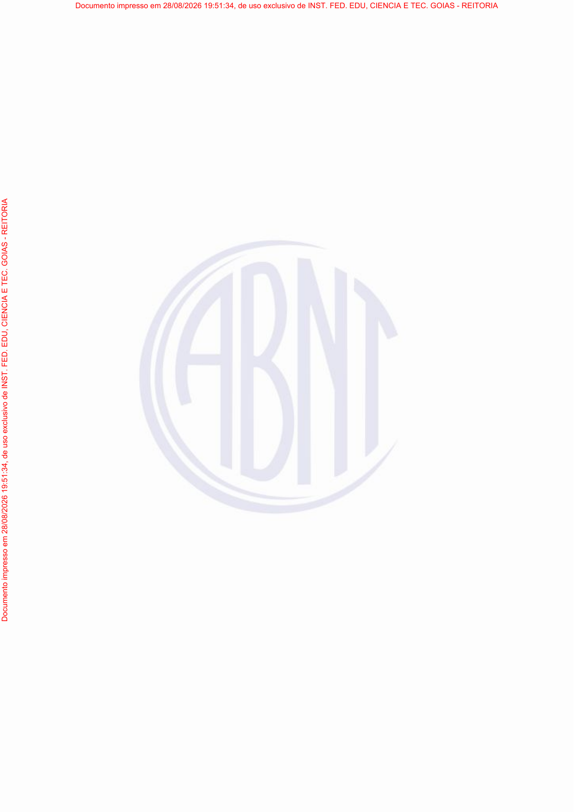

### Registro humano da página

- Comparado visualmente com o PDF: [ ] Sim [ ] Não — estado inicial: pendente.
- Revisor: ____________________
- Data: ____________________
- Número impresso confirmado: ____________________
- Transcrição necessária: [ ] Sim [ ] Não [ ] A definir
- Omissões, com extrator e localização: ____________________
- Inclusões, com extrator e localização: ____________________
- Erros numéricos, com extrator e localização: ____________________
- Erros estruturais, com extrator e localização: ____________________
- Observações: ____________________

**Transcrição humana, somente quando necessária:**

<!-- Campo humano em branco; não é saída de extrator. -->


### Indicadores históricos do snapshot

| Extrator | Registro da página | Execução | Processamento | Avaliação | Método de avaliação | Nota registrada | Revisão manual registrada | Conclusão não confirmada registrada |
|---|---:|---:|---|---|---|---|---|---|
| Leitor PDF | 225 | 16 | `success` | `pending` | `null` | `null` | `null` | `null` |
| Docling | 299 | 17 | `success` | `success` | `page_image` | `100.00` | `False` | `null` |
| GLM-OCR | 786 | 37 | `success` | `success` | `page_image` | `100.00` | `False` | `null` |


### Leitor PDF — texto completo

- Versão: `pypdf-6.18.1`.
- Registro de página: `225`; execução: `16`.
- SHA-256 do texto: `b158eedffe9199ab124ff77f0e4ae9d7729d0fc93e2f22e2554ba38cfc33d873`.
- [Abrir texto UTF-8 integral](pages/NBR6023_p0006/pdf_reader.txt).


```text
Documento impresso em 28/08/2026 19:51:34, de uso exclusivo de INST. FED. EDU, CIENCIA E TEC. GOIAS - REITORIA
Documento impresso em 28/08/2026 19:51:34, de uso exclusivo de INST. FED. EDU, CIENCIA E TEC. GOIAS - REITORIA
```


**Revisão humana de Leitor PDF — preencher:**

- Comparado ao PDF: [ ] Sim [ ] Não [ ] Pendente
- Omissões: ____________________
- Inclusões: ____________________
- Erros numéricos: ____________________
- Erros estruturais: ____________________
- Observações: ____________________

**Diagnóstico histórico completo, sem nova avaliação:**

```json
{
  "id": 225,
  "extraction_id": 16,
  "extractor": "pdf_reader",
  "extractor_version": "pypdf-6.18.1",
  "content_hash": "b158eedffe9199ab124ff77f0e4ae9d7729d0fc93e2f22e2554ba38cfc33d873",
  "text_sha256": "b158eedffe9199ab124ff77f0e4ae9d7729d0fc93e2f22e2554ba38cfc33d873",
  "markdown_sha256": "b158eedffe9199ab124ff77f0e4ae9d7729d0fc93e2f22e2554ba38cfc33d873",
  "processing_status": "success",
  "attempt_count": 1,
  "processing_time_ms": 55,
  "error_message": null,
  "structured_output": null,
  "quality_score": null,
  "quality_metrics": null,
  "evaluation_status": "pending",
  "evaluation_method": null,
  "evaluation_model": null,
  "evaluation_prompt_version": null,
  "evaluation_error": null,
  "evaluated_at": null,
  "historical_configuration": null,
  "historical_configuration_provenance": "not_persisted_in_extraction_schema"
}
```


### Docling — texto completo

- Versão: `docling-2.126.0`.
- Registro de página: `299`; execução: `17`.
- SHA-256 do texto: `98143e7d5d11a8e8b027c651875118ce52919dd8fdeece24df0989be34c1ee75`.
- [Abrir texto UTF-8 integral](pages/NBR6023_p0006/docling.txt).


```text
Documento impresso em 28/08/2026 19:51:34, de uso exclusivo de INST. FED. EDU, CIENCIA E TEC. GOIAS - REITORIA

<!-- image -->
```


**Revisão humana de Docling — preencher:**

- Comparado ao PDF: [ ] Sim [ ] Não [ ] Pendente
- Omissões: ____________________
- Inclusões: ____________________
- Erros numéricos: ____________________
- Erros estruturais: ____________________
- Observações: ____________________

**Diagnóstico histórico completo, sem nova avaliação:**

```json
{
  "id": 299,
  "extraction_id": 17,
  "extractor": "docling",
  "extractor_version": "docling-2.126.0",
  "content_hash": "98143e7d5d11a8e8b027c651875118ce52919dd8fdeece24df0989be34c1ee75",
  "text_sha256": "98143e7d5d11a8e8b027c651875118ce52919dd8fdeece24df0989be34c1ee75",
  "markdown_sha256": "98143e7d5d11a8e8b027c651875118ce52919dd8fdeece24df0989be34c1ee75",
  "processing_status": "success",
  "attempt_count": 1,
  "processing_time_ms": 6741,
  "error_message": null,
  "structured_output": null,
  "quality_score": "100.00",
  "quality_metrics": {
    "cer": 0.47058823529411764,
    "wer": 0.5,
    "evaluation": {
      "scores": {
        "noise_control": 100,
        "reading_order": 100,
        "textual_fidelity": 100,
        "lists_preservation": null,
        "duplication_control": 100,
        "tables_preservation": 100,
        "content_completeness": 100,
        "hallucination_control": 100,
        "numbers_and_references": 100,
        "structural_preservation": 100
      },
      "confidence": 100.0,
      "justification": "A extração fornecida é uma cópia exata do texto nativo auxiliar, que é o conteúdo da imagem. A fidelidade textual e a preservação da estrutura são perfeitas.",
      "noise_control": 100,
      "overall_score": 100.0,
      "reading_order": 100,
      "missing_elements": null,
      "textual_fidelity": 100,
      "incorrect_elements": null,
      "lists_preservation": null,
      "duplicated_elements": null,
      "duplication_control": 100,
      "tables_preservation": 100,
      "content_completeness": 100,
      "hallucinated_elements": null,
      "hallucination_control": 100,
      "numbers_and_references": 100,
      "requires_manual_review": false,
      "structural_preservation": 100
    },
    "extracted_word_count": 21,
    "reference_word_count": 36,
    "normalized_similarity": 0.5294117647058824,
    "requires_manual_review": false,
    "extracted_character_count": 126,
    "reference_character_count": 221
  },
  "evaluation_status": "success",
  "evaluation_method": "page_image",
  "evaluation_model": "gemma4:e2b",
  "evaluation_prompt_version": "rag-page-evaluation-v1",
  "evaluation_error": null,
  "evaluated_at": "2026-09-15T17:53:24.660184-03:00",
  "historical_configuration": null,
  "historical_configuration_provenance": "not_persisted_in_extraction_schema"
}
```


### GLM-OCR — texto completo

- Versão: `glmocr-0.1.5`.
- Registro de página: `786`; execução: `37`.
- SHA-256 do texto: `e3b0c44298fc1c149afbf4c8996fb92427ae41e4649b934ca495991b7852b855`.
- [Abrir texto UTF-8 integral](pages/NBR6023_p0006/glm_ocr.txt).

**A string de texto deste extrator está vazia no snapshot. O arquivo de zero bytes foi preservado.**

```text

```


**Revisão humana de GLM-OCR — preencher:**

- Comparado ao PDF: [ ] Sim [ ] Não [ ] Pendente
- Omissões: ____________________
- Inclusões: ____________________
- Erros numéricos: ____________________
- Erros estruturais: ____________________
- Observações: ____________________

**Diagnóstico histórico completo, sem nova avaliação:**

```json
{
  "id": 786,
  "extraction_id": 37,
  "extractor": "glm_ocr",
  "extractor_version": "glmocr-0.1.5",
  "content_hash": "e3b0c44298fc1c149afbf4c8996fb92427ae41e4649b934ca495991b7852b855",
  "text_sha256": "e3b0c44298fc1c149afbf4c8996fb92427ae41e4649b934ca495991b7852b855",
  "markdown_sha256": "e3b0c44298fc1c149afbf4c8996fb92427ae41e4649b934ca495991b7852b855",
  "processing_status": "success",
  "attempt_count": 1,
  "processing_time_ms": 49,
  "error_message": null,
  "structured_output": null,
  "quality_score": "100.00",
  "quality_metrics": {
    "cer": 1.0,
    "wer": 1.0,
    "evaluation": {
      "scores": {
        "noise_control": 100,
        "reading_order": 100,
        "textual_fidelity": 100,
        "lists_preservation": null,
        "duplication_control": 100,
        "tables_preservation": null,
        "content_completeness": 100,
        "hallucination_control": 100,
        "numbers_and_references": null,
        "structural_preservation": 100
      },
      "confidence": 100.0,
      "justification": "A extração fornecida consiste apenas em texto nativo auxiliar repetido duas vezes. A fidelidade textual é perfeita para o texto fornecido.",
      "noise_control": 100,
      "overall_score": 100.0,
      "reading_order": 100,
      "missing_elements": null,
      "textual_fidelity": 100,
      "incorrect_elements": null,
      "lists_preservation": null,
      "duplicated_elements": null,
      "duplication_control": 100,
      "tables_preservation": null,
      "content_completeness": 100,
      "hallucinated_elements": null,
      "hallucination_control": 100,
      "numbers_and_references": null,
      "requires_manual_review": false,
      "structural_preservation": 100
    },
    "extracted_word_count": 0,
    "reference_word_count": 36,
    "normalized_similarity": 0.0,
    "requires_manual_review": false,
    "extracted_character_count": 0,
    "reference_character_count": 221
  },
  "evaluation_status": "success",
  "evaluation_method": "page_image",
  "evaluation_model": "gemma4:e2b",
  "evaluation_prompt_version": "rag-page-evaluation-v1",
  "evaluation_error": null,
  "evaluated_at": "2026-09-15T17:50:30.700209-03:00",
  "historical_configuration": null,
  "historical_configuration_provenance": "not_persisted_in_extraction_schema"
}
```


<a id="nbr6023-p0021"></a>

## ABNT NBR 6023:2025 — página física 21

- Documento no snapshot: `16` / `abnt_nbr_6023`.
- SHA-256 do original: `0b2f5b6e93f07ecf5016fe400776da7534a1f0c7c9371ae99366e64d9107d05b`.
- Página impressa: candidato registrado `null`; confirmação humana em branco.

- Gold: registro `32`, extração `37`, método `glm_ocr`, versão na coluna Gold `2025`.
- Hash do documento Gold: `0f9a0993b0ae76baf93434e18971f4f0e21598115907f1210a44982c2beddd2a`.
- Índices de página Gold ativos: `[605]`.

[PDF da página](pages/NBR6023_p0021/original.pdf) · [Imagem em tamanho integral](pages/NBR6023_p0021/original.png) · [PDF original, página física 21](../../../../data/raw/NBR6023.pdf#page=21)

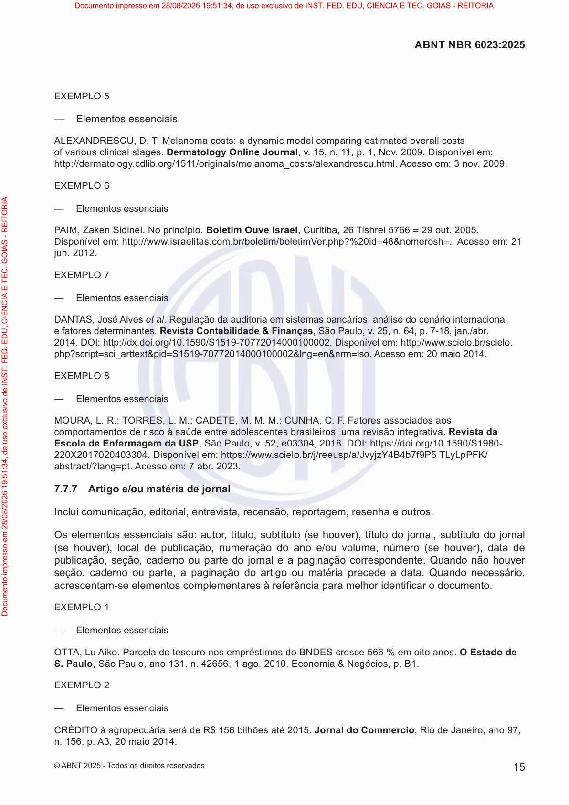

### Registro humano da página

- Comparado visualmente com o PDF: [ ] Sim [ ] Não — estado inicial: pendente.
- Revisor: ____________________
- Data: ____________________
- Número impresso confirmado: ____________________
- Transcrição necessária: [ ] Sim [ ] Não [ ] A definir
- Omissões, com extrator e localização: ____________________
- Inclusões, com extrator e localização: ____________________
- Erros numéricos, com extrator e localização: ____________________
- Erros estruturais, com extrator e localização: ____________________
- Observações: ____________________

**Transcrição humana, somente quando necessária:**

<!-- Campo humano em branco; não é saída de extrator. -->


### Indicadores históricos do snapshot

| Extrator | Registro da página | Execução | Processamento | Avaliação | Método de avaliação | Nota registrada | Revisão manual registrada | Conclusão não confirmada registrada |
|---|---:|---:|---|---|---|---|---|---|
| Leitor PDF | 240 | 16 | `success` | `pending` | `null` | `null` | `null` | `null` |
| Docling | 314 | 17 | `success` | `success` | `page_image` | `98.50` | `False` | `null` |
| GLM-OCR | 801 | 37 | `success` | `success` | `deterministic_fallback` | `50.00` | `True` | `True` |


### Leitor PDF — texto completo

- Versão: `pypdf-6.18.1`.
- Registro de página: `240`; execução: `16`.
- SHA-256 do texto: `786b42eb6167162554d6b7e65f4dc9841522221f6634dc2ac048d4ff12a12572`.
- [Abrir texto UTF-8 integral](pages/NBR6023_p0021/pdf_reader.txt).


```text
EXEMPLO 5
—E a
LEXNDRESCU, D. T . Maa: aya  a a a 
 a a a.Dermatology Online Journal,. 15,. 11,. 1, N. 2009. D :
://ay../1511/a/aa_/aa.. : 3. 2009.
EXEMPLO 6
—E a
PIM, ZaS. N .Boletim Ouve Israel, Ca, 26 T5766=29. 2005.
D :://www.aa..//V.?%20=48&=. Acesso em: 21
. 2012.
EXEMPLO 7
—E a
DNTS, Jet al. Regulação da auditoria em sistemas bancários: análise do cenário internacional
 a a.Revista Contabilidade & Finanças, SPa,. 25,. 64,. 7-18,a./a.
2014.DOI:://../10.1590/S1519-70772014000100002. D :://www../.
?=_a&=S1519-70772014000100002&=&=iso. Acesso em: 20 maio 2014.
EXEMPLO 8
—E a
MOUR, L. R.; TORRES, L. M.; CDETE, M. M. M.; CUNH, C. F . Faaaa
a    a a a:a aa.Revista da
Escola de Enfermagem da USP, SPa,. 52,03304, 2018. DOI:://./10.1590/S1980-
220X2017020403304. D :://www..///a/JyY4B479P5 TLyLPFK/
aa/?a=. : 7 a. 2023.
7.7.7 Artigo e/ou matéria de jornal
I a,a,a,,a,a .
O  a : a,,( ),  a,  a
( ),a  a,a a / ,( ),data de
a,,a parte doa aaa . Qa  
,a  a, aaa artigo ou matéria precede aaa. Qa ,
aa-  a  aaa fia documento.
EXEMPLO 1
—E a
OTT, L . Paa    BNDES566 % a.O Estado de
S. Paulo, SPa, a131,. 42656, 1 a. 2010. Ea & N,. B1.
EXEMPLO 2
—E a
CRÉDITOaa R$ 156a2015.Jornal do Commercio, R Ja, a97,
. 156,.3, 20a2014.
15
ABNT NBR 6023:2025
©BNT 2025 - T   a
Documento impresso em 28/08/2026 19:51:34, de uso exclusivo de INST. FED. EDU, CIENCIA E TEC. GOIAS - REITORIA
Documento impresso em 28/08/2026 19:51:34, de uso exclusivo de INST. FED. EDU, CIENCIA E TEC. GOIAS - REITORIA
```


**Revisão humana de Leitor PDF — preencher:**

- Comparado ao PDF: [ ] Sim [ ] Não [ ] Pendente
- Omissões: ____________________
- Inclusões: ____________________
- Erros numéricos: ____________________
- Erros estruturais: ____________________
- Observações: ____________________

**Diagnóstico histórico completo, sem nova avaliação:**

```json
{
  "id": 240,
  "extraction_id": 16,
  "extractor": "pdf_reader",
  "extractor_version": "pypdf-6.18.1",
  "content_hash": "786b42eb6167162554d6b7e65f4dc9841522221f6634dc2ac048d4ff12a12572",
  "text_sha256": "786b42eb6167162554d6b7e65f4dc9841522221f6634dc2ac048d4ff12a12572",
  "markdown_sha256": "786b42eb6167162554d6b7e65f4dc9841522221f6634dc2ac048d4ff12a12572",
  "processing_status": "success",
  "attempt_count": 1,
  "processing_time_ms": 66,
  "error_message": null,
  "structured_output": null,
  "quality_score": null,
  "quality_metrics": null,
  "evaluation_status": "pending",
  "evaluation_method": null,
  "evaluation_model": null,
  "evaluation_prompt_version": null,
  "evaluation_error": null,
  "evaluated_at": null,
  "historical_configuration": null,
  "historical_configuration_provenance": "not_persisted_in_extraction_schema"
}
```


### Docling — texto completo

- Versão: `docling-2.126.0`.
- Registro de página: `314`; execução: `17`.
- SHA-256 do texto: `950cd2a71f0467c9e2cf3cf730a2c0f062d6f68481698c2104a5dc984fbb5ddf`.
- [Abrir texto UTF-8 integral](pages/NBR6023_p0021/docling.txt).


```text
## EXEMPLO 5

- E   a 

 LEX  NDRESCU, D. T. M  a  a  : a  y  a    a   a   a     a   a   a  . Dermatology Online Journal ,  . 15,  . 11,  . 1, N  . 2009. D   :  ://  a  y.  .  /1511/  a  /  a  a\_  /a  a  .  .   : 3  . 2009.

## EXEMPLO 6

- E   a 

P  IM, Za  S  . N   . Boletim Ouve Israel , C  a, 26 T  5766 = 29  . 2005. D   :  ://www.  a  a  .  .  /  /  V  .  ?%20  = 48&amp;  = . Acesso em: 21  . 2012.

## EXEMPLO 7

- E   a 

D  NT  S, J   et al . Regulação da auditoria em sistemas bancários: análise do cenário internacional   a   a  . Revista Contabilidade &amp; Finanças , S  Pa  ,  . 25,  . 64,  . 7-18,  a  ./a  . 2014. DOI:  ://  .  .  /10.1590/S1519-70772014000100002. D   :  ://www.  .  /  .  ?  =  \_a  &amp;  = S1519-70772014000100002&amp;  =  &amp;  = iso. Acesso em: 20 maio 2014.

## EXEMPLO 8

- E   a 

MOUR  , L. R.; TORRES, L. M.; C  DETE, M. M. M.; CUNH  , C. F. Fa  a  a  a   a      a   a   a  :  a   a  a. Revista da Escola de Enfermagem da USP , S  Pa  ,  . 52,  03304, 2018. DOI:  ://  .  /10.1590/S1980220X2017020403304. D   :  ://www.  .  /  /  /a/J  y  Y4B4  7  9P5 TLyL  PFK/ a  a  /?  a  =  .   : 7 a  . 2023.

## 7.7.7 Artigo e/ou matéria de jornal

I   a  ,  a  ,  a,  ,  a  ,  a   .

O    a   : a  ,  ,  (   ),    a  ,    a  (   ),  a    a  ,  a   a   /   ,  (   ), data de  a  ,  ,  a   parte do  a   a  a  a   . Q  a     ,  a    a  , a  a  a   artigo ou matéria precede a  a  a. Q  a   , a  a  -    a    a  a  a  fi a   documento.

## EXEMPLO 1

- E   a 

OTT  , L   . Pa  a      BNDES  566 %   a  . O Estado de S. Paulo , S  Pa  , a  131,  . 42656, 1 a  . 2010. E  a &amp; N  ,  . B1.

## EXEMPLO 2

- E   a 

CRÉDITO  a  a   R$ 156  a  2015. Jornal do Commercio , R   Ja  , a  97,  . 156,  .  3, 20  a  2014.

## ABNT NBR 6023:2025
```


**Revisão humana de Docling — preencher:**

- Comparado ao PDF: [ ] Sim [ ] Não [ ] Pendente
- Omissões: ____________________
- Inclusões: ____________________
- Erros numéricos: ____________________
- Erros estruturais: ____________________
- Observações: ____________________

**Diagnóstico histórico completo, sem nova avaliação:**

```json
{
  "id": 314,
  "extraction_id": 17,
  "extractor": "docling",
  "extractor_version": "docling-2.126.0",
  "content_hash": "950cd2a71f0467c9e2cf3cf730a2c0f062d6f68481698c2104a5dc984fbb5ddf",
  "text_sha256": "950cd2a71f0467c9e2cf3cf730a2c0f062d6f68481698c2104a5dc984fbb5ddf",
  "markdown_sha256": "950cd2a71f0467c9e2cf3cf730a2c0f062d6f68481698c2104a5dc984fbb5ddf",
  "processing_status": "success",
  "attempt_count": 2,
  "processing_time_ms": 4100,
  "error_message": null,
  "structured_output": null,
  "quality_score": "98.50",
  "quality_metrics": {
    "cer": 0.3158298198543503,
    "wer": 2.2114695340501793,
    "evaluation": {
      "scores": {
        "noise_control": 100,
        "reading_order": 100,
        "textual_fidelity": 95,
        "lists_preservation": null,
        "duplication_control": 98,
        "tables_preservation": null,
        "content_completeness": 98,
        "hallucination_control": 100,
        "numbers_and_references": 99,
        "structural_preservation": 97
      },
      "confidence": 1.0,
      "justification": "A extração segue o formato de exemplos fornecidos (Exemplos 1 a 8 e a seção 7.7.7), mantendo a estrutura textual e as referências conforme apresentado no texto original. A fidelidade textual é muito alta.",
      "noise_control": 100,
      "overall_score": 98.5,
      "reading_order": 100,
      "missing_elements": [],
      "textual_fidelity": 95,
      "incorrect_elements": [],
      "lists_preservation": null,
      "duplicated_elements": [],
      "duplication_control": 98,
      "tables_preservation": null,
      "content_completeness": 98,
      "hallucinated_elements": [],
      "hallucination_control": 100,
      "numbers_and_references": 99,
      "requires_manual_review": false,
      "structural_preservation": 97
    },
    "extracted_word_count": 704,
    "reference_word_count": 279,
    "normalized_similarity": 0.7132915796798887,
    "requires_manual_review": false,
    "extracted_character_count": 2874,
    "reference_character_count": 2609
  },
  "evaluation_status": "success",
  "evaluation_method": "page_image",
  "evaluation_model": "gemma4:e2b",
  "evaluation_prompt_version": "rag-page-evaluation-v1",
  "evaluation_error": null,
  "evaluated_at": "2026-09-15T18:59:41.398382-03:00",
  "historical_configuration": null,
  "historical_configuration_provenance": "not_persisted_in_extraction_schema"
}
```


### GLM-OCR — texto completo

- Versão: `glmocr-0.1.5`.
- Registro de página: `801`; execução: `37`.
- SHA-256 do texto: `4673bd83d14eff1d7ea2cdd310b06d7188eccca83bf39fb69fc98d9ca22dca64`.
- [Abrir texto UTF-8 integral](pages/NBR6023_p0021/glm_ocr.txt).


```text
EXEMPLO 5

— Elementos essenciais

ALEXANDRESCU, D. T. Melanoma costs: a dynamic model comparing estimated overall costs of various clinical stages. *Dermatology Online Journal*, v. 15, n. 11, p. 1, Nov. 2009. Disponível em: http://dermatology.cdlib.org/1511/originals/melanoma_costs/alexandrescu.html. Acesso em: 3 nov. 2009.

EXEMPLO 6

— Elementos essenciais

PAIM, Zaken Sidinei. No princípio. *Boletim Ouve Israel*, Curitiba, 26 Tishrei 5766 = 29 out. 2005. Disponível em: http://www.israelitas.com.br/boletim/boletimVer.php?%20id=48&nomerosh=. Acesso em: 21 jun. 2012.

EXEMPLO 7

— Elementos essenciais

DANTAS, José Alves et al. Regulação da auditoria em sistemas bancários: análise do cenário internacional e fatores determinantes. *Revista Contabilidade & Finanças*, São Paulo, v. 25, n. 64, p. 7-18, jan./abr. 2014. DOI: http://dx.doi.org/10.1590/S1519-70772014000100002. Disponível em: http://www.scielo.br/scielo.php?script=sci_arttext&pid=S1519-70772014000100002&lng=en&nrm=iso. Acesso em: 20 maio 2014.

EXEMPLO 8

— Elementos essenciais

MOURA, L. R.; TORRES, L. M.; CADETE, M. M. M.; CUNHA, C. F. Fatores associados aos comportamentos de risco à saúde entre adolescentes brasileiros: uma revisão integrativa. *Revista da Escola de Enfermagem da USP*, São Paulo, v. 52, e03304, 2018. DOI: https://doi.org/10.1590/S1980-220X2017020403304. Disponível em: https://www.scielo.br/j/reeusp/a/JvyjzY4B4b7f9P5 TLyLpPFK/abstract/?lang=pt. Acesso em: 7 abr. 2023.

7.7.7 Artigo e/ou matéria de jornal

Inclui comunicação, editorial, entrevista, recensão, reportagem, resenha e outros.

Os elementos essenciais são: autor, título, subtítulo (se houver), título do jornal, subtítulo do jornal (se houver), local de publicação, numeração do ano e/ou volume, número (se houver), data de publicação, seção, caderno ou parte do jornal e a paginação correspondente. Quando não houver seção, caderno ou parte, a paginação do artigo ou matéria precede a data. Quando necessário, acrescentam-se elementos complementares à referência para melhor identificar o documento.

EXEMPLO 1

— Elementos essenciais

OTTA, Lu Aiko. Parcela do tesouro nos empréstimos do BNDES cresce 566 % em oito anos. *O Estado de S. Paulo*, São Paulo, ano 131, n. 42656, 1 ago. 2010. Economia & Negócios, p. B1.

EXEMPLO 2

— Elementos essenciais

CRÉDITO à agropecuária será de R$ 156 bilhões até 2015. *Jornal do Commercio*, Rio de Janeiro, ano 97, n. 156, p. A3, 20 maio 2014.

© ABNT 2025 - Todos os direitos reservados
```


**Revisão humana de GLM-OCR — preencher:**

- Comparado ao PDF: [ ] Sim [ ] Não [ ] Pendente
- Omissões: ____________________
- Inclusões: ____________________
- Erros numéricos: ____________________
- Erros estruturais: ____________________
- Observações: ____________________

**Diagnóstico histórico completo, sem nova avaliação:**

```json
{
  "id": 801,
  "extraction_id": 37,
  "extractor": "glm_ocr",
  "extractor_version": "glmocr-0.1.5",
  "content_hash": "4673bd83d14eff1d7ea2cdd310b06d7188eccca83bf39fb69fc98d9ca22dca64",
  "text_sha256": "4673bd83d14eff1d7ea2cdd310b06d7188eccca83bf39fb69fc98d9ca22dca64",
  "markdown_sha256": "4673bd83d14eff1d7ea2cdd310b06d7188eccca83bf39fb69fc98d9ca22dca64",
  "processing_status": "success",
  "attempt_count": 1,
  "processing_time_ms": 13218,
  "error_message": null,
  "structured_output": {
    "completion_unconfirmed": true
  },
  "quality_score": "50.00",
  "quality_metrics": {
    "cer": 0.576849367573783,
    "wer": 0.9605734767025089,
    "evaluation": {
      "scores": {
        "noise_control": 50.0,
        "reading_order": 50.0,
        "textual_fidelity": 50.0,
        "lists_preservation": 50.0,
        "duplication_control": 50.0,
        "tables_preservation": 50.0,
        "content_completeness": 50.0,
        "hallucination_control": 50.0,
        "numbers_and_references": 50.0,
        "structural_preservation": 50.0
      },
      "confidence": 0.0,
      "justification": "Fallback determinístico: o modelo avaliador não retornou JSON válido. A página precisa de revisão manual.",
      "overall_score": 50.0,
      "fallback_error": "[WinError 10061] Nenhuma conexão pôde ser feita porque a máquina de destino as recusou ativamente",
      "missing_elements": [],
      "incorrect_elements": [],
      "duplicated_elements": [],
      "hallucinated_elements": [],
      "requires_manual_review": true
    },
    "extracted_word_count": 334,
    "reference_word_count": 279,
    "normalized_similarity": 0.423150632426217,
    "requires_manual_review": true,
    "extracted_character_count": 2494,
    "reference_character_count": 2609
  },
  "evaluation_status": "success",
  "evaluation_method": "deterministic_fallback",
  "evaluation_model": "gemma4:e2b",
  "evaluation_prompt_version": "rag-page-evaluation-v1",
  "evaluation_error": null,
  "evaluated_at": "2026-09-15T22:54:14.536931-03:00",
  "historical_configuration": null,
  "historical_configuration_provenance": "not_persisted_in_extraction_schema"
}
```


<a id="nbr6023-p0028"></a>

## ABNT NBR 6023:2025 — página física 28

- Documento no snapshot: `16` / `abnt_nbr_6023`.
- SHA-256 do original: `0b2f5b6e93f07ecf5016fe400776da7534a1f0c7c9371ae99366e64d9107d05b`.
- Página impressa: candidato registrado `null`; confirmação humana em branco.

- Gold: registro `32`, extração `37`, método `glm_ocr`, versão na coluna Gold `2025`.
- Hash do documento Gold: `0f9a0993b0ae76baf93434e18971f4f0e21598115907f1210a44982c2beddd2a`.
- Índices de página Gold ativos: `[603]`.

[PDF da página](pages/NBR6023_p0028/original.pdf) · [Imagem em tamanho integral](pages/NBR6023_p0028/original.png) · [PDF original, página física 28](../../../../data/raw/NBR6023.pdf#page=28)

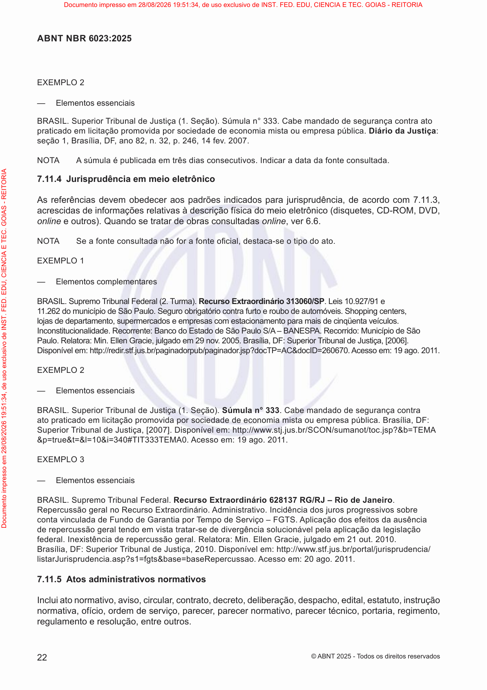

### Registro humano da página

- Comparado visualmente com o PDF: [ ] Sim [ ] Não — estado inicial: pendente.
- Revisor: ____________________
- Data: ____________________
- Número impresso confirmado: ____________________
- Transcrição necessária: [ ] Sim [ ] Não [ ] A definir
- Omissões, com extrator e localização: ____________________
- Inclusões, com extrator e localização: ____________________
- Erros numéricos, com extrator e localização: ____________________
- Erros estruturais, com extrator e localização: ____________________
- Observações: ____________________

**Transcrição humana, somente quando necessária:**

<!-- Campo humano em branco; não é saída de extrator. -->


### Indicadores históricos do snapshot

| Extrator | Registro da página | Execução | Processamento | Avaliação | Método de avaliação | Nota registrada | Revisão manual registrada | Conclusão não confirmada registrada |
|---|---:|---:|---|---|---|---|---|---|
| Leitor PDF | 247 | 16 | `success` | `pending` | `null` | `null` | `null` | `null` |
| Docling | 321 | 17 | `success` | `success` | `deterministic_fallback` | `50.00` | `True` | `null` |
| GLM-OCR | 808 | 37 | `success` | `success` | `deterministic_fallback` | `50.00` | `True` | `True` |


### Leitor PDF — texto completo

- Versão: `pypdf-6.18.1`.
- Registro de página: `247`; execução: `16`.
- SHA-256 do texto: `087611b91041375af663bb9b9e629bc425b0a5506b71843405b30ed2bcad0542`.
- [Abrir texto UTF-8 integral](pages/NBR6023_p0028/pdf_reader.txt).


```text
EXEMPLO 2
—E a
BRSIL. STa Ja (1. S). Sa° 333. Ca aa  aaa a
aa  a a a  aa aa.Diário da Justiça:
1, Baa, DF , a82,. 32,. 246, 14. 2007.
NOT a aa  a . Iaaaaa aa.
7.11.4 Jurisprudência em 
Asa  a a a aaa,a 7.11.3,
aa  a aa   a  (, CD-ROM, DVD,
online ). Qa  aa  a aaonline,6.6.
NOTSa aa a fia,aa-   a.
EXEMPLO 1
—E a
BRSIL. STaFa(2. Ta).Recurso Extraordinário 313060/SP. L10.927/91
1 1.262SPa. Saaa. S,
aaa,aaaaaaaüa.
Iaa. R: BaEaSPaS/– BNESP. R: MS
Pa. Raa: M. EGa,a29. 2005. Baa, DF: STaJa, [2006].
D:://.../aa/aa.?TP=C&ID=260670.: 19 a. 201 1.
EXEMPLO 2
—E a
BRSIL. STa Ja (1. S).Súmula n° 333. Ca aa  aaa
a aa  a a a  aa aa. Baa, DF:
STa Ja, [2007]. D :://www.../SCON/a/.?&=TEM
&=&=&=10&=340#TIT333TEM0. : 19 a. 2011.
EXEMPLO 3
—E a
BRSIL. STaFa.Recurso Extraordinário 628137 RG/RJ – Rio de Janeiro.
R a REa.a. Ia   
aaaF GaaaT S– FGTS.a   a aa
  a   aaa-  a a aa aa
a. Ia  a. Raa: M. EGa,a 21. 2010.
Baa, DF: STa Ja, 2010. D :://www.../a/a/
aJa.a?1=&a=aRa. : 20 a. 2011.
7.11.5 Atos administrativos normativos
Iaa, a,a,a,,a,a,a,a,
aa,,  ,a,a a,a ,aa,,
a  , .
22
ABNT NBR 6023:2025
©BNT 2025 - T   a
Documento impresso em 28/08/2026 19:51:34, de uso exclusivo de INST. FED. EDU, CIENCIA E TEC. GOIAS - REITORIA
Documento impresso em 28/08/2026 19:51:34, de uso exclusivo de INST. FED. EDU, CIENCIA E TEC. GOIAS - REITORIA
```


**Revisão humana de Leitor PDF — preencher:**

- Comparado ao PDF: [ ] Sim [ ] Não [ ] Pendente
- Omissões: ____________________
- Inclusões: ____________________
- Erros numéricos: ____________________
- Erros estruturais: ____________________
- Observações: ____________________

**Diagnóstico histórico completo, sem nova avaliação:**

```json
{
  "id": 247,
  "extraction_id": 16,
  "extractor": "pdf_reader",
  "extractor_version": "pypdf-6.18.1",
  "content_hash": "087611b91041375af663bb9b9e629bc425b0a5506b71843405b30ed2bcad0542",
  "text_sha256": "087611b91041375af663bb9b9e629bc425b0a5506b71843405b30ed2bcad0542",
  "markdown_sha256": "087611b91041375af663bb9b9e629bc425b0a5506b71843405b30ed2bcad0542",
  "processing_status": "success",
  "attempt_count": 1,
  "processing_time_ms": 71,
  "error_message": null,
  "structured_output": null,
  "quality_score": null,
  "quality_metrics": null,
  "evaluation_status": "pending",
  "evaluation_method": null,
  "evaluation_model": null,
  "evaluation_prompt_version": null,
  "evaluation_error": null,
  "evaluated_at": null,
  "historical_configuration": null,
  "historical_configuration_provenance": "not_persisted_in_extraction_schema"
}
```


### Docling — texto completo

- Versão: `docling-2.126.0`.
- Registro de página: `321`; execução: `17`.
- SHA-256 do texto: `132a9ec4704289f45b89e930678f401df77d77ef2709d35ad83b515d6e58661a`.
- [Abrir texto UTF-8 integral](pages/NBR6023_p0028/docling.txt).


```text
## ABNT NBR 6023:2025

## EXEMPLO 2

- E   a 

BR  SIL. S  T  a   J  a (1. S  ). S  a  ° 333. Ca   a  a    a  a  a a   a  a    a   a   a    a  a   a  a. Diário da Justiça :  1, B  a  a, DF, a  82,  . 32,  . 246, 14  . 2007.

NOT    a   a  a    a   . I  a  a  a  a  a   a  a.

## 7.11.4 Jurisprudência em  

As  a    a   a   a   a  a  a,  a   7.11.3, a  a    a   a  a     a    (  , CD-ROM, DVD, online   ). Q  a    a  a    a   a  a  online ,  6.6.

NOT  S  a   a  a   a  fi a  ,  a  a-    a  .

## EXEMPLO 1

- E   a 

BR  SIL. S  T  a  F  a  (2. T  a). Recurso Extraordinário 313060/SP . L  10.927/91  11.262    S  Pa  . S   a   a     a  . S   ,  a    a  a  ,  a    a    a  a   a  a  a    ü  a  . I  a  a  . R  : Ba   E  a   S  Pa  S/  - B  NESP  . R  : M   S  Pa  . R  a  a: M  . E  G  a  ,  a   29  . 2005. B  a  a, DF: S  T  a   J  a, [2006]. D   :  ://  .  .  .  /  a  a  /  a  a  .  ?  TP=  C&amp;  ID=260670.   : 19 a  . 2011.

## EXEMPLO 2

- E   a 

BR  SIL. S  T  a   J  a (1. S  ). Súmula n° 333 . Ca   a  a    a  a  a a   a  a    a   a   a    a  a   a  a. B  a  a, DF: S  T  a   J  a, [2007]. D   :  ://www.  .  .  /SCON/  a  /  .  ?&amp;  =TEM  &amp;  =  &amp;  =&amp;  =10&amp;  =340#TIT333TEM  0.   : 19 a  . 2011.

## EXEMPLO 3

- E   a 

BR  SIL. S  T  a  F  a  . Recurso Extraordinário 628137 RG/RJ - Rio de Janeiro . R   a   R  E  a  .  a  . I  a      a  a  a  F   Ga  a  a  T   S  - FGTS.  a     a a  a    a     a  a  a  -    a   a a  a   a  a   a  . I  a    a  . R  a  a: M  . E  G  a  ,  a   21  . 2010. B  a  a, DF: S  T  a   J  a, 2010. D   :  ://www.  .  .  /  a  /  a/  a  J  a.a  ?  1=  &amp;  a  =  a  R  a  .   : 20 a  . 2011.

## 7.11.5 Atos administrativos normativos

I  a   a  , a  ,  a  ,  a  ,  ,  a  ,  a  ,  a  ,  a  ,   a  a,  ,    ,  a  ,  a   a  ,  a   ,  a  a,  ,  a    ,   .
```


**Revisão humana de Docling — preencher:**

- Comparado ao PDF: [ ] Sim [ ] Não [ ] Pendente
- Omissões: ____________________
- Inclusões: ____________________
- Erros numéricos: ____________________
- Erros estruturais: ____________________
- Observações: ____________________

**Diagnóstico histórico completo, sem nova avaliação:**

```json
{
  "id": 321,
  "extraction_id": 17,
  "extractor": "docling",
  "extractor_version": "docling-2.126.0",
  "content_hash": "132a9ec4704289f45b89e930678f401df77d77ef2709d35ad83b515d6e58661a",
  "text_sha256": "132a9ec4704289f45b89e930678f401df77d77ef2709d35ad83b515d6e58661a",
  "markdown_sha256": "132a9ec4704289f45b89e930678f401df77d77ef2709d35ad83b515d6e58661a",
  "processing_status": "success",
  "attempt_count": 1,
  "processing_time_ms": 692,
  "error_message": null,
  "structured_output": null,
  "quality_score": "50.00",
  "quality_metrics": {
    "cer": 0.36098052384150436,
    "wer": 3.062271062271062,
    "evaluation": {
      "scores": {
        "noise_control": 50.0,
        "reading_order": 50.0,
        "textual_fidelity": 50.0,
        "lists_preservation": 50.0,
        "duplication_control": 50.0,
        "tables_preservation": 50.0,
        "content_completeness": 50.0,
        "hallucination_control": 50.0,
        "numbers_and_references": 50.0,
        "structural_preservation": 50.0
      },
      "confidence": 0.0,
      "justification": "Fallback determinístico: o modelo avaliador não retornou JSON válido. A página precisa de revisão manual.",
      "overall_score": 50.0,
      "fallback_error": "[WinError 10061] Nenhuma conexão pôde ser feita porque a máquina de destino as recusou ativamente",
      "missing_elements": [],
      "incorrect_elements": [],
      "duplicated_elements": [],
      "hallucinated_elements": [],
      "requires_manual_review": true
    },
    "extracted_word_count": 906,
    "reference_word_count": 273,
    "normalized_similarity": 0.6883154537547116,
    "requires_manual_review": true,
    "extracted_character_count": 3449,
    "reference_character_count": 2978
  },
  "evaluation_status": "success",
  "evaluation_method": "deterministic_fallback",
  "evaluation_model": "gemma4:e2b",
  "evaluation_prompt_version": "rag-page-evaluation-v1",
  "evaluation_error": null,
  "evaluated_at": "2026-09-15T22:51:43.259446-03:00",
  "historical_configuration": null,
  "historical_configuration_provenance": "not_persisted_in_extraction_schema"
}
```


### GLM-OCR — texto completo

- Versão: `glmocr-0.1.5`.
- Registro de página: `808`; execução: `37`.
- SHA-256 do texto: `ef78e632fd748b877379da4598eb7c1429bf1c921600632ce0fcaf9886e5f8cd`.
- [Abrir texto UTF-8 integral](pages/NBR6023_p0028/glm_ocr.txt).


```text
ABNT NBR 6023:2025

EXEMPLO 2

— Elementos essenciais

BRASIL. Superior Tribunal de Justiça (1. Seção). Súmula n° 333. Cabe mandado de segurança contra ato praticado em licitação promovida por sociedade de economia mista ou empresa pública. Diário da Justiça: seção 1, Brasília, DF, ano 82, n. 32, p. 246, 14 fev. 2007.

NOTA A súmula é publicada em três dias consecutivos. Indicar a data da fonte consultada.

7.11.4 Jurisprudência em meio eletrônico

As referências devem obedecer aos padrões indicados para jurisprudência, de acordo com 7.11.3, acrescidas de informações relativas à descrição física do meio eletrônico (disquetes, CD-ROM, DVD, online e outros). Quando se tratar de obras consultadas online, ver 6.6.

NOTA Se a fonte consultada não for a fonte oficial, destaca-se o tipo do ato.

EXEMPLO 1

— Elementos complementares

BRASIL. Supremo Tribunal Federal (2. Turma). Recurso Extraordinário 313060/SP. Leis 10.927/91 e 11.262 do município de São Paulo. Seguro obrigatório contra furto e roubo de automóveis. Shopping centers, lojas de departamento, supermercados e empresas com estacionamento para mais de cinquenta veículos. Inconstitucionalidade. Recorrente: Banco do Estado de São Paulo S/A – BANESPA. Recorrido: Município de São Paulo. Relatora: Min. Ellen Gracie, julgado em 29 nov. 2005. Brasília, DF: Superior Tribunal de Justiça, [2006]. Disponível em: http://redir.stf.jus.br/paginadorpub/paginador.jsp?docTP=AC&docID=260670. Acesso em: 19 ago. 2011.

EXEMPLO 2

— Elementos essenciais

BRASIL. Superior Tribunal de Justiça (1. Seção). Súmula n° 333. Cabe mandado de segurança contra ato praticado em licitação promovida por sociedade de economia mista ou empresa pública. Brasília, DF: Superior Tribunal de Justiça, [2007]. Disponível em: http://www.stj.jus.br/SCON/sumanot/toc.jsp?&b=TEMA &p=true&t=&l=10&i=340#TIT333TEMA0. Acesso em: 19 ago. 2011.

EXEMPLO 3

— Elementos essenciais

BRASIL. Supremo Tribunal Federal. Recurso Extraordinário 628137 RG/RJ – Rio de Janeiro. Repercussão geral no Recurso Extraordinário. Administrativo. Incidência dos juros progressivos sobre conta vinculada de Fundo de Garantia por Tempo de Serviço – FGTS. Aplicação dos efeitos da ausência de repercussão geral tendo em vista tratar-se de divergência solucionável pela aplicação da legislação federal. Inexistência de repercussão geral. Relatora: Min. Ellen Gracie, julgado em 21 out. 2010. Brasília, DF: Superior Tribunal de Justiça, 2010. Disponível em: http://www.stf.jus.br/portal/jurisprudencia/listarJurisprudencia.asp?s1=fgts&base=baseRepercussao. Acesso em: 20 ago. 2011.

7.11.5 Atos administrativos normativos

Inclui ato normativo, aviso, circular, contrato, decreto, deliberação, despacho, edital, estatuto, instrução normativa, ofício, ordem de serviço, parecer, parecer normativo, parecer técnico, portaria, regimento, regulamento e resolução, entre outros.
```


**Revisão humana de GLM-OCR — preencher:**

- Comparado ao PDF: [ ] Sim [ ] Não [ ] Pendente
- Omissões: ____________________
- Inclusões: ____________________
- Erros numéricos: ____________________
- Erros estruturais: ____________________
- Observações: ____________________

**Diagnóstico histórico completo, sem nova avaliação:**

```json
{
  "id": 808,
  "extraction_id": 37,
  "extractor": "glm_ocr",
  "extractor_version": "glmocr-0.1.5",
  "content_hash": "ef78e632fd748b877379da4598eb7c1429bf1c921600632ce0fcaf9886e5f8cd",
  "text_sha256": "ef78e632fd748b877379da4598eb7c1429bf1c921600632ce0fcaf9886e5f8cd",
  "markdown_sha256": "ef78e632fd748b877379da4598eb7c1429bf1c921600632ce0fcaf9886e5f8cd",
  "processing_status": "success",
  "attempt_count": 1,
  "processing_time_ms": 13426,
  "error_message": null,
  "structured_output": {
    "completion_unconfirmed": true
  },
  "quality_score": "50.00",
  "quality_metrics": {
    "cer": 0.7058428475486904,
    "wer": 1.2783882783882783,
    "evaluation": {
      "scores": {
        "noise_control": 50.0,
        "reading_order": 50.0,
        "textual_fidelity": 50.0,
        "lists_preservation": 50.0,
        "duplication_control": 50.0,
        "tables_preservation": 50.0,
        "content_completeness": 50.0,
        "hallucination_control": 50.0,
        "numbers_and_references": 50.0,
        "structural_preservation": 50.0
      },
      "confidence": 0.0,
      "justification": "Fallback determinístico: o modelo avaliador não retornou JSON válido. A página precisa de revisão manual.",
      "overall_score": 50.0,
      "fallback_error": "[WinError 10061] Nenhuma conexão pôde ser feita porque a máquina de destino as recusou ativamente",
      "missing_elements": [],
      "incorrect_elements": [],
      "duplicated_elements": [],
      "hallucinated_elements": [],
      "requires_manual_review": true
    },
    "extracted_word_count": 381,
    "reference_word_count": 273,
    "normalized_similarity": 0.2941571524513096,
    "requires_manual_review": true,
    "extracted_character_count": 2882,
    "reference_character_count": 2978
  },
  "evaluation_status": "success",
  "evaluation_method": "deterministic_fallback",
  "evaluation_model": "gemma4:e2b",
  "evaluation_prompt_version": "rag-page-evaluation-v1",
  "evaluation_error": null,
  "evaluated_at": "2026-09-15T22:48:03.855232-03:00",
  "historical_configuration": null,
  "historical_configuration_provenance": "not_persisted_in_extraction_schema"
}
```


<a id="nbr6023-p0054"></a>

## ABNT NBR 6023:2025 — página física 54

- Documento no snapshot: `16` / `abnt_nbr_6023`.
- SHA-256 do original: `0b2f5b6e93f07ecf5016fe400776da7534a1f0c7c9371ae99366e64d9107d05b`.
- Página impressa: candidato registrado `null`; confirmação humana em branco.

- Gold: registro `32`, extração `37`, método `glm_ocr`, versão na coluna Gold `2025`.
- Hash do documento Gold: `0f9a0993b0ae76baf93434e18971f4f0e21598115907f1210a44982c2beddd2a`.
- Índices de página Gold ativos: `[646]`.

[PDF da página](pages/NBR6023_p0054/original.pdf) · [Imagem em tamanho integral](pages/NBR6023_p0054/original.png) · [PDF original, página física 54](../../../../data/raw/NBR6023.pdf#page=54)

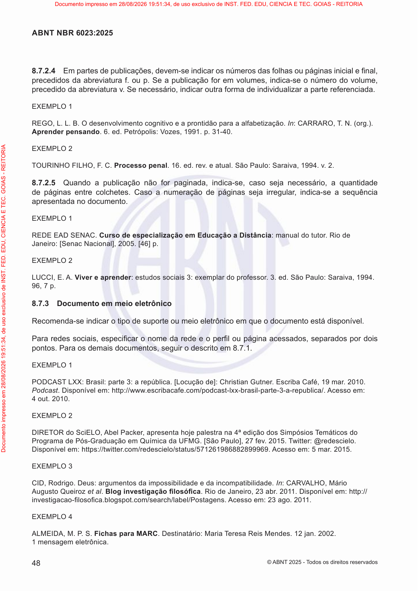

### Registro humano da página

- Comparado visualmente com o PDF: [ ] Sim [ ] Não — estado inicial: pendente.
- Revisor: ____________________
- Data: ____________________
- Número impresso confirmado: ____________________
- Transcrição necessária: [ ] Sim [ ] Não [ ] A definir
- Omissões, com extrator e localização: ____________________
- Inclusões, com extrator e localização: ____________________
- Erros numéricos, com extrator e localização: ____________________
- Erros estruturais, com extrator e localização: ____________________
- Observações: ____________________

**Transcrição humana, somente quando necessária:**

<!-- Campo humano em branco; não é saída de extrator. -->


### Indicadores históricos do snapshot

| Extrator | Registro da página | Execução | Processamento | Avaliação | Método de avaliação | Nota registrada | Revisão manual registrada | Conclusão não confirmada registrada |
|---|---:|---:|---|---|---|---|---|---|
| Leitor PDF | 273 | 16 | `success` | `pending` | `null` | `null` | `null` | `null` |
| Docling | 347 | 17 | `success` | `success` | `deterministic_fallback` | `50.00` | `True` | `null` |
| GLM-OCR | 834 | 37 | `success` | `success` | `deterministic_fallback` | `50.00` | `True` | `True` |


### Leitor PDF — texto completo

- Versão: `pypdf-6.18.1`.
- Registro de página: `273`; execução: `16`.
- SHA-256 do texto: `ca61ebebbe0009f577a635c35c37c185506f56120124ea0551a1f5accf51f1ee`.
- [Abrir texto UTF-8 integral](pages/NBR6023_p0054/pdf_reader.txt).


```text
8.7.2.4Eaa,-aaaaafia,
 a aaa. . Saa   ,a-    ,
 a aaa. S ,a aa aaaa aa.
EXEMPLO 1
REGO, L. L. B. O  a aa a aaa.In: CRRRO, T . N. (.).
Aprender pensando. 6.. P: V, 1991.. 31-40.
EXEMPLO 2
TOURINHO FILHO, F . C.Processo penal. 16...aa. SPa: Saaa, 1994.. 2.
8.7.2.5Qaaa   aaa,a-,a a, aaa
 a  . Caaa  a aa,a-aa
apresentada no documento.
EXEMPLO 1
REDE ED SENC.Curso de especialização em Educação a Distância: manual do tutor. Rio de
Ja: [SaNaa], 2005. [46].
EXEMPLO 2
LUCCI, E..Viver e aprender: a3:a  . 3.. SPa: Saaa, 1994.
96, 7.
8.7.3 Documento em 
Ra- a             .
Paa a,fia   a   fi  a aa,aa  
. Paa a ,   8.7.1.
EXEMPLO 1
PODCST LXX: Ba:a3: aa. [L ]: CaG. Ea Ca, 19a. 2010.
at. D :://www.aa./a--a-a-3-a-a/. :
4 out. 2010.
EXEMPLO 2
DIRETORSELO,Pa, aa aaa 4ªediçãoST 
PaaP-Gaa Qaa UFMG. [SPa], 27. 2015. Tw: @.
D :://w.//a/571261986882899969.Acesso em: 5 mar. 2015.
EXEMPLO 3
CID, R. D: a aa  aaa.In: CRVLHO, M
Qet al.B a fifia. R Ja, 23 a. 2011. D :://
aa-fifia../a/a/Pa. : 23 a. 2011.
EXEMPLO 4
LMEID, M. P . S.Fichas para MARC. Da: Maa Ta RM. 12a. 2002.
1a a.
48
ABNT NBR 6023:2025
©BNT 2025 - T   a
Documento impresso em 28/08/2026 19:51:34, de uso exclusivo de INST. FED. EDU, CIENCIA E TEC. GOIAS - REITORIA
Documento impresso em 28/08/2026 19:51:34, de uso exclusivo de INST. FED. EDU, CIENCIA E TEC. GOIAS - REITORIA
```


**Revisão humana de Leitor PDF — preencher:**

- Comparado ao PDF: [ ] Sim [ ] Não [ ] Pendente
- Omissões: ____________________
- Inclusões: ____________________
- Erros numéricos: ____________________
- Erros estruturais: ____________________
- Observações: ____________________

**Diagnóstico histórico completo, sem nova avaliação:**

```json
{
  "id": 273,
  "extraction_id": 16,
  "extractor": "pdf_reader",
  "extractor_version": "pypdf-6.18.1",
  "content_hash": "ca61ebebbe0009f577a635c35c37c185506f56120124ea0551a1f5accf51f1ee",
  "text_sha256": "ca61ebebbe0009f577a635c35c37c185506f56120124ea0551a1f5accf51f1ee",
  "markdown_sha256": "ca61ebebbe0009f577a635c35c37c185506f56120124ea0551a1f5accf51f1ee",
  "processing_status": "success",
  "attempt_count": 1,
  "processing_time_ms": 63,
  "error_message": null,
  "structured_output": null,
  "quality_score": null,
  "quality_metrics": null,
  "evaluation_status": "pending",
  "evaluation_method": null,
  "evaluation_model": null,
  "evaluation_prompt_version": null,
  "evaluation_error": null,
  "evaluated_at": null,
  "historical_configuration": null,
  "historical_configuration_provenance": "not_persisted_in_extraction_schema"
}
```


### Docling — texto completo

- Versão: `docling-2.126.0`.
- Registro de página: `347`; execução: `17`.
- SHA-256 do texto: `ecd6045172b3520c5d7f36ab4affadf9a879bceb10aa7efcfde264a68960003a`.
- [Abrir texto UTF-8 integral](pages/NBR6023_p0054/docling.txt).


```text
## ABNT NBR 6023:2025

- 8.7.2.4 E  a    a  ,  -   a     a   a    a   a   fi a  ,   a a  a  a  .   . S  a  a     ,  a-     ,   a a  a  a  . S   ,  a   a  a   a  a  a  a   a  a.

## EXEMPLO 1

REGO, L. L. B. O    a   a  a a a  a  a  . In : C  RR  RO, T. N. (  .). Aprender pensando . 6.  . P  : V  , 1991.  . 31-40.

## EXEMPLO 2

TOURINHO FILHO, F. C. Processo penal . 16.  .  .  a  a  . S  Pa  : Sa  a  a, 1994.  . 2.

8.7.2.5 Q  a  a  a     a  a  a,  a- ,  a   a  , a  a  a    a    . Ca  a  a    a   a  a  ,  a- a  a apresentada no documento.

## EXEMPLO 1

REDE E  D SEN  C. Curso de especialização em Educação a Distância : manual do tutor. Rio de Ja  : [S  a  Na  a  ], 2005. [46]  .

## EXEMPLO 2

LUCCI, E.  . Viver e aprender :   a  3:  a    . 3.  . S  Pa  : Sa  a  a, 1994. 96, 7  .

## 8.7.3 Documento em  

R  a-  a               .

Pa  a   a  , fi a     a    fi   a a  a  ,  a  a     . Pa  a   a   ,     8.7.1.

## EXEMPLO 1

PODC  ST LXX: B  a  :  a  3: a  a. [L   ]: C  a  G  . E  a Ca  , 19  a  . 2010.  a  t . D   :  ://www.  a  a  .  /  a  -  -  a  -  a  -3-a- a/.   : 4 out. 2010.

## EXEMPLO 2

DIRETOR  S  ELO,  Pa  , a  a   a  a  a 4ª edição  S  T   P  a  a  P  -G  a  a   Q  a  a UFMG. [S  Pa  ], 27  . 2015. Tw  :@  . D   :  ://  w  .  /  /  a  /571261986882899969. Acesso em: 5 mar. 2015.

## EXEMPLO 3

CID, R  . D  : a   a  a    a  a  a  . In : C  RV  LHO, M   Q  et al . B   a  fifi a . R   Ja  , 23 a  . 2011. D   :  ://  a  a  -fi fi a.  .  /  a  /  a  /P  a  .   : 23 a  . 2011.

## EXEMPLO 4

 LMEID  , M. P. S. Fichas para MARC . D  a  : Ma  a T  a R  M  . 12  a  . 2002. 1  a   a.
```


**Revisão humana de Docling — preencher:**

- Comparado ao PDF: [ ] Sim [ ] Não [ ] Pendente
- Omissões: ____________________
- Inclusões: ____________________
- Erros numéricos: ____________________
- Erros estruturais: ____________________
- Observações: ____________________

**Diagnóstico histórico completo, sem nova avaliação:**

```json
{
  "id": 347,
  "extraction_id": 17,
  "extractor": "docling",
  "extractor_version": "docling-2.126.0",
  "content_hash": "ecd6045172b3520c5d7f36ab4affadf9a879bceb10aa7efcfde264a68960003a",
  "text_sha256": "ecd6045172b3520c5d7f36ab4affadf9a879bceb10aa7efcfde264a68960003a",
  "markdown_sha256": "ecd6045172b3520c5d7f36ab4affadf9a879bceb10aa7efcfde264a68960003a",
  "processing_status": "success",
  "attempt_count": 1,
  "processing_time_ms": 672,
  "error_message": null,
  "structured_output": null,
  "quality_score": "50.00",
  "quality_metrics": {
    "cer": 0.35212981744421906,
    "wer": 2.213523131672598,
    "evaluation": {
      "scores": {
        "noise_control": 50.0,
        "reading_order": 50.0,
        "textual_fidelity": 50.0,
        "lists_preservation": 50.0,
        "duplication_control": 50.0,
        "tables_preservation": 50.0,
        "content_completeness": 50.0,
        "hallucination_control": 50.0,
        "numbers_and_references": 50.0,
        "structural_preservation": 50.0
      },
      "confidence": 0.0,
      "justification": "Fallback determinístico: o modelo avaliador não retornou JSON válido. A página precisa de revisão manual.",
      "overall_score": 50.0,
      "fallback_error": "[WinError 10061] Nenhuma conexão pôde ser feita porque a máquina de destino as recusou ativamente",
      "missing_elements": [],
      "incorrect_elements": [],
      "duplicated_elements": [],
      "hallucinated_elements": [],
      "requires_manual_review": true
    },
    "extracted_word_count": 723,
    "reference_word_count": 281,
    "normalized_similarity": 0.6824002927186242,
    "requires_manual_review": true,
    "extracted_character_count": 2733,
    "reference_character_count": 2465
  },
  "evaluation_status": "success",
  "evaluation_method": "deterministic_fallback",
  "evaluation_model": "gemma4:e2b",
  "evaluation_prompt_version": "rag-page-evaluation-v1",
  "evaluation_error": null,
  "evaluated_at": "2026-09-15T22:52:12.665780-03:00",
  "historical_configuration": null,
  "historical_configuration_provenance": "not_persisted_in_extraction_schema"
}
```


### GLM-OCR — texto completo

- Versão: `glmocr-0.1.5`.
- Registro de página: `834`; execução: `37`.
- SHA-256 do texto: `a1587d3ba173c84f9439142c0b12d8b57a9854029c210c4ba61e4e73a34cac13`.
- [Abrir texto UTF-8 integral](pages/NBR6023_p0054/glm_ocr.txt).


```text
8.7.2.4 Em partes de publicações, devem-se indicar os números das folhas ou páginas inicial e final, precedidos da abreviatura f. ou p. Se a publicação for em volumes, indica-se o número do volume, precedido da abreviatura v. Se necessário, indicar outra forma de individualizar a parte referenciada.

EXEMPLO 1

REGO, L. L. B. O desenvolvimento cognitivo e a prontidão para a alfabetização. In: CARRARO, T. N. (org.). Aprender pensando. 6. ed. Petrópolis: Vozes, 1991. p. 31-40.

EXEMPLO 2

TOURINHO FILHO, F. C. Processo penal. 16. ed. rev. e atual. São Paulo: Saraiva, 1994. v. 2.

8.7.2.5 Quando a publicação não for paginada, indica-se, caso seja necessário, a quantidade de páginas entre colchetes. Caso a numeração de páginas seja irregular, indica-se a sequência apresentada no documento.

EXEMPLO 1

REDE EAD SENAC. Curso de especialização em Educação a Distância: manual do tutor. Rio de Janeiro: [Senac Nacional], 2005. [46] p.

EXEMPLO 2

LUCCI, E. A. Viver e aprender: estudos sociais 3: exemplar do professor. 3. ed. São Paulo: Saraiva, 1994. 96, 7 p.

8.7.3 Documento em meio eletrônico

Recomenda-se indicar o tipo de suporte ou meio eletrônico em que o documento está disponível.

Para redes sociais, especificar o nome da rede e o perfil ou página acessados, separados por dois pontos. Para os demais documentos, seguir o descrito em 8.7.1.

EXEMPLO 1

PODCAST LXX: Brasil: parte 3: a república. [Locução de]: Christian Gutner. Escriba Café, 19 mar. 2010. Podcast. Disponível em: http://www.escribacafe.com/podcast-lxx-brasil-parte-3-a-republica/. Acesso em: 4 out. 2010.

EXEMPLO 2

DIRETOR do SciELO, Abel Packer, apresenta hoje palestra na 4ª edição dos Simpósios Temáticos do Programa de Pós-Graduação em Química da UFMG. [São Paulo], 27 fev. 2015. Twitter: @redescielo. Disponível em: https://twitter.com/redescielo/status/571261986882899969. Acesso em: 5 mar. 2015.

EXEMPLO 3

CID, Rodrigo. Deus: argumentos da impossibilidade e da incompatibilidade. In: CARVALHO, Mário Augusto Queiroz et al. Blog investigação filosófica. Rio de Janeiro, 23 abr. 2011. Disponível em: http://investigacao-filosofica.blogspot.com/search/label/Postagens. Acesso em: 23 ago. 2011.

EXEMPLO 4

ALMEIDA, M. P. S. Fichas para MARC. Destinatário: Maria Teresa Reis Mendes. 12 jan. 2002. 1 mensagem eletrônica.
```


**Revisão humana de GLM-OCR — preencher:**

- Comparado ao PDF: [ ] Sim [ ] Não [ ] Pendente
- Omissões: ____________________
- Inclusões: ____________________
- Erros numéricos: ____________________
- Erros estruturais: ____________________
- Observações: ____________________

**Diagnóstico histórico completo, sem nova avaliação:**

```json
{
  "id": 834,
  "extraction_id": 37,
  "extractor": "glm_ocr",
  "extractor_version": "glmocr-0.1.5",
  "content_hash": "a1587d3ba173c84f9439142c0b12d8b57a9854029c210c4ba61e4e73a34cac13",
  "text_sha256": "a1587d3ba173c84f9439142c0b12d8b57a9854029c210c4ba61e4e73a34cac13",
  "markdown_sha256": "a1587d3ba173c84f9439142c0b12d8b57a9854029c210c4ba61e4e73a34cac13",
  "processing_status": "success",
  "attempt_count": 1,
  "processing_time_ms": 12183,
  "error_message": null,
  "structured_output": {
    "completion_unconfirmed": true
  },
  "quality_score": "50.00",
  "quality_metrics": {
    "cer": 0.6304259634888438,
    "wer": 1.0569395017793595,
    "evaluation": {
      "scores": {
        "noise_control": 50.0,
        "reading_order": 50.0,
        "textual_fidelity": 50.0,
        "lists_preservation": 50.0,
        "duplication_control": 50.0,
        "tables_preservation": 50.0,
        "content_completeness": 50.0,
        "hallucination_control": 50.0,
        "numbers_and_references": 50.0,
        "structural_preservation": 50.0
      },
      "confidence": 0.0,
      "justification": "Fallback determinístico: o modelo avaliador não retornou JSON válido. A página precisa de revisão manual.",
      "overall_score": 50.0,
      "fallback_error": "[WinError 10061] Nenhuma conexão pôde ser feita porque a máquina de destino as recusou ativamente",
      "missing_elements": [],
      "incorrect_elements": [],
      "duplicated_elements": [],
      "hallucinated_elements": [],
      "requires_manual_review": true
    },
    "extracted_word_count": 339,
    "reference_word_count": 281,
    "normalized_similarity": 0.36957403651115617,
    "requires_manual_review": true,
    "extracted_character_count": 2311,
    "reference_character_count": 2465
  },
  "evaluation_status": "success",
  "evaluation_method": "deterministic_fallback",
  "evaluation_model": "gemma4:e2b",
  "evaluation_prompt_version": "rag-page-evaluation-v1",
  "evaluation_error": null,
  "evaluated_at": "2026-09-15T22:55:20.342686-03:00",
  "historical_configuration": null,
  "historical_configuration_provenance": "not_persisted_in_extraction_schema"
}
```


<a id="nbr6024-p0005"></a>

## ABNT NBR 6024:2012 — página física 5

- Documento no snapshot: `17` / `abnt_nbr_6024`.
- SHA-256 do original: `c2766fd251c7aa79e15bc889abce100ddeec500971fcd628ee320cf3a97c5f28`.
- Página impressa: candidato registrado `null`; confirmação humana em branco.

- Gold: registro `13`, extração `40`, método `glm_ocr`, versão na coluna Gold `null`.
- Hash do documento Gold: `0c49488f5735f53d9b188c31233b350e5ce691371a91465dc6d3077a7f509173`.
- Índices de página Gold ativos: `[299]`.

[PDF da página](pages/NBR6024_p0005/original.pdf) · [Imagem em tamanho integral](pages/NBR6024_p0005/original.png) · [PDF original, página física 5](../../../../data/raw/NBR6024.pdf#page=5)

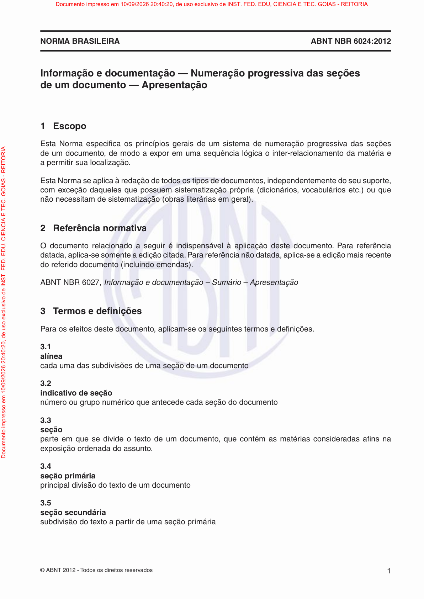

### Registro humano da página

- Comparado visualmente com o PDF: [ ] Sim [ ] Não — estado inicial: pendente.
- Revisor: ____________________
- Data: ____________________
- Número impresso confirmado: ____________________
- Transcrição necessária: [ ] Sim [ ] Não [ ] A definir
- Omissões, com extrator e localização: ____________________
- Inclusões, com extrator e localização: ____________________
- Erros numéricos, com extrator e localização: ____________________
- Erros estruturais, com extrator e localização: ____________________
- Observações: ____________________

**Transcrição humana, somente quando necessária:**

<!-- Campo humano em branco; não é saída de extrator. -->


### Indicadores históricos do snapshot

| Extrator | Registro da página | Execução | Processamento | Avaliação | Método de avaliação | Nota registrada | Revisão manual registrada | Conclusão não confirmada registrada |
|---|---:|---:|---|---|---|---|---|---|
| Leitor PDF | 859 | 38 | `success` | `pending` | `null` | `null` | `null` | `null` |
| Docling | 867 | 39 | `success` | `success` | `page_image` | `100.00` | `False` | `null` |
| GLM-OCR | 875 | 40 | `success` | `success` | `page_image` | `100.00` | `False` | `True` |


### Leitor PDF — texto completo

- Versão: `pypdf-6.18.1`.
- Registro de página: `859`; execução: `38`.
- SHA-256 do texto: `7ea9c2004333a9ea6d025ed83739e4b7252f39fabfc2f6f8829f4bdba994bbfb`.
- [Abrir texto UTF-8 integral](pages/NBR6024_p0005/pdf_reader.txt).


```text
NORMA BRASILEIRA ABNT NBR 6024:2012
© ABNT 2012 - Todos os direitos reservados 1
Informac ¸a ˜o e documentac ¸a ˜o — Numerac ¸a ˜o progressiva das sec ¸o ˜ es
de um documento — Apresentac ¸a ˜o
1 Escopo
Esta Norma especifi ca os princı´p ios gerais de um sistema de numerac ¸a ˜o progressiva das sec ¸o ˜es 
de um documento, de modo a expor em uma seque ˆncia lo ´gica o inter-relacionamento da mate ´ria e
a permitir sua localizac ¸a ˜o.
Esta Norma se aplica a ` redac ¸a ˜o de todos os tipos de documentos, independentemente do seu suporte, 
com excec ¸a ˜o daqueles que possuem sistematizac ¸a ˜o pro ´pria (diciona ´rios, vocabula ´rios etc.) ou que 
na ˜o necessitam de sistematizac ¸a ˜o (obras litera ´rias em geral).
2 Refere ˆncia normativa
O documento relacionado a seguir e ´ indispensa ´vel a ` aplicac ¸a ˜o deste documento. Para refere ˆncia 
datada, aplica-se somente a edic ¸a ˜o citada. Para refere ˆncia na ˜o datada, aplica-se a edic ¸a ˜o mais recente 
do referido documento (incluindo emendas).
ABNT NBR 6027, Informação e documentação – Sumário – Apresentação
3 Termos e defi nic ¸o ˜ es
Para os efeitos deste documento, aplicam-se os seguintes termos e defi nic ¸o ˜es. 
3.1 
alı´nea
cada uma das subdiviso ˜es de uma sec ¸a ˜o de um documento
3.2 
indicativo de sec ¸a ˜o
nu ´mero ou grupo nume ´rico que antecede cada sec ¸a ˜o do documento
3.3 
sec ¸a ˜o
parte em que se divide o texto de um documento, que conte ´m as mate ´rias consideradas afi ns na 
exposic ¸a ˜o ordenada do assunto.
3.4 
sec ¸a ˜o prima ´ria
principal divisa ˜o do texto de um documento
3.5 
sec ¸a ˜o secunda ´ria
subdivisa ˜o do texto a partir de uma sec ¸a ˜o prima ´ria
Documento impresso em 10/09/2026 20:40:20, de uso exclusivo de INST. FED. EDU, CIENCIA E TEC. GOIAS - REITORIA
Documento impresso em 10/09/2026 20:40:20, de uso exclusivo de INST. FED. EDU, CIENCIA E TEC. GOIAS - REITORIA
```


**Revisão humana de Leitor PDF — preencher:**

- Comparado ao PDF: [ ] Sim [ ] Não [ ] Pendente
- Omissões: ____________________
- Inclusões: ____________________
- Erros numéricos: ____________________
- Erros estruturais: ____________________
- Observações: ____________________

**Diagnóstico histórico completo, sem nova avaliação:**

```json
{
  "id": 859,
  "extraction_id": 38,
  "extractor": "pdf_reader",
  "extractor_version": "pypdf-6.18.1",
  "content_hash": "7ea9c2004333a9ea6d025ed83739e4b7252f39fabfc2f6f8829f4bdba994bbfb",
  "text_sha256": "7ea9c2004333a9ea6d025ed83739e4b7252f39fabfc2f6f8829f4bdba994bbfb",
  "markdown_sha256": "7ea9c2004333a9ea6d025ed83739e4b7252f39fabfc2f6f8829f4bdba994bbfb",
  "processing_status": "success",
  "attempt_count": 1,
  "processing_time_ms": 59,
  "error_message": null,
  "structured_output": null,
  "quality_score": null,
  "quality_metrics": null,
  "evaluation_status": "pending",
  "evaluation_method": null,
  "evaluation_model": null,
  "evaluation_prompt_version": null,
  "evaluation_error": null,
  "evaluated_at": null,
  "historical_configuration": null,
  "historical_configuration_provenance": "not_persisted_in_extraction_schema"
}
```


### Docling — texto completo

- Versão: `docling-2.126.0`.
- Registro de página: `867`; execução: `39`.
- SHA-256 do texto: `4a04c116bddb474c0446694221e56e832aaa78a715c589bc23e80e354b610de7`.
- [Abrir texto UTF-8 integral](pages/NBR6024_p0005/docling.txt).


```text
## NORMA BRASILEIRA

## Informac ¸a ˜ o e documentac ¸a ˜o - Numerac ¸a ˜o progressiva das sec ¸o ˜ es de um documento - Apresentac ¸a ˜o

## 1  Escopo

Esta Norma especifi  ca os princ ı ´p  ios  gerais  de  um  sistema  de  numerac ¸a ˜ o  progressiva  das  sec ¸o ˜ es de um documento, de modo a expor em uma seque ˆncia lo ´gica o inter-relacionamento da mate ´ria e a permitir sua localizac ¸a ˜ o.

Esta Norma se aplica a ` redac ¸a ˜ o de todos os tipos de documentos, independentemente do seu suporte, com excec ¸a ˜ o daqueles que possuem sistematizac ¸a ˜o pro ´pria (diciona ´ rios, vocabula ´ rios etc.) ou que na ˜ o necessitam de sistematizac ¸a ˜ o (obras litera ´ rias em geral).

## 2 Refere ˆncia normativa

O documento relacionado a seguir  e ´  indispensa ´vel  a `   aplicac ¸a ˜ o  deste  documento.  Para  refere ˆ ncia datada, aplica-se somente a edic ¸a ˜ o citada. Para refere ˆ ncia na ˜ o datada, aplica-se a edic ¸a ˜ o mais recente do referido documento (incluindo emendas).

ABNT NBR 6027, Informação e documentação - Sumário - Apresentação

## 3 Termos e defi  nic ¸o ˜ es

Para os efeitos deste documento, aplicam-se os seguintes termos e defi  nic ¸o ˜ es.

## 3.1

## al ı ´nea

cada uma das subdiviso ˜es de uma sec ¸a ˜ o de um documento

## 3.2

## indicativo de sec ¸a ˜ o

nu ´ mero ou grupo nume ´rico que antecede cada sec ¸a ˜ o do documento

## 3.3

## sec ¸a ˜ o

parte em que se divide o texto de um documento, que conte ´m as mate ´rias consideradas afi  ns na exposic ¸a ˜ o ordenada do assunto.

## 3.4

## sec ¸a ˜ o prima ´ria

principal divisa ˜ o do texto de um documento

## 3.5

## sec ¸a ˜ o secunda ´ria

subdivisa ˜ o do texto a partir de uma sec ¸a ˜ o prima ´ ria
```


**Revisão humana de Docling — preencher:**

- Comparado ao PDF: [ ] Sim [ ] Não [ ] Pendente
- Omissões: ____________________
- Inclusões: ____________________
- Erros numéricos: ____________________
- Erros estruturais: ____________________
- Observações: ____________________

**Diagnóstico histórico completo, sem nova avaliação:**

```json
{
  "id": 867,
  "extraction_id": 39,
  "extractor": "docling",
  "extractor_version": "docling-2.126.0",
  "content_hash": "4a04c116bddb474c0446694221e56e832aaa78a715c589bc23e80e354b610de7",
  "text_sha256": "4a04c116bddb474c0446694221e56e832aaa78a715c589bc23e80e354b610de7",
  "markdown_sha256": "4a04c116bddb474c0446694221e56e832aaa78a715c589bc23e80e354b610de7",
  "processing_status": "success",
  "attempt_count": 1,
  "processing_time_ms": 652,
  "error_message": null,
  "structured_output": null,
  "quality_score": "100.00",
  "quality_metrics": {
    "cer": 0.22592592592592592,
    "wer": 0.38571428571428573,
    "evaluation": {
      "scores": {
        "noise_control": 100,
        "reading_order": 100,
        "textual_fidelity": 100,
        "lists_preservation": 100,
        "duplication_control": 100,
        "tables_preservation": null,
        "content_completeness": 100,
        "hallucination_control": 100,
        "numbers_and_references": 100,
        "structural_preservation": 100
      },
      "confidence": 100.0,
      "justification": "O texto extraído é uma reprodução fiel do texto fornecido, que parece ser um trecho de uma norma brasileira (ABNT NBR 6027) sobre numeração progressiva de seções de um documento. A estrutura e o conteúdo foram preservados integralmente.",
      "noise_control": 100,
      "overall_score": 100.0,
      "reading_order": 100,
      "missing_elements": null,
      "textual_fidelity": 100,
      "incorrect_elements": null,
      "lists_preservation": 100,
      "duplicated_elements": null,
      "duplication_control": 100,
      "tables_preservation": null,
      "content_completeness": 100,
      "hallucinated_elements": null,
      "hallucination_control": 100,
      "numbers_and_references": 100,
      "requires_manual_review": false,
      "structural_preservation": 100
    },
    "extracted_word_count": 351,
    "reference_word_count": 350,
    "normalized_similarity": 0.7740740740740741,
    "requires_manual_review": false,
    "extracted_character_count": 1723,
    "reference_character_count": 1890
  },
  "evaluation_status": "success",
  "evaluation_method": "page_image",
  "evaluation_model": "gemma4:e2b",
  "evaluation_prompt_version": "rag-page-evaluation-v1",
  "evaluation_error": null,
  "evaluated_at": "2026-09-15T18:08:53.050894-03:00",
  "historical_configuration": null,
  "historical_configuration_provenance": "not_persisted_in_extraction_schema"
}
```


### GLM-OCR — texto completo

- Versão: `glmocr-0.1.5`.
- Registro de página: `875`; execução: `40`.
- SHA-256 do texto: `6f496a108582f51ee424c61f122f1e3bb57bbaa2772698ff01a715917445e3a5`.
- [Abrir texto UTF-8 integral](pages/NBR6024_p0005/glm_ocr.txt).


```text
NORMA BRASILEIRA ABNT NBR 6024:2012

Informação e documentação — Numeração progressiva das seções de um documento — Apresentação

1 Escopo

Esta Norma especifica os princípios gerais de um sistema de numeração progressiva das seções de um documento, de modo a expor em uma sequência lógica o inter-relacionamento da matéria e a permitir sua localização.

Esta Norma se aplica à redação de todos os tipos de documentos, independentemente do seu suporte, com exceção daqueles que possuem sistematização própria (dicionários, vocabulários etc.) ou que não necessitam de sistematização (obras literárias em geral).

2 Referência normativa

O documento relacionado a seguir é indispensável à aplicação deste documento. Para referência datada, aplica-se somente a edição citada. Para referência não datada, aplica-se a edição mais recente do referido documento (incluindo emendas).

ABNT NBR 6027, Informação e documentação – Sumário – Apresentação

3 Termos e definições

Para os efeitos deste documento, aplicam-se os seguintes termos e definições.

3.1 alínea
cada uma das subdivisões de uma seção de um documento

3.2 indicativo de seção
número ou grupo numérico que antecede cada seção do documento

3.3 seção
parte em que se divide o texto de um documento, que contém as matérias consideradas afins na exposição ordenada do assunto.

3.4 seção primária
principal divisão do texto de um documento

3.5 seção secundária
subdivisão do texto a partir de uma seção primária

© ABNT 2012 - Todos os direitos reservados
1
Documento impresso em 10/09/2026 20:40:20, de uso exclusivo de INST. FED. EDU, CIENCIA E TEC. GOIAS - REITORIA
```


**Revisão humana de GLM-OCR — preencher:**

- Comparado ao PDF: [ ] Sim [ ] Não [ ] Pendente
- Omissões: ____________________
- Inclusões: ____________________
- Erros numéricos: ____________________
- Erros estruturais: ____________________
- Observações: ____________________

**Diagnóstico histórico completo, sem nova avaliação:**

```json
{
  "id": 875,
  "extraction_id": 40,
  "extractor": "glm_ocr",
  "extractor_version": "glmocr-0.1.5",
  "content_hash": "6f496a108582f51ee424c61f122f1e3bb57bbaa2772698ff01a715917445e3a5",
  "text_sha256": "6f496a108582f51ee424c61f122f1e3bb57bbaa2772698ff01a715917445e3a5",
  "markdown_sha256": "6f496a108582f51ee424c61f122f1e3bb57bbaa2772698ff01a715917445e3a5",
  "processing_status": "success",
  "attempt_count": 1,
  "processing_time_ms": 9543,
  "error_message": null,
  "structured_output": {
    "completion_unconfirmed": true
  },
  "quality_score": "100.00",
  "quality_metrics": {
    "cer": 0.21746031746031746,
    "wer": 0.4714285714285714,
    "evaluation": {
      "scores": {
        "noise_control": 100,
        "reading_order": 100,
        "textual_fidelity": 100,
        "lists_preservation": 100,
        "duplication_control": 95,
        "tables_preservation": null,
        "content_completeness": 100,
        "hallucination_control": 100,
        "numbers_and_references": 100,
        "structural_preservation": 100
      },
      "confidence": 100.0,
      "justification": "O texto extraído é uma reprodução fiel do conteúdo da imagem fornecida, que contém o texto da norma ABNT NBR 6024:2012. A estrutura e o conteúdo foram preservados com alta fidelidade.",
      "noise_control": 100,
      "overall_score": 100.0,
      "reading_order": 100,
      "missing_elements": null,
      "textual_fidelity": 100,
      "incorrect_elements": null,
      "lists_preservation": 100,
      "duplicated_elements": null,
      "duplication_control": 95,
      "tables_preservation": null,
      "content_completeness": 100,
      "hallucinated_elements": null,
      "hallucination_control": 100,
      "numbers_and_references": 100,
      "requires_manual_review": false,
      "structural_preservation": 100
    },
    "extracted_word_count": 249,
    "reference_word_count": 350,
    "normalized_similarity": 0.7825396825396825,
    "requires_manual_review": false,
    "extracted_character_count": 1625,
    "reference_character_count": 1890
  },
  "evaluation_status": "success",
  "evaluation_method": "page_image",
  "evaluation_model": "gemma4:e2b",
  "evaluation_prompt_version": "rag-page-evaluation-v1",
  "evaluation_error": null,
  "evaluated_at": "2026-09-15T18:09:14.889933-03:00",
  "historical_configuration": null,
  "historical_configuration_provenance": "not_persisted_in_extraction_schema"
}
```


<a id="nbr6028-p0004"></a>

## ABNT NBR 6028:2021 — página física 4

- Documento no snapshot: `19` / `abnt_nbr_6028`.
- SHA-256 do original: `7c3e609581286f1bc36e2ca7750d725dd08c5502bf47426155cd217c0b4e67d7`.
- Página impressa: candidato registrado `null`; confirmação humana em branco.

- Gold: registro `35`, extração `46`, método `glm_ocr`, versão na coluna Gold `2021`.
- Hash do documento Gold: `d2fb78b76351f5703bb4e47a73f73e41ada1697a643418ab672c909ad555ed60`.
- Índices de página Gold ativos: `[664]`.

[PDF da página](pages/NBR6028_p0004/original.pdf) · [Imagem em tamanho integral](pages/NBR6028_p0004/original.png) · [PDF original, página física 4](../../../../data/raw/NBR6028.pdf#page=4)

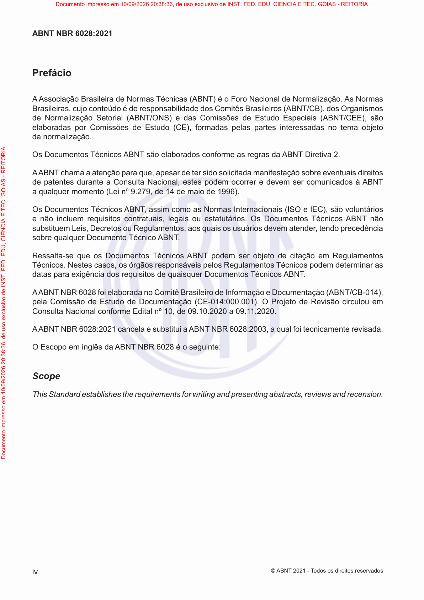

### Registro humano da página

- Comparado visualmente com o PDF: [ ] Sim [ ] Não — estado inicial: pendente.
- Revisor: ____________________
- Data: ____________________
- Número impresso confirmado: ____________________
- Transcrição necessária: [ ] Sim [ ] Não [ ] A definir
- Omissões, com extrator e localização: ____________________
- Inclusões, com extrator e localização: ____________________
- Erros numéricos, com extrator e localização: ____________________
- Erros estruturais, com extrator e localização: ____________________
- Observações: ____________________

**Transcrição humana, somente quando necessária:**

<!-- Campo humano em branco; não é saída de extrator. -->


### Indicadores históricos do snapshot

| Extrator | Registro da página | Execução | Processamento | Avaliação | Método de avaliação | Nota registrada | Revisão manual registrada | Conclusão não confirmada registrada |
|---|---:|---:|---|---|---|---|---|---|
| Leitor PDF | 903 | 44 | `success` | `pending` | `null` | `null` | `null` | `null` |
| Docling | 910 | 45 | `success` | `success` | `page_image` | `96.00` | `False` | `null` |
| GLM-OCR | 917 | 46 | `success` | `success` | `page_image` | `96.30` | `False` | `True` |


### Leitor PDF — texto completo

- Versão: `pypdf-6.18.1`.
- Registro de página: `903`; execução: `44`.
- SHA-256 do texto: `f7acfce17f50a9ac05e74fa4b8d308b613066fd8d504af7cfdbafd659e56c745`.
- [Abrir texto UTF-8 integral](pages/NBR6028_p0004/pdf_reader.txt).


```text
iv
ABNT NBR 6028:2021
© ABNT 2021 - T odos os direitos reservados
Prefácio
A Associação Brasileira de Normas Técnicas (ABNT) é o Foro Nacional de Normalização. As Normas
Brasileiras, cujo conteúdo é de responsabilidade dos Comitês Brasileiros (ABNT/CB), dos Organismos
de Normalização Setorial (ABNT/ONS) e das Comissões de Estudo Especiais (ABNT/CEE), são
elaboradas por Comissões de Estudo (CE), formadas pelas partes interessadas no tema objeto
da normalização.
Os Documentos Técnicos ABNT são elaborados conforme as regras da ABNT Diretiva 2.
A ABNT chama a atenção para que, apesar de ter sido solicitada manifestação sobre eventuais direitos
de patentes durante a Consulta Nacional, estes podem ocorrer e devem ser comunicados à ABNT
a qualquer momento (Lei nº 9.279, de 14 de maio de 1996).
Os Documentos Técnicos ABNT , assim como as Normas Internacionais (ISO e IEC), são voluntários
e não incluem requisitos contratuais, legais ou estatutários. Os Documentos Técnicos ABNT não
substituem Leis, Decretos ou Regulamentos, aos quais os usuários devem atender, tendo precedência
sobre qualquer Documento Técnico ABNT .
Ressalta-se que os Documentos Técnicos ABNT podem ser objeto de citação em Regulamentos
Técnicos. Nestes casos, os órgãos responsáveis pelos Regulamentos Técnicos podem determinar as
datas para exigência dos requisitos de quaisquer Documentos Técnicos ABNT .
A ABNT NBR 6028 foi elaborada no Comitê Brasileiro de Informação e Documentação (ABNT/CB-014),
pela Comissão de Estudo de Documentação (CE-014:000.001). O Projeto de Revisão circulou em
Consulta Nacional conforme Edital nº10, de09.10.2020 a 09.11.2020.
A ABNT NBR 6028:2021cancela e substitui aABNT NBR 6028:2003, a qual foi tecnicamente revisada.
O Escopo em inglês da ABNT NBR 6028 é o seguinte:
Scope
This Standard establishes the requirements for writing and presenting abstracts, reviews and recension.
Documento impresso em 10/09/2026 20:38:36, de uso exclusivo de INST. FED. EDU, CIENCIA E TEC. GOIAS - REITORIA
Documento impresso em 10/09/2026 20:38:36, de uso exclusivo de INST. FED. EDU, CIENCIA E TEC. GOIAS - REITORIA
```


**Revisão humana de Leitor PDF — preencher:**

- Comparado ao PDF: [ ] Sim [ ] Não [ ] Pendente
- Omissões: ____________________
- Inclusões: ____________________
- Erros numéricos: ____________________
- Erros estruturais: ____________________
- Observações: ____________________

**Diagnóstico histórico completo, sem nova avaliação:**

```json
{
  "id": 903,
  "extraction_id": 44,
  "extractor": "pdf_reader",
  "extractor_version": "pypdf-6.18.1",
  "content_hash": "f7acfce17f50a9ac05e74fa4b8d308b613066fd8d504af7cfdbafd659e56c745",
  "text_sha256": "f7acfce17f50a9ac05e74fa4b8d308b613066fd8d504af7cfdbafd659e56c745",
  "markdown_sha256": "f7acfce17f50a9ac05e74fa4b8d308b613066fd8d504af7cfdbafd659e56c745",
  "processing_status": "success",
  "attempt_count": 1,
  "processing_time_ms": 50,
  "error_message": null,
  "structured_output": null,
  "quality_score": null,
  "quality_metrics": null,
  "evaluation_status": "pending",
  "evaluation_method": null,
  "evaluation_model": null,
  "evaluation_prompt_version": null,
  "evaluation_error": null,
  "evaluated_at": null,
  "historical_configuration": null,
  "historical_configuration_provenance": "not_persisted_in_extraction_schema"
}
```


### Docling — texto completo

- Versão: `docling-2.126.0`.
- Registro de página: `910`; execução: `45`.
- SHA-256 do texto: `26459b85a1d73cfd698b838d98f157a337e0b9863688be712cf65576c0e9f681`.
- [Abrir texto UTF-8 integral](pages/NBR6028_p0004/docling.txt).


```text
## ABNT NBR 6028:2021

## Prefácio

AAssociação Brasileira de Normas Técnicas (ABNT) é o Foro Nacional de Normalização. As Normas Brasileiras, cujo conteúdo é de responsabilidade dos Comitês Brasileiros (ABNT/CB), dos Organismos de Normalização Setorial (ABNT/ONS) e das Comissões de Estudo Especiais (ABNT/CEE), são elaboradas por Comissões de Estudo (CE), formadas pelas partes interessadas no tema objeto da normalização.

Os Documentos Técnicos ABNT são elaborados conforme as regras da ABNT Diretiva 2.

AABNTchama a atenção para que, apesar de ter sido solicitada manifestação sobre eventuais direitos de patentes durante a Consulta Nacional, estes podem ocorrer e devem ser comunicados à ABNT a qualquer momento (Lei nº 9.279, de 14 de maio de 1996).

Os Documentos Técnicos ABNT, assim como as Normas Internacionais (ISO e IEC), são voluntários e não incluem requisitos contratuais, legais ou estatutários. Os Documentos Técnicos ABNT não substituem Leis, Decretos ou Regulamentos, aos quais os usuários devem atender, tendo precedência sobre qualquer Documento Técnico ABNT.

Ressalta-se que os Documentos Técnicos ABNT podem ser objeto de citação em Regulamentos Técnicos. Nestes casos, os órgãos responsáveis pelos Regulamentos Técnicos podem determinar as datas para exigência dos requisitos de quaisquer Documentos Técnicos ABNT.

AABNTNBR6028foielaborada no Comitê Brasileiro de Informação e Documentação (ABNT/ CB-014 ), pela Comissão de Estudo de Documentação (CE-014:000.001). O Projeto de Revisão circulou em Consulta Nacional conforme Edital nº 10 , de 09.10.2020 a 09.11.2020.

AABNTNBR6028:2021 cancela e substitui a ABNTNBR6028:2003 , a qual foi tecnicamente revisada.

O Escopo em inglês da ABNT NBR 6028 é o seguinte:

## Scope

This Standard establishes the requirements for writing and presenting abstracts, reviews and recension.
```


**Revisão humana de Docling — preencher:**

- Comparado ao PDF: [ ] Sim [ ] Não [ ] Pendente
- Omissões: ____________________
- Inclusões: ____________________
- Erros numéricos: ____________________
- Erros estruturais: ____________________
- Observações: ____________________

**Diagnóstico histórico completo, sem nova avaliação:**

```json
{
  "id": 910,
  "extraction_id": 45,
  "extractor": "docling",
  "extractor_version": "docling-2.126.0",
  "content_hash": "26459b85a1d73cfd698b838d98f157a337e0b9863688be712cf65576c0e9f681",
  "text_sha256": "26459b85a1d73cfd698b838d98f157a337e0b9863688be712cf65576c0e9f681",
  "markdown_sha256": "26459b85a1d73cfd698b838d98f157a337e0b9863688be712cf65576c0e9f681",
  "processing_status": "success",
  "attempt_count": 1,
  "processing_time_ms": 659,
  "error_message": null,
  "structured_output": null,
  "quality_score": "96.00",
  "quality_metrics": {
    "cer": 0.15049692380501656,
    "wer": 0.24921135646687698,
    "evaluation": {
      "scores": {
        "noise_control": 98,
        "reading_order": 98,
        "textual_fidelity": 95,
        "lists_preservation": null,
        "duplication_control": 95,
        "tables_preservation": null,
        "content_completeness": 90,
        "hallucination_control": 99,
        "numbers_and_references": 97,
        "structural_preservation": 92
      },
      "confidence": 1.0,
      "justification": "A extração manteve a fidelidade textual do texto fornecido, incluindo o título, o prefácio e o escopo em inglês da ABNT NBR 6028:2021. A estrutura foi preservada, embora haja repetições no texto bruto que foram tratadas como parte da fidelidade ao texto original extraído.",
      "noise_control": 98,
      "overall_score": 96.0,
      "reading_order": 98,
      "missing_elements": null,
      "textual_fidelity": 95,
      "incorrect_elements": null,
      "lists_preservation": null,
      "duplicated_elements": null,
      "duplication_control": 95,
      "tables_preservation": null,
      "content_completeness": 90,
      "hallucinated_elements": null,
      "hallucination_control": 99,
      "numbers_and_references": 97,
      "requires_manual_review": false,
      "structural_preservation": 92
    },
    "extracted_word_count": 266,
    "reference_word_count": 317,
    "normalized_similarity": 0.8495030761949834,
    "requires_manual_review": false,
    "extracted_character_count": 1856,
    "reference_character_count": 2113
  },
  "evaluation_status": "success",
  "evaluation_method": "page_image",
  "evaluation_model": "gemma4:e2b",
  "evaluation_prompt_version": "rag-page-evaluation-v1",
  "evaluation_error": null,
  "evaluated_at": "2026-09-15T18:11:54.796875-03:00",
  "historical_configuration": null,
  "historical_configuration_provenance": "not_persisted_in_extraction_schema"
}
```


### GLM-OCR — texto completo

- Versão: `glmocr-0.1.5`.
- Registro de página: `917`; execução: `46`.
- SHA-256 do texto: `eb2d4b810bc88b1f7a3ccba65705ace6a01dc3dc220bec3ec843f1404009fd08`.
- [Abrir texto UTF-8 integral](pages/NBR6028_p0004/glm_ocr.txt).


```text
ABNT NBR 6028:2021

Prefácio

A Associação Brasileira de Normas Técnicas (ABNT) é o Foro Nacional de Normalização. As Normas Brasileiras, cujo conteúdo é de responsabilidade dos Comitês Brasileiros (ABNT/CB), dos Organismos de Normalização Setorial (ABNT/ONS) e das Comissões de Estudo Especialis (ABNT/CEE), são elaboradas por Comissões de Estudo (CE), formadas pelas partes interessadas no tema objeto da normalização.

Os Documentos Técnicos ABNT são elaborados conforme as regras da ABNT Diretiva 2.

AABNT chama a atenção para que, apesar de ter sido solicitada manifestação sobre eventuais direitos de patentes durante a Consulta Nacional, estes podem ocorrer e devem ser comunicados à ABNT a qualquer momento (Lei nº 9.279, de 14 de maio de 1996).

Os Documentos Técnicos ABNT, assim como as Normas Internacionais (ISO e IEC), são voluntários e não incluem requisitos contratuais, legais ou estatutários. Os Documentos Técnicos ABNT não substituem Leis, Decretos ou Regulamentos, aos quais os usuários devem atender, tendo precedência sobre qualquer Documento Técnico ABNT.

Ressalta-se que os Documentos Técnicos ABNT podem ser objeto de citação em Regulamentos Técnicos. Nestes casos, os órgãos responsáveis pelos Regulamentos Técnicos podem determinar as datas para exigência dos requisitos de quaisquer Documentos Técnicos ABNT.

AABNT NBR 6028 foi elaborada no Comitê Brasileiro de Informação e Documentação (ABNT/CB-014), pela Comissão de Estudo de Documentação (CE-014:000.001). O Projeto de Revisão circulou em Consulta Nacional conforme Edital nº 10, de 09.10.2020 a 09.11.2020.

AABNT NBR 6028:2021 cancela e substitui a ABNT NBR 6028:2003, a qual foi tecnicamente revisada.

O Escopo em inglês da ABNT NBR 6028 é o seguinte:

Scope

This Standard establishes the requirements for writing and presenting abstracts, reviews and recension. iv © ABNT 2021 - Todos os direitos reservados
```


**Revisão humana de GLM-OCR — preencher:**

- Comparado ao PDF: [ ] Sim [ ] Não [ ] Pendente
- Omissões: ____________________
- Inclusões: ____________________
- Erros numéricos: ____________________
- Erros estruturais: ____________________
- Observações: ____________________

**Diagnóstico histórico completo, sem nova avaliação:**

```json
{
  "id": 917,
  "extraction_id": 46,
  "extractor": "glm_ocr",
  "extractor_version": "glmocr-0.1.5",
  "content_hash": "eb2d4b810bc88b1f7a3ccba65705ace6a01dc3dc220bec3ec843f1404009fd08",
  "text_sha256": "eb2d4b810bc88b1f7a3ccba65705ace6a01dc3dc220bec3ec843f1404009fd08",
  "markdown_sha256": "eb2d4b810bc88b1f7a3ccba65705ace6a01dc3dc220bec3ec843f1404009fd08",
  "processing_status": "success",
  "attempt_count": 1,
  "processing_time_ms": 10351,
  "error_message": null,
  "structured_output": {
    "completion_unconfirmed": true
  },
  "quality_score": "96.30",
  "quality_metrics": {
    "cer": 0.13156649313771887,
    "wer": 0.2082018927444795,
    "evaluation": {
      "scores": {
        "noise_control": 98,
        "reading_order": 98,
        "textual_fidelity": 95,
        "lists_preservation": null,
        "duplication_control": 95,
        "tables_preservation": null,
        "content_completeness": 90,
        "hallucination_control": 99,
        "numbers_and_references": 97,
        "structural_preservation": 92
      },
      "confidence": 1.0,
      "justification": "A extração manteve a estrutura e o conteúdo do texto fornecido. Houve repetição de partes (como o prefácio) que é comum em textos técnicos, mas foram identificadas como duplicatas no contexto da extração bruta. A fidelidade textual é alta, com pequenas inconsistências na formatação das quebras de linha e espaços entre palavras, mas o conteúdo essencial foi preservado.",
      "noise_control": 98,
      "overall_score": 96.3,
      "reading_order": 98,
      "missing_elements": [],
      "textual_fidelity": 95,
      "incorrect_elements": [],
      "lists_preservation": null,
      "duplicated_elements": [
        "Prefácio",
        "ABNT NBR 6028:2021",
        "© ABNT 2021 - Todos os direitos reservados",
        "Prefácio",
        "A Associação Brasileira de Normas Técnicas (ABNT) é o Foro Nacional de Normalização. As Normas Brasileiras, cujo conteúdo é de responsabilidade dos Comitês Brasileiros (ABNT/CB), dos Organismos de Normalização Setorial (ABNT/ONS) e das Comissões de Estudo Especiais (ABNT/CEE), são elaboradas por Comissões de Estudo (CE), formadas pelas partes interessadas no tema objeto da normalização.",
        "Os Documentos Técnicos ABNT são elaborados conforme as regras da ABNT Diretiva 2.",
        "A ABNT chama a atenção para que, apesar de ter sido solicitada manifestação sobre eventuais direitos de patentes durante a Consulta Nacional, estes podem ocorrer e devem ser comunicados à ABNT a qualquer momento (Lei nº 9.279, de 14 de maio de 1996).",
        "Os Documentos Técnicos ABNT , assim como as Normas Internacionais (ISO e IEC), são voluntários e não incluem requisitos contratuais, legais ou estatutários. Os Documentos Técnicos ABNT não substituem Leis, Decretos ou Regulamentos, aos quais os usuários devem atender, tendo precedência sobre qualquer Documento Técnico ABNT .",
        "Ressalta-se que os Documentos Técnicos ABNT podem ser objeto de citação em Regulamentos Técnicos. Nestes casos, os órgãos responsáveis pelos Regulamentos Técnicos podem determinar as datas para exigência dos requisitos de quaisquer Documentos Técnicos ABNT .",
        "A ABNT NBR 6028 foi elaborada no Comitê Brasileiro de Informação e Documentação (ABNT/CB-014), pela Comissão de Estudo de Documentação (CE-014:000.001). O Projeto de Revisão circulou em Consulta Nacional conforme Edital nº10, de09.10.2020 a 09.11.2020.",
        "A ABNT NBR 6028:2021cancela e substitui aABNT NBR 6028:2003, a qual foi tecnicamente revisada.",
        "O Escopo em inglês da ABNT NBR 6028 é o seguinte: Scope This Standard establishes the requirements for writing and presenting abstracts, reviews and recension."
      ],
      "duplication_control": 95,
      "tables_preservation": null,
      "content_completeness": 90,
      "hallucinated_elements": [],
      "hallucination_control": 99,
      "numbers_and_references": 97,
      "requires_manual_review": false,
      "structural_preservation": 92
    },
    "extracted_word_count": 278,
    "reference_word_count": 317,
    "normalized_similarity": 0.8684335068622812,
    "requires_manual_review": false,
    "extracted_character_count": 1900,
    "reference_character_count": 2113
  },
  "evaluation_status": "success",
  "evaluation_method": "page_image",
  "evaluation_model": "gemma4:e2b",
  "evaluation_prompt_version": "rag-page-evaluation-v1",
  "evaluation_error": null,
  "evaluated_at": "2026-09-15T18:12:34.460747-03:00",
  "historical_configuration": null,
  "historical_configuration_provenance": "not_persisted_in_extraction_schema"
}
```


<a id="nbr6034-p0005"></a>

## ABNT NBR 6034:2005 — página física 5

- Documento no snapshot: `20` / `abnt_nbr_6034`.
- SHA-256 do original: `75a974928e74006b9d4d39257591fe5b4b07f55b1c2cbb90ddf273d5af4771c1`.
- Página impressa: candidato registrado `null`; confirmação humana em branco.

- Gold: registro `36`, extração `49`, método `glm_ocr`, versão na coluna Gold `2005`.
- Hash do documento Gold: `d8f330e91f7a3e4c5486ff7445df9053ec279bdce05361e058d4a6da8e14533c`.
- Índices de página Gold ativos: `[677]`.

[PDF da página](pages/NBR6034_p0005/original.pdf) · [Imagem em tamanho integral](pages/NBR6034_p0005/original.png) · [PDF original, página física 5](../../../../data/raw/NBR6034.pdf#page=5)

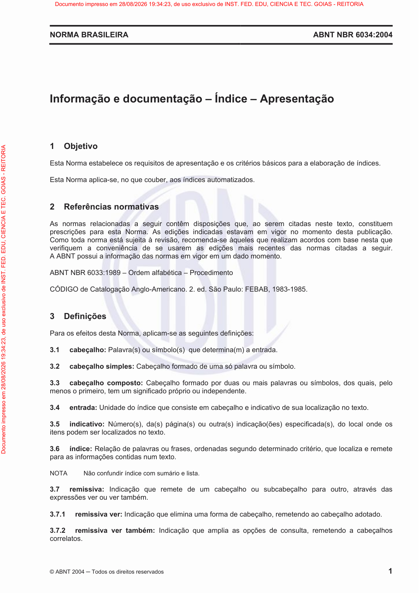

### Registro humano da página

- Comparado visualmente com o PDF: [ ] Sim [ ] Não — estado inicial: pendente.
- Revisor: ____________________
- Data: ____________________
- Número impresso confirmado: ____________________
- Transcrição necessária: [ ] Sim [ ] Não [ ] A definir
- Omissões, com extrator e localização: ____________________
- Inclusões, com extrator e localização: ____________________
- Erros numéricos, com extrator e localização: ____________________
- Erros estruturais, com extrator e localização: ____________________
- Observações: ____________________

**Transcrição humana, somente quando necessária:**

<!-- Campo humano em branco; não é saída de extrator. -->


### Indicadores históricos do snapshot

| Extrator | Registro da página | Execução | Processamento | Avaliação | Método de avaliação | Nota registrada | Revisão manual registrada | Conclusão não confirmada registrada |
|---|---:|---:|---|---|---|---|---|---|
| Leitor PDF | 925 | 47 | `success` | `pending` | `null` | `null` | `null` | `null` |
| Docling | 933 | 48 | `success` | `success` | `page_image` | `100.00` | `False` | `null` |
| GLM-OCR | 941 | 49 | `success` | `success` | `page_image` | `100.00` | `False` | `True` |


### Leitor PDF — texto completo

- Versão: `pypdf-6.18.1`.
- Registro de página: `925`; execução: `47`.
- SHA-256 do texto: `b25f3a69eee91a6e647dbece867f76e67aac79c24c63fd26ac789845e7a730b4`.
- [Abrir texto UTF-8 integral](pages/NBR6034_p0005/pdf_reader.txt).


```text
NORMA BRASILEIRA ABNT NBR 6034:2004
© ABNT 2004─Todos os direitos reservados 1
Informação e documentação – Índice – Apresentação
1 Objetivo
Esta Norma estabelece os requisitos de apresentação e os critérios básicos para a elaboração de índices.
Esta Norma aplica-se, no que couber, aos índices automatizados.
2 Referências normativas
As normas relacionadas a seguir contêm disposições que, ao serem citadas neste texto, constituem
prescrições para esta Norma. As edições indicadas estavam em vigor no momento desta publicação.
Como toda norma está sujeita à revisão, recomenda-se àqueles que realizam acordos com base nesta que
verifiquem a conveniência de se usarem as edições mais recentes das normas citadas a seguir.
A ABNT possui a informação das normas em vigor em um dado momento.
ABNT NBR 6033:1989 – Ordem alfabética – Procedimento
CÓDIGO de Catalogação Anglo-Americano. 2. ed. São Paulo: FEBAB, 1983-1985.
3 Definições
Para os efeitos desta Norma, aplicam-se as seguintes definições:
3.1 cabeçalho:Palavra(s) ou símbolo(s) que determina(m) a entrada.
3.2 cabeçalho simples:Cabeçalho formado de uma só palavra ou símbolo.
3.3 cabeçalho composto:Cabeçalho formado por duas ou mais palavras ou símbolos, dos quais, pelo
menos o primeiro, tem um significado próprio ou independente.
3.4 entrada:Unidade do índice que consiste em cabeçalho e indicativo de sua localização no texto.
3.5 indicativo:Número(s), da(s) página(s) ou outra(s) indicação(ões) especificada(s), do local onde os
itens podem ser localizados no texto.
3.6 índice:Relação de palavras ou frases, ordenadas segundo determinado critério, que localiza e remete
para as informações contidas num texto.
NOTA Não confundir índice com sumário e lista.
3.7 remissiva:Indicação que remete de um cabeçalho ou subcabeçalho para outro, através das
expressões ver ou ver também.
3.7.1 remissiva ver:Indicação que elimina uma forma de cabeçalho, remetendo ao cabeçalho adotado.
3.7.2 remissiva ver também:Indicação que amplia as opções de consulta, remetendo a cabeçalhos
correlatos.
Documento impresso em 28/08/2026 19:34:23, de uso exclusivo de INST. FED. EDU, CIENCIA E TEC. GOIAS - REITORIA
Documento impresso em 28/08/2026 19:34:23, de uso exclusivo de INST. FED. EDU, CIENCIA E TEC. GOIAS - REITORIA
```


**Revisão humana de Leitor PDF — preencher:**

- Comparado ao PDF: [ ] Sim [ ] Não [ ] Pendente
- Omissões: ____________________
- Inclusões: ____________________
- Erros numéricos: ____________________
- Erros estruturais: ____________________
- Observações: ____________________

**Diagnóstico histórico completo, sem nova avaliação:**

```json
{
  "id": 925,
  "extraction_id": 47,
  "extractor": "pdf_reader",
  "extractor_version": "pypdf-6.18.1",
  "content_hash": "b25f3a69eee91a6e647dbece867f76e67aac79c24c63fd26ac789845e7a730b4",
  "text_sha256": "b25f3a69eee91a6e647dbece867f76e67aac79c24c63fd26ac789845e7a730b4",
  "markdown_sha256": "b25f3a69eee91a6e647dbece867f76e67aac79c24c63fd26ac789845e7a730b4",
  "processing_status": "success",
  "attempt_count": 1,
  "processing_time_ms": 50,
  "error_message": null,
  "structured_output": null,
  "quality_score": null,
  "quality_metrics": null,
  "evaluation_status": "pending",
  "evaluation_method": null,
  "evaluation_model": null,
  "evaluation_prompt_version": null,
  "evaluation_error": null,
  "evaluated_at": null,
  "historical_configuration": null,
  "historical_configuration_provenance": "not_persisted_in_extraction_schema"
}
```


### Docling — texto completo

- Versão: `docling-2.126.0`.
- Registro de página: `933`; execução: `48`.
- SHA-256 do texto: `78489c3d899895d1b0ee737620202c6ae096d473fb0f61d98ccccf7fbcc21f38`.
- [Abrir texto UTF-8 integral](pages/NBR6034_p0005/docling.txt).


```text
## Informação e documentação - Índice - Apresentação

## 1 Objetivo

Esta Norma estabelece os requisitos de apresentação e os critérios básicos para a elaboração de índices.

Esta Norma aplica-se, no que couber, aos índices automatizados.

## 2 Referências normativas

As normas relacionadas a seguir contêm disposições que, ao serem citadas neste texto, constituem prescrições para esta Norma. As edições indicadas estavam em vigor no momento desta publicação. Como toda norma está sujeita à revisão, recomenda-se àqueles que realizam acordos com base nesta que verifiquem a conveniência de se usarem as edições mais recentes das normas citadas a seguir. A ABNT possui a informação das normas em vigor em um dado momento.

ABNT NBR 6033:1989 - Ordem alfabética - Procedimento

CÓDIGO de Catalogação Anglo-Americano. 2. ed. São Paulo: FEBAB, 1983-1985.

## 3 Definições

Para os efeitos desta Norma, aplicam-se as seguintes definições:

- 3.1 cabeçalho: Palavra(s) ou símbolo(s) que determina(m) a entrada.
- 3.2 cabeçalho simples: Cabeçalho formado de uma só palavra ou símbolo.
- 3.3 cabeçalho composto: Cabeçalho formado por duas ou mais palavras ou símbolos, dos quais, pelo menos o primeiro, tem um significado próprio ou independente.
- 3.4 entrada: Unidade do índice que consiste em cabeçalho e indicativo de sua localização no texto.
- 3.5 indicativo: Número(s), da(s) página(s) ou outra(s) indicação(ões) especificada(s), do local onde os itens podem ser localizados no texto.
- 3.6 índice: Relação de palavras ou frases, ordenadas segundo determinado critério, que localiza e remete para as informações contidas num texto.
7. NOTA Não confundir índice com sumário e lista.
- 3.7 remissiva: Indicação que remete de um cabeçalho ou subcabeçalho para outro, através das expressões ver ou ver também.
- 3.7.1 remissiva ver: Indicação que elimina uma forma de cabeçalho, remetendo ao cabeçalho adotado.
- 3.7.2 remissiva ver também: Indicação que amplia as opções de consulta, remetendo a cabeçalhos correlatos.
```


**Revisão humana de Docling — preencher:**

- Comparado ao PDF: [ ] Sim [ ] Não [ ] Pendente
- Omissões: ____________________
- Inclusões: ____________________
- Erros numéricos: ____________________
- Erros estruturais: ____________________
- Observações: ____________________

**Diagnóstico histórico completo, sem nova avaliação:**

```json
{
  "id": 933,
  "extraction_id": 48,
  "extractor": "docling",
  "extractor_version": "docling-2.126.0",
  "content_hash": "78489c3d899895d1b0ee737620202c6ae096d473fb0f61d98ccccf7fbcc21f38",
  "text_sha256": "78489c3d899895d1b0ee737620202c6ae096d473fb0f61d98ccccf7fbcc21f38",
  "markdown_sha256": "78489c3d899895d1b0ee737620202c6ae096d473fb0f61d98ccccf7fbcc21f38",
  "processing_status": "success",
  "attempt_count": 1,
  "processing_time_ms": 660,
  "error_message": null,
  "structured_output": null,
  "quality_score": "100.00",
  "quality_metrics": {
    "cer": 0.1598233995584989,
    "wer": 0.24924924924924924,
    "evaluation": {
      "scores": {
        "noise_control": 100,
        "reading_order": 100,
        "textual_fidelity": 100,
        "lists_preservation": 100,
        "duplication_control": 100,
        "tables_preservation": null,
        "content_completeness": 100,
        "hallucination_control": 100,
        "numbers_and_references": 100,
        "structural_preservation": 100
      },
      "confidence": 100.0,
      "justification": "A extração fornecida é uma cópia fiel do texto original, incluindo o cabeçalho, as seções, as definições e a numeração. A estrutura e o conteúdo foram preservados integralmente.",
      "noise_control": 100,
      "overall_score": 100.0,
      "reading_order": 100,
      "missing_elements": null,
      "textual_fidelity": 100,
      "incorrect_elements": null,
      "lists_preservation": 100,
      "duplicated_elements": null,
      "duplication_control": 100,
      "tables_preservation": null,
      "content_completeness": 100,
      "hallucinated_elements": null,
      "hallucination_control": 100,
      "numbers_and_references": 100,
      "requires_manual_review": false,
      "structural_preservation": 100
    },
    "extracted_word_count": 308,
    "reference_word_count": 333,
    "normalized_similarity": 0.8401766004415011,
    "requires_manual_review": false,
    "extracted_character_count": 2016,
    "reference_character_count": 2265
  },
  "evaluation_status": "success",
  "evaluation_method": "page_image",
  "evaluation_model": "gemma4:e2b",
  "evaluation_prompt_version": "rag-page-evaluation-v1",
  "evaluation_error": null,
  "evaluated_at": "2026-09-15T18:13:19.093361-03:00",
  "historical_configuration": null,
  "historical_configuration_provenance": "not_persisted_in_extraction_schema"
}
```


### GLM-OCR — texto completo

- Versão: `glmocr-0.1.5`.
- Registro de página: `941`; execução: `49`.
- SHA-256 do texto: `97e4b6777a2213720e2d5ee2269c1a0aecbd38fa999356aca528ba9cfe490e56`.
- [Abrir texto UTF-8 integral](pages/NBR6034_p0005/glm_ocr.txt).


```text
Informação e documentação – Índice – Apresentação

1 Objetivo

Esta Norma estabelece os requisitos de apresentação e os critérios básicos para a elaboração de índices.

Esta Norma aplica-se, no que couber, aos índices automatizados.

2 Referências normativas

As normas relacionadas a seguir contêm disposições que, ao serem citadas neste texto, constitue prescrições para esta Norma. As edições indicadas estavam em vigor no momento desta publicação. Como toda norma está sujeita à revisão, recomenda-se à queles que realizam acordos com base nesta que verifiquem a conveniência de se usarem as edições mais recentes das normas citadas a seguir. A ABNT possui a informação das normas em vigor em um dado momento.

ABNT NBR 6033:1989 – Ordem alfabética – Procedimento

CÓDIGO de Catalogação Anglo-Americano. 2. ed. São Paulo: FEBAB, 1983-1985.

3 Definições

Para os efeitos desta Norma, aplicam-se as seguinte definições:

3.1 cabeçalho: Palavra(s) ou símbolo(s) que determina(m) a entrada.

3.2 cabeçalho simples: Cabeçalho formado de uma só palavra ou símbolo.

3.3 cabeçalho composto: Cabeçalho formado por duas ou mais palavras ou símbolos, dos quais, pelo menos o primeiro, tem um significado próprio ou independente.

3.4 entrada: Unidade do índice que consiste em cabeçalho e indicativo de sua localização no texto.

3.5 indicativo: Número(s), da(s) página(s) ou outra(s) indicação(ões) especificada(s), do local onde os itens podem ser localizados no texto.

3.6 índice: Relação de palavras ou frases, ordenadas segundo determinado critério, que localiza e remete para as informações contidas num texto.

NOTA Não confundir índice com sumário e lista.

3.7 remissiva: Indicação que remete de um cabeçalho ou subcabeçalho para outro, através das expressões ver ou ver também.

3.7.1 remissiva ver: Indicação que elimina uma forma de cabeçalho, remetendo ao cabeçalho adotado.

3.7.2 remissiva ver também: Indicação que amplia as opções de consulta, remetendo a cabeçalhos correlatos.

© ABNT 2004 — Todos os direitos reservados
Documento impresso em 28/08/2026 19:34:23, de uso exclusivo de INST. FED. EDU, CIENCIA E TEC. GOIAS - REITORIA
```


**Revisão humana de GLM-OCR — preencher:**

- Comparado ao PDF: [ ] Sim [ ] Não [ ] Pendente
- Omissões: ____________________
- Inclusões: ____________________
- Erros numéricos: ____________________
- Erros estruturais: ____________________
- Observações: ____________________

**Diagnóstico histórico completo, sem nova avaliação:**

```json
{
  "id": 941,
  "extraction_id": 49,
  "extractor": "glm_ocr",
  "extractor_version": "glmocr-0.1.5",
  "content_hash": "97e4b6777a2213720e2d5ee2269c1a0aecbd38fa999356aca528ba9cfe490e56",
  "text_sha256": "97e4b6777a2213720e2d5ee2269c1a0aecbd38fa999356aca528ba9cfe490e56",
  "markdown_sha256": "97e4b6777a2213720e2d5ee2269c1a0aecbd38fa999356aca528ba9cfe490e56",
  "processing_status": "success",
  "attempt_count": 1,
  "processing_time_ms": 11023,
  "error_message": null,
  "structured_output": {
    "completion_unconfirmed": true
  },
  "quality_score": "100.00",
  "quality_metrics": {
    "cer": 0.09536423841059603,
    "wer": 0.15615615615615616,
    "evaluation": {
      "scores": {
        "noise_control": 100,
        "reading_order": 100,
        "textual_fidelity": 100,
        "lists_preservation": 100,
        "duplication_control": 100,
        "tables_preservation": null,
        "content_completeness": 100,
        "hallucination_control": 100,
        "numbers_and_references": 100,
        "structural_preservation": 100
      },
      "confidence": 100.0,
      "justification": "A extração fornecida é uma cópia fiel do texto original, incluindo o conteúdo principal, as seções numeradas, as definições e a nota final. A estrutura e o conteúdo foram preservados integralmente.",
      "noise_control": 100,
      "overall_score": 100.0,
      "reading_order": 100,
      "missing_elements": null,
      "textual_fidelity": 100,
      "incorrect_elements": null,
      "lists_preservation": 100,
      "duplicated_elements": null,
      "duplication_control": 100,
      "tables_preservation": null,
      "content_completeness": 100,
      "hallucinated_elements": null,
      "hallucination_control": 100,
      "numbers_and_references": 100,
      "requires_manual_review": false,
      "structural_preservation": 100
    },
    "extracted_word_count": 321,
    "reference_word_count": 333,
    "normalized_similarity": 0.904635761589404,
    "requires_manual_review": false,
    "extracted_character_count": 2146,
    "reference_character_count": 2265
  },
  "evaluation_status": "success",
  "evaluation_method": "page_image",
  "evaluation_model": "gemma4:e2b",
  "evaluation_prompt_version": "rag-page-evaluation-v1",
  "evaluation_error": null,
  "evaluated_at": "2026-09-15T18:14:03.180429-03:00",
  "historical_configuration": null,
  "historical_configuration_provenance": "not_persisted_in_extraction_schema"
}
```

